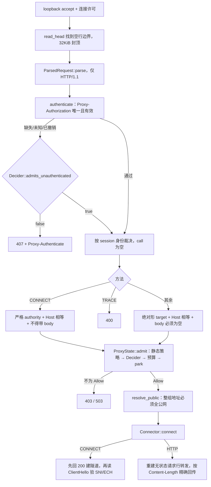

[上一篇：Workspace权限沙箱与Git](11-Workspace权限沙箱与Git.md) · [总目录](README.md) · 第 12 / 22 篇 · [下一篇：持久化记忆与会话恢复](13-持久化记忆与会话恢复.md)

# 12 · 认证、网络、遥测与更新

> **场景**：grok 要连 LLM API，就得有 token；token 会过期，得刷新；每次请求要带 bearer 并在 401 时重试；整个过程要被遥测记录；崩溃要留得下报告；产品还要能在后台静默自更新。这五件事（认证 / 网络 / 遥测 / 崩溃上报 / 更新）是「能长期稳定跑起来的 Agent」的运维骨架。
>
> **阅读说明**：源码基准 `HEAD = 42f4d7d3`（2026-10-27，`SOURCE_REV = 559751fd`；前次基准 `HEAD = 0e2bfffb` / `SOURCE_REV = 036a5d83`）。**工具版本**：Rust 1.94.0（`rust-toolchain.toml` `[toolchain].channel`）；`ratatui 0.29 / tokio full / agent-client-protocol 0.10.4`；workspace members 共 **107** 个。
>
> 五个子系统分别位于：`crates/codegen/xai-grok-auth`（认证 seam + 401 重试中间件）、`crates/codegen/xai-grok-login`（登录/刷新/存储，已从 shell 抽出成独立 crate）、`crates/codegen/xai-grok-http`（共享 reqwest 客户端与传输错误分类）、`crates/codegen/xai-grok-telemetry` + `crates/codegen/xai-grok-otel` + `crates/codegen/xai-mixpanel`（遥测栈）、`crates/codegen/xai-crash-handler`（崩溃处理，**注意不是 `xai-grok-crash-handler`**）、`crates/codegen/xai-grok-update`（自更新）。
>
> **索引记法**：`文件路径 · 符号`；需要指向定义内部某点时写 `符号(+N)`，`+0` 为定义所在行，`+N` 为向下第 N 行。非函数定义写 `Struct：X` / `Enum：X` / `Const：Y` / `Module：z`。**绝对行号随版本漂移，本文只把行号当快照辅助，定位主依据是符号名。**
>
> **本版（`6c01b90c` → `2178c69c`）相对旧文档的必要更正**：① 遥测发射器 `track` 在旧文档里被写成 `TelemetryClient::track`，当前源码里它是 `client` 模块的**自由函数** `crate::client::track`（`TelemetryClient` 只保留 `from_config`）。② `xai-mixpanel` 不再只看 HTTP 状态码，改为 `verbose=1` + 校验应答体。③ `xai-crash-handler` 的崩溃目录对 leader 模式多一层 `leader/` 子目录。④ 遥测事件新增 `harness_changed` 与 `long_reasoning_reminder`，OTel 脱敏新增「枚举值白名单」。

---

## 第一层 · 简单框架（系统骨架）

五个子系统各管一件事，但「认证」是其他四件的基础——没有有效 token，网络请求、遥测上报、崩溃上报、更新下载都走不通：

```
┌────────────────────────────────────────────────────────────────────────────┐
│  ① 认证 seam：xai-grok-auth  （只有 5 个文件，纯抽象层）                       │
│     trait HttpAuth                 visibility.rs · HttpAuth                 │
│     trait AuthCredentialProvider   auth_provider.rs · AuthCredentialProvider│
│     CredentialSnapshot             auth_provider.rs · CredentialSnapshot    │
│     （middleware feature 才编译 retry_middleware.rs）lib.rs · retry_middleware│
└──────────────┬─────────────────────────────────────────┬───────────────────┘
               │ 实现方                                   │ 401 重试中间件
               ▼                                         ▼
┌──────────────────────────────┐        ┌────────────────────────────────────┐
│  ② 认证实现：xai-grok-login   │        │  ③ 网络：xai-grok-http              │
│  AuthManager    manager.rs    │        │  shared_client()      lib.rs       │
│  auth()         manager.rs    │        │  with_auth_retry()    lib.rs       │
│  start_proactive_refresh      │        │   → AuthRetryMiddleware::new(_, 1) │
│                 manager.rs    │        │  send_with_retry_                   │
│  ShellAuthCredentialProvider  │        │    escaping_pool()   lib.rs        │
│    credential_provider.rs     │        │  TransportFailure::classify lib.rs │
│  storage.rs（auth.json 原子写）│        └────────────────────────────────────┘
└──────────────┬───────────────┘
               │ 登录/刷新事件
               ▼
┌────────────────────────────────────────────────────────────────────────────┐
│  ④ 遥测栈：xai-grok-telemetry / xai-grok-otel / xai-mixpanel                 │
│     TelemetryClient   client.rs · TelemetryClient                           │
│     track()           client.rs · track（自由函数）                          │
│     trait TelemetryEvent  events/mod.rs · TelemetryEvent                    │
│     telemetry_event! 宏   events/mod.rs · telemetry_event!                   │
│     → Mixpanel（track/engage）· xAI events API · Sentry · OTLP spans          │
└────────────────────────────────────────────────────────────────────────────┘
┌──────────────────────────────┐  ┌─────────────────────────────────────────┐
│  ⑤ 崩溃：xai-crash-handler    │  │  ⑥ 更新：xai-grok-update                │
│  install()          lib.rs    │  │  check_update_background  auto_update   │
│  check_previous_crash lib.rs  │  │  run_update_if_available  auto_update   │
│  → last-crash.bin / history/  │  │  run_update               auto_update   │
└──────────────────────────────┘  └─────────────────────────────────────────┘
```

| 子系统 | 入口 | 位置 | 一句话职责 |
|--------|------|------|-----------|
| 认证 seam | `trait AuthCredentialProvider` | `crates/codegen/xai-grok-auth/src/auth_provider.rs · AuthCredentialProvider` | 依赖倒置：数据层拿 token，壳层实现刷新 |
| 401 重试 | `AuthRetryMiddleware` | `crates/codegen/xai-grok-auth/src/retry_middleware.rs · AuthRetryMiddleware` | bearer 注入 + 401 刷新重发 + stamp 归因 |
| 认证实现 | `AuthManager` | `crates/codegen/xai-grok-login/src/manager.rs · AuthManager` | 登录流 / device_code / OIDC / 刷新 / 落盘 |
| 网络 | `shared_client` / `with_auth_retry` | `crates/codegen/xai-grok-http/src/lib.rs · shared_client` / `· with_auth_retry` | OnceLock 缓存客户端 + 传输错误分类 |
| 遥测 | `TelemetryClient` / `track` | `crates/codegen/xai-grok-telemetry/src/client.rs · TelemetryClient` / `· track` | 事件采集 + Mixpanel/Sentry/OTel/统一日志 |
| OTel 底座 | `build_otel_layer` | `crates/codegen/xai-grok-otel/src/provider.rs · build_otel_layer` | tracer provider + 可刷新 token 的 span exporter |
| 崩溃处理 | `install` / `check_previous_crash` | `crates/codegen/xai-crash-handler/src/lib.rs · install` / `· check_previous_crash` | 信号捕获、写 crash blob、上次崩溃回读 |
| 更新 | `check_update_background` | `crates/codegen/xai-grok-update/src/auto_update.rs · check_update_background` | 后台检测 / 下载 / 安装 / 重启 / 通道路由 |

> **结构要点**：① 旧的 `xai-grok-shell/src/auth/*` 已**整体搬走**，现在是独立 crate `xai-grok-login`，shell 只是 re-export（`crates/codegen/xai-grok-login/src/lib.rs` 的 crate doc 明说 "Extracted from `xai-grok-shell::auth`"）。② 不存在 `xai-grok-crash-handler`，真实 crate 名是 `xai-crash-handler`。③ `xai-grok-http` 是「共享 HTTP 客户端 + 传输错误分类」的独立 crate，认证中间件的装配点也在这里。

---

## 第二层 · 一个完整例子（全路径走读）

以「用户首次启动 grok 并登录，随后正常跑 Agent，中途 token 过期，最后升级二进制」为例：

```
① 进程启动（crates/codegen/xai-grok-pager-bin/src/main.rs）
   xai_crash_handler::install_terminal_restore_only()      ← 最早，只恢复终端
   xai_grok_telemetry::sentry::init(Config{..})            ← Sentry guard
   xai_grok_telemetry::otel_layer::build_otel_layer(..)    ← OTel layer（挂到 tracing_subscriber）
   若 config.crash_handler_enabled：
       crash_dir = crash_dir_for(&args)        （leader 模式多一层 leader/）
       xai_crash_handler::check_previous_crash(&crash_dir)
       xai_crash_handler::install(CrashHandlerConfig{..})
        │
② 认证：壳层建 AuthManager 检查本地凭证
   AuthManager::new_with_proxy_base_url(..)   manager.rs
   没有可用凭证 → 走登录流
   run_auth_flow(..)                          flow.rs
     ├─ 外部认证提供者 run_external_auth_provider  flow.rs
     ├─ device-code：request_device_code   device_code.rs
     │              → complete_device_code_login  device_code.rs
     └─ OIDC loopback：oidc/login.rs
   登录成功 → AuthManager::update(..)  manager.rs → 原子写 auth.json
   发出 Login 遥测事件（events/auth.rs，名字 "login"）
        │
③ Agent 跑起来，要调 LLM API：
   AuthManager::auth()                        manager.rs
     → auth_dispatch()
       ├─ 内存 token 未过期 → 直接返回
       ├─ 有 permanent_failure → 试采纳同盘兄弟进程的 token，否则报错
       └─ 否则 refresh_chain(OidcSession|ExternalBinary, PreRequest)
        │
④ 请求经中间件注入 bearer：
   xai_grok_http::with_auth_retry(shared_client(), provider)   lib.rs
     = ClientBuilder::new(client).with(AuthRetryMiddleware::new(credentials, 1))
   Middleware::handle                        retry_middleware.rs
     apply_auth_header(..)  retry_middleware.rs（写 bearer + StampedBearerSuffix）
   遇 401 → credentials.refresh_after_unauthorized()
          → ShellAuthCredentialProvider::refresh_after_unauthorized
                                       credential_provider.rs
          → 重放 backup clone，对调用方透明
        │
⑤ 每次关键动作发遥测事件：
   xai_grok_telemetry::client::track(event_name, request_id, ctx, metadata)  client.rs
     → 打 xAI events API（events_url + x-api-key）
     → Mixpanel::track(..)  xai-mixpanel/src/lib.rs
   事件类型实现 trait TelemetryEvent  events/mod.rs（宏 telemetry_event!）
        │
⑥ 后台静默更新检查：
   auto_update::check_update_background(&update_config)  auto_update.rs
     有新版 → run_update_subcommand(NonBlocking, AutoBackground)  auto_update.rs
             → 生成 detached `grok update` 子进程（返回 tokio Child 给 TUI 持有）
   退出/重启时 → restart_grok()  auto_update.rs
```

链路说明：**token 是贯穿全过程的「通行证」**；认证 seam 让「需要 token 的数据层（如 `xai-file-utils`、OTel exporter）」不反向依赖「会弹登录 UI 的壳层」；遥测把每个关键节点变成可观测事件；崩溃处理器在信号路径上尽量不做 I/O；更新在后台完成下载、在退出点做原子替换与重启。

---

## 第三层 · 详细逐步说明（主链路拆解）

### 步骤 1 — 认证依赖倒置 seam（`xai-grok-auth`，5 个文件）

`crates/codegen/xai-grok-auth/src/lib.rs · Module：xai-grok-auth`（crate doc）明确写出 seam 的目的：介于 `xai-file-utils`（持有方）与 `xai-grok-shell`（实现方）之间，**让数据收集器的 import 图里不出现壳层类型**，同时仍能由「刷新感知的 token 解析」驱动 HTTP 请求。

模块面（`lib.rs · Module` 区）：

- `visibility`（`crates/codegen/xai-grok-auth/src/visibility.rs · trait HttpAuth`）—— 最基础的 `HttpAuth`：只有 `apply(&self, builder: RequestBuilder, base_url: &str) -> RequestBuilder` 一个方法，注释点名实现方是 `xai-grok-shell::util::grok_auth_credentials::GrokAuthCredentials`。
- `auth_provider`（`auth_provider.rs`）—— `CredentialSnapshot` 与 `trait AuthCredentialProvider: HttpAuth + Send + Sync + 'static`。
- `bearer_fragment`（`bearer_fragment.rs`）—— `BEARER_SUFFIX_LEN = 12` 与 `fn bearer_suffix(s: &str) -> &str`。
- `retry_middleware`（`retry_middleware.rs`）—— **只有启用 `middleware` feature 才编译**（`lib.rs` 的 `#[cfg(feature = "middleware")]`）。

`CredentialSnapshot`（`auth_provider.rs · Struct：CredentialSnapshot`）的六个字段各自对应一处下游用途：

| 字段 | 语义 | 谁读 |
|------|------|------|
| `token` | wire bearer；CI / `--api-key` 无认证时为 `None` | 中间件、401 归因、OTel |
| `user_id` | bearer 属主 | OTel `user.id` resource attribute |
| `team_id` | OAuth 团队 id | 遥测 team 维度 |
| `deployment_id` | `uuidv5(NAMESPACE_OID, deployment_key)` | 企业部署归因；该解析入口本轮起住在 `crates/codegen/xai-grok-cloud-config/src/managed_config/store.rs` · 函数：`resolve_deployment_id`，由 shell 与 `xai-grok-update` 注入消费 |
| `api_key_id` | `uuidv5(NAMESPACE_OID, api_key)` | `AuthMode::ApiKey` 归因 |
| `organization_id` | OIDC `organizationId` claim | 组织维度 |

`trait AuthCredentialProvider`（`auth_provider.rs · AuthCredentialProvider`）有四个成员：

- `fn snapshot(&self) -> CredentialSnapshot` —— 契约写明：实现方应在快照前做一次**廉价的磁盘重读**，这样调用方能看见兄弟进程（`grok-desktop`、`grok login`）的更新；并且 `token` 字段**必须**与 `HttpAuth::apply` 实际发到线上的 bearer 一致，否则 401 归因前缀会对不上。
- `async fn refresh_after_unauthorized(&self) -> bool` —— 返回 `true` 表示拿到了不同的 token，调用方应重试一次；`false` 表示没配置 refresher 或刷新失败。
- `fn needs_token_auth_header(&self) -> bool`（默认 `true`）—— 是否发 `X-XAI-Token-Auth`；deployment key 走裸 Bearer 时为 `false`。
- `fn has_usable_credential(&self) -> bool`（默认 `true`）—— 是否值得真发一次出站请求。

`StaticAuthCredentialProvider`（`auth_provider.rs · StaticAuthCredentialProvider`）是测试/简单场景用的静态实现：`new(inner: Box<dyn HttpAuth>, bearer: Option<String>)`，`snapshot()` 只填 `token`，`refresh_after_unauthorized()` 恒返回 `false`。它的 `Debug` 只打印 `has_bearer` 布尔，刻意不落 token。

### 步骤 2 — 网络层：共享客户端 + bearer/401 中间件

`xai-grok-http` 是独立抽出的一层（`crates/codegen/xai-grok-http/src/lib.rs · Module：xai-grok-http` 的 crate doc 说明动机：构造 `reqwest::Client` 很贵，约 95ms，因为要加载 OS TLS roots，所以共享客户端用 `OnceLock` 缓存；TLS 策略住在 `xai_grok_extra_ca`）。

**常量与它们的编译期断言**（`lib.rs` 顶部常量区）——这层把超时预算写成常量，并用 `const _: () = assert!(...)` 把「谁必须大于谁」编码进编译期：

| 常量 | 值 | 语义 |
|------|-----|------|
| `STARTUP_FETCH_TIMEOUT` | 5s | 单次启动 `/settings` 或 `/v1/models` 抓取的每次尝试上限 |
| `STARTUP_AUTH_TIMEOUT` | 60s | 非交互启动期认证（刷新或冷启动 mint）总预算 |
| `STARTUP_AUTH_REFRESH_TIMEOUT` | 5s | 单次启动 token 刷新往返 |
| `SETTINGS_REAPPLY_TIMEOUT` | 30s | 单个 settings-reapply 任务的外层上限 |
| `SETTINGS_FETCH_MAX_ATTEMPTS` | 3 | 后台 settings 抓取尝试次数 |
| `SETTINGS_RETRY_BACKOFF_STEP` | 500ms | 尝试之间的退避步长 |
| `STARTUP_SETTINGS_WAIT_DEADLINE` | 5.5s | 一次抓取超时 + 一次退避 |
| `MANAGED_STARTUP_SETTINGS_WAIT_DEADLINE` | 25s | managed 场景下最坏三次尝试阶梯 |
| `MIN_CLIENT_CONNECT_TIMEOUT` | 120s | 客户端连 leader 的下界（≥ 2× `STARTUP_AUTH_TIMEOUT`） |

注意**预算与实现分居两个 crate**：这些常量住在 `xai-grok-http`，但它们所约束的「远端配置的拉取」实现本轮已搬到 `xai-grok-cloud-config`——`/settings` 的阻塞抓取在 `crates/codegen/xai-grok-cloud-config/src/settings_fetch.rs` · 函数：`fetch_settings_blocking_with_attempts`（重试 `SETTINGS_FETCH_MAX_ATTEMPTS=3`、退避 `500ms*attempt` 的语义即由这组常量表达；5xx/网络错误续、401 立即停），模型清单 `/v1/models` 的缓存/预取在同 crate 的 `remote_settings/` 模块（`cache.rs` · `ModelsCache`，本轮起为泛型）。`shell/src/agent/remote_config/settings_get.rs` 现在只是薄适配器（注入 `policy_repair_pending`），实现在 cloud-config 的 `settings_get.rs`。另记一处代码内自相矛盾（不下服务端结论）：**代码拼的 URL 是 `{cli_chat_proxy_base_url}/settings`（无 `/v1` 前缀），而旧注释仍写 `/v1/settings`**（如 `crates/codegen/xai-grok-cloud-config/src/settings_get.rs` 内 live 读取函数的 doc、以及 `xai-grok-test-support` mock 路由）。

**`shared_client()`**（`lib.rs · shared_client`）——`OnceLock<reqwest::Client>`，`get_or_init` 里先开一个 `startup_timer!("startup.http_client_build")` 埋点，然后经 `xai_grok_extra_ca::build_reqwest_client` 装配：`connect_timeout(30s)`、`user_agent(process_user_agent_string())`、`pool_idle_timeout(30s)`、HTTP/2 keep-alive 20s / timeout 10s / `while_idle(true)`、`tcp_keepalive(30s)`。失败直接 `expect("failed to build shared HTTP client")`。

**`with_auth_retry(client, credentials)`**（`lib.rs · with_auth_retry`）——把任意 `reqwest::Client` 包成带认证重试的 `ClientWithMiddleware`：

```rust
pub fn with_auth_retry(
    client: reqwest::Client,
    credentials: std::sync::Arc<dyn xai_grok_auth::AuthCredentialProvider>,
) -> reqwest_middleware::ClientWithMiddleware {
    reqwest_middleware::ClientBuilder::new(client)
        .with(xai_grok_auth::AuthRetryMiddleware::new(credentials, 1))
        .build()
}
```

注意 `max_retries` 硬编码为 **1**：全应用统一「401 只刷新重发一次」。

**另外几个客户端**：`shared_upload_client()`（`http1_only` + `pool_max_idle_per_host(2)` + 10s idle）、`fresh_http1_client()`（`pub(crate)`，`pool_max_idle_per_host(0)`，用于「逃出连接池」）、`shared_startup_blocking_client()`（`reqwest::blocking`，`connect_timeout`/`timeout` 都取 `STARTUP_FETCH_TIMEOUT`）。另有 UA/身份相关的 `process_user_agent_string`、`session_user_agent_string`、`user_agent_string_for`、`origin_client_info_from_env` / `_from_client_type` / `_from_meta`、`merge_origin_client_info`、`set_client_name`、`set_process_client_mode_headless`、`process_client_mode`、`process_client_identifier`、`client_type_from_origin`。

**传输错误分类**：`Enum：TransportFailureKind` 有 `Unreachable` / `CertificateUntrusted` / `CertificateInvalid` / `Interrupted` / `Permanent` 五态；`TransportFailure::classify(&reqwest::Error)`（`lib.rs · TransportFailure::classify`）先用 `certificate_error(e)` 沿 source 链找 `rustls::Error::InvalidCertificate`（`UnknownIssuer` → `UntrustedIssuer`，其余 → `Other`），再按 `is_connect()` / `is_timeout()||is_request()||is_body()` 分派（`lib.rs · transport_kind`）。`find_os_error_code`（`lib.rs · find_os_error_code`）沿 source 链下钻 `std::io::Error::raw_os_error`，找不到时退回解析 `"(os error N)"` 文本（`lib.rs · parse_os_error`）——测试里用真实 connection reset 与真实 TLS 握手来钉这条分类。

**`send_with_retry_escaping_pool`**（`lib.rs · send_with_retry_escaping_pool`）——泛型重试组合子：`max_attempts.max(1)`，前 `n-1` 次用 pooled client，**最后一次**换成 `fresh_http1_client()`（惰性构造并缓存），每次重试前 `await backoff(attempt)`；`is_retryable` 为假时立即返回错误，否则记 `last_err` 继续；循环结束返回最后一个错误。

### 步骤 3 — 401 重试中间件（真实函数体拆解）

`crates/codegen/xai-grok-auth/src/retry_middleware.rs` 把「刷新感知的 HTTP 重试」做成 `reqwest_middleware::Middleware`，而不是让调用方写循环。四个关键符号：

**`Struct：StampedBearerSuffix(pub String)`**（`retry_middleware.rs · StampedBearerSuffix`）——只存 bearer 的**尾部**片段（`BEARER_SUFFIX_LEN = 12`）。doc 注释给了理由：JWT 头部是共享常量、xAI key 前缀也是共享的，只有尾部能区分；而且尾部可以安全落日志。

**`fn bearer_suffix(s: &str) -> &str`**（`bearer_fragment.rs · bearer_suffix`）——用 `char_indices().rev().nth(N-1)` 取**字符**而非字节，注释点名原因：从 `auth.json` 或 auth-provider 命令来的 token 可能非 ASCII，按字节切会 panic。单测覆盖了 `"ééééééééééééé"` 与 emoji 用例。

**`async fn execute_with_stamp(client, req)`**（`retry_middleware.rs · execute_with_stamp`）——入口，把实际发出的 bearer 后缀带回来：

```rust
pub async fn execute_with_stamp(
    client: &reqwest_middleware::ClientWithMiddleware,
    req: Request,
) -> reqwest_middleware::Result<(Response, Option<StampedBearerSuffix>)> {
    let mut ext = http::Extensions::new();
    let resp = client.execute_with_extensions(req, &mut ext).await?;
    Ok((resp, ext.get::<StampedBearerSuffix>().cloned()))
}
```

**`fn apply_auth_header(req, token, extensions)`**（`retry_middleware.rs · apply_auth_header`，私有）——`HeaderValue::from_str(&format!("Bearer {token}"))` 成功则写 `AUTHORIZATION` 头并把 `StampedBearerSuffix(bearer_suffix(token))` 插进 extensions；失败只 `tracing::warn!`（不 panic）。

**`impl Middleware for AuthRetryMiddleware::handle`**（`retry_middleware.rs · AuthRetryMiddleware::handle`）——真正的 401 循环：

```rust
async fn handle(&self, mut req, extensions, next) -> Result<Response, Error> {
    if let Some(ref token) = self.credentials.snapshot().token {
        apply_auth_header(&mut req, token, extensions);
    }
    let backup = req.try_clone();
    let resp = next.clone().run(req, extensions).await?;
    if resp.status() != StatusCode::UNAUTHORIZED || self.max_retries == 0 {
        return Ok(resp);
    }
    let Some(backup) = backup else { return Ok(resp) };
    let _retry_span = tracing::info_span!("auth.retry_401");
    let mut last_resp = resp;
    for _ in 0..self.max_retries {
        if !self.credentials.refresh_after_unauthorized().await { break; }
        let Some(ref token) = self.credentials.snapshot().token else { break; };
        let Some(mut retry) = backup.try_clone() else { break; };
        apply_auth_header(&mut retry, token, extensions);
        last_resp = next.clone().run(retry, extensions).await?;
        if last_resp.status() != StatusCode::UNAUTHORIZED { return Ok(last_resp); }
    }
    Ok(last_resp)
}
```

要点：(1) 只在 `401` 且 `max_retries > 0` 时进入重试；(2) 每次重试先 `refresh_after_unauthorized` 再重放 `backup` clone，对调用方完全透明；(3) `stamp` 由 `apply_auth_header` 写进 `extensions`，`execute_with_stamp` 在返回里带回，调用方据此做 401 归因。单测钉了六条不变量：`test_401_no_refresh_returns_401`、`test_e2e_stale_token_refreshed_and_retried`、`test_e2e_auth_header_stamped_automatically`、`execute_with_stamp_reports_last_stamped_bearer`（**stamp 必须描述「调用方手上那个响应」对应的 bearer，即刷新后的新 token**）、`execute_with_stamp_is_none_when_nothing_stamped`、`test_max_retries_bounds_attempts`。

真实调用点（`Grep` 已核，全部在当前 HEAD）：

| 调用方 | 用法 |
|--------|------|
| `crates/codegen/xai-grok-shell/src/extensions/privacy.rs` | `crate::http::with_auth_retry(shared_client(), provider)` |
| `crates/codegen/xai-grok-shell/src/extensions/consent.rs` | 同上 |
| `crates/codegen/xai-grok-shell/src/session/acp_session_impl/session_setup.rs` | `with_auth_retry` + `xai_grok_auth::execute_with_stamp` |
| `crates/codegen/xai-grok-shell/src/agent/feedback_client.rs` | `execute_with_stamp` |
| `crates/codegen/xai-grok-shell/src/agent/session_registry_client.rs` | `with_auth_retry` + `execute_with_stamp` |
| `crates/codegen/xai-grok-shell/src/remote/client.rs` | `with_auth_retry` |
| `crates/codegen/xai-file-utils/src/storage_client.rs` / `.../src/lib.rs` | 转出自己的 `with_auth_retry` 包装 |
| `crates/codegen/xai-grok-memory/src/embedding.rs` | 包嵌入请求 |
| `crates/codegen/xai-grok-shell/src/session/acp_session_impl/sampler_turn.rs` | 壳层自研 `call_with_auth_retry`（工具调用路径上的同类逻辑） |

### 步骤 4 — 登录与凭证实现（`xai-grok-login`）

**crate 抽取**：`crates/codegen/xai-grok-login/src/lib.rs` 的 crate doc 写明 "Extracted from `xai-grok-shell::auth`; the shell re-exports this crate as `xai_grok_shell::auth`"。文件顶部还有一个 `#![allow(unused_imports, unused_variables, unused_mut, unreachable_code, dead_code)]`，是抽取迁移期的痕迹。

`AuthManager`（`manager.rs · AuthManager`）是「`auth.json` 与内存 bearer 的唯一真相源」。结构体字段注释把锁序写死了：**先 `refresh_lock`（async），再同步锁（`inner` / `refresher` / `permanent_failure` / `manual_auth`），永不共持**；`permanent_failure()` 先读 `permanent_failure` 再读 `inner`，也不共持；**永不跨 `.await` 持有 `parking_lot` guard**。字段含 `inner: Arc<RwLock<Option<GrokAuth>>>`（注释说明用 `Arc` 是为了让 `/user` enrichment 任务回写）、`refresh_lock: tokio::sync::Mutex<()>`、`permanent_failure: RwLock<Option<ScopedRefreshFailure>>`、`refresh_notify` / `wake_notify` 两个 `Notify`、`disk_state`、`static_key_cache`、`process_static_api_key` 等。

时间/超时常量（`manager.rs` 常量区）：

| 常量 | 值 | 为什么是这个值（源码注释） |
|------|-----|--------------------------|
| `AUTH_LOCK_TIMEOUT` | 10s | 建议性 `auth.json.lock` 获取超时（flow/enrichment/recovery 用） |
| `REFRESH_LOCK_TIMEOUT` | 25s | `refresh_chain` 跨 IdP 调用持锁，防 refresh-token 重用；按 OIDC 交换 15s HTTP 预算 + 两次重试 + discovery/JWKS 冷缓存估 |
| `BEST_EFFORT_REFRESH_TIMEOUT` | 20s | RPC 路径的有界刷新预算，必须 < `REFRESH_LOCK_TIMEOUT`（有编译期 `assert!`） |
| `BACKOFF_INTERVAL` | 300s | 主动刷新任务在「无可用刷新」时的长轮询间隔 |
| `LOCK_TIMEOUT_WAIT` | 2s | 文件锁超时后等锁持有者写完再重读磁盘 |
| `SEND_HORIZON_SECS` | 5 | `auth()` 可拿缓存 token 顶替失败刷新的剩余寿命视野 |
| `JITTER_RANGE_SECS` | 60 | 主动刷新 sleep 的随机抖动，错开兄弟进程避免惊群 |
| `RELOAD_RETRY_TRIES` / `RELOAD_RETRY_BACKOFF` | 3 / 50ms | `force_reload_from_disk` 的重读预算（吸收唤醒后瞬时 ENOENT） |
| `PERMANENT_FAILURE_TTL` | 300s | 可恢复失败原因的自愈 TTL，用双时钟计量（`DualClock`），因此是「5 真实分钟」而非「5 清醒分钟」 |

`AuthManager::auth()`（`manager.rs · AuthManager::auth`）是公共入口，包一层「团队 pin 门」：先 `auth_dispatch()`，再用 `cached_token_policy_error(&auth)` 检查；不过就 `reject_and_clear(&e)` 并返回错误——注释说明「错团队的缓存/刷新会话在这里被清掉并拒绝，绝不交给消费方」。

`auth_dispatch()`（`manager.rs · AuthManager::auth_dispatch`）是决策树：

```
snapshot = owned_inner();  token_type = TokenType::from_auth(snapshot)
├─ snapshot 存在且未过期 → 直接返回 clone
├─ 有 permanent_failure
│    ├─ snapshot 还活过 SEND_HORIZON → 返回 snapshot（grace）
│    ├─ try_adopt_disk_token(PreRequest, "auth: adopted sibling token …") 成功 → 返回
│    └─ 否则返回该错误
└─ 按 token_type 分派
     ├─ None                    → AuthError::NotLoggedIn
     ├─ ApiKey                  → 有 snapshot 则 TokenExpiredNoRefresh，否则 NotLoggedIn
     ├─ LegacySession           → pick_up_sibling_token() 后取 current()
     └─ OidcSession|ExternalBinary
          → refresh_chain(token_type, PreRequest)
              成功 → Ok
              失败 → 若错误不是 RefreshTokenRejected 且 snapshot 还活过 SEND_HORIZON
                      → 用缓存（"refresh failed but token still valid (grace)"）
                     否则 Err
```

`get_valid_token()`（`manager.rs · AuthManager::get_valid_token`）就是 `self.auth().await.map(|a| a.key)`。

`apply_refresh_outcome()`（`manager.rs · AuthManager::apply_refresh_outcome`）是**唯一变更点**：`_lock: &AuthFileLock` 这个参数用类型强制「持久化的 `update()` 必须在文件锁下运行」；`RefreshOutcome::Success` 分支会 `self.update(*new_auth).await`，成功后同时发 `unified_log::info("auth.refresh.success", …)` 与 `tracing::info!`，记 `old_key_prefix` / `new_key_prefix` / `key_changed`，然后 `refresh_notify.notify_waiters()` 唤醒 `ModelsManager`。

**主动刷新**：`start_proactive_refresh(self: &Arc<Self>, cancel: CancellationToken)`（`manager.rs · AuthManager::start_proactive_refresh`）由 `proactive_started: AtomicBool` 做幂等门（注释：避免在同一 `Arc` 上 spawn 竞争循环）。循环的睡眠时长由 `compute_proactive_sleep(&AuthManager)`（`manager.rs · compute_proactive_sleep`）算，退避由 `refresh_failure_backoff` 与 `proactive_failure_backoff` 给，下限是 `PROACTIVE_MIN_SLEEP = 1s`。`wake_notify` 专门接 OS `DidWake`（含 dark wake）来重新武装循环——注释解释了原因：单调时钟在挂起期间暂停，睡前排的计划会在醒来后「按清醒时间」晚几个小时才触发，于是唤醒后的请求只能靠 401 去发现 token 已过期。配套的 `wait_for_token_refresh(timeout) -> bool`、`notify_wake()`、`refresh_notifier()`、`hot_swap(new_auth)`、`clear_in_memory()` 都在 `impl AuthManager` 里。

**落盘**：`storage.rs`。`AuthFileLock`（`storage.rs · AuthFileLock`）是建议性文件锁；路径解析走 `resolve_auth_json_path(grok_auth_path, grok_home)`（`storage.rs · resolve_auth_json_path`，读 `GROK_AUTH_PATH`）与 `auth_json_path(grok_home)`（`storage.rs · auth_json_path`）。读路径 `read_auth_json`（`storage.rs · read_auth_json`）→ 损坏时 `backup_corrupt_auth_file`（`storage.rs · backup_corrupt_auth_file`）→ `read_auth_json_or_empty_recovering_corrupt`（`storage.rs · read_auth_json_or_empty_recovering_corrupt`）。写路径 `write_auth_json_with`（`storage.rs · write_auth_json_with`）→ `write_store_to`（`storage.rs · write_store_to`）→ **`write_auth_json_atomic`（临时文件 + rename）** 或 `write_auth_json_in_place`；`restore_prior_bytes` 用于回滚。API key 三件套：`read_api_key` / `store_api_key` / `clear_api_key`（`storage.rs`）。

**适配到 seam**：`credential_provider.rs` 里 `ShellAuthCredentialProvider`（`credential_provider.rs · ShellAuthCredentialProvider`）实现 `HttpAuth::apply` 与 `AuthCredentialProvider::snapshot`（注释要求它必须与 wire bearer 一致）、`refresh_after_unauthorized`、`needs_token_auth_header`。`WireValidBearerResolver`（`credential_provider.rs · WireValidBearerResolver`）实现 `xai_grok_sampler::BearerResolver`（`current_bearer` / `prepare_for_send`），`pre_send_refresh_budget(remaining_wire_life)`（`credential_provider.rs · pre_send_refresh_budget`）在发送前决定要不要先刷新。`StorageClientAttributionBridge`（`credential_provider.rs · StorageClientAttributionBridge`）实现 `xai_file_utils::storage_client::Auth401AttributionCallback` 的 `record_401(&self, operation, sent_bearer_prefix)`（`credential_provider.rs · StorageClientAttributionBridge::record_401`），把 401 归因接到存储客户端。`OtelAuthCredentialProvider`（`credential_provider.rs · OtelAuthCredentialProvider`）是给 OTLP exporter 用的、能在 bootstrap 与 live manager 之间热切换的 provider（`set_live` / `set_deployment_key`），配套 `wire_otel_auth_manager`、`wire_otel_deployment_key`、`install_bootstrap_otel_provider`（均在 `credential_provider.rs`）。

**API key 的运行时覆盖（本版新增）**：`auth_method.rs` 引入 `static RUNTIME_API_KEY: RwLock<Option<String>>`（`auth_method.rs · Const：RUNTIME_API_KEY`），并导出 `set_runtime_xai_api_key`、`clear_runtime_xai_api_key`、`read_env_var`、`read_xai_api_key_env`、`has_xai_api_key_env` 与常量 `XAI_API_KEY_ENV_VAR = "XAI_API_KEY"` / `LEGACY_XAI_API_KEY_ENV_VAR = "GROK_CODE_XAI_API_KEY"`。注释把动机写死：**运行时加载的 key 不放进程 env，因为 `set_var` 会与其他线程里的 C `getenv`（DNS、libgit2）竞争**。`read_env_var` 只在 `name == XAI_API_KEY` 时优先返回运行时覆盖值，否则回落 `std::env::var`。

**登录流**：`flow.rs` 的 `LoginTransportOverride`（`flow.rs · Enum：LoginTransportOverride`）区分 `None` / 强制 loopback（`--oauth`）/ 强制 device（`--device-auth`）；`run_auth_flow`、`run_auth_flow_with_stderr_bridge`、`run_auth_flow_interactive` 是入口，`run_auth_flow_inner` 是共同内核（注释说明两种 transport 都先试外部认证提供者与 devbox 自动迁移）。`AuthUrlMode` / `AuthUrlInfo` / `AuthChannels` 是 UI 通道。`report_signed_in(&GrokAuth)` 负责发登录成功遥测。`ensure_authenticated` / `ensure_authenticated_with_override` / `ensure_authenticated_or_noninteractive` / `run_cli_login` / `perform_logout`（返回 `LogoutResult`）是 CLI 面。

`device_code.rs` 是「终端无浏览器」路径：`Enum：DeviceCodeError` 的 `NotEnabled` **只**类型化 404 一种失败（注释解释：登录漏斗要匹配它来回落 loopback，其它错误若也包一层 `#[error(transparent)]` 会遮住 `reqwest::Error` 的 source）；`Enum：ClientSurface` 分 `Ui` / `Cli` / `Headless`，作为 `x-grok-client-surface` 头，让 device-flow 转化率分母不被人力不可能完成的 headless 自动化污染（`detect_cli_surface` 用 `stderr().is_terminal()` 判定）；`request_device_code` 单次 POST `/oauth2/device/code`，带 `x-grok-client-version`；`complete_device_code_login`、`run_device_code_login_channels`、`prompt_and_poll` 完成轮询；`DEVICE_SLOW_DOWN_INCREMENT_SECS = 5` 处理 `slow_down`。

`single_flight.rs` 是并发登录去重：`AuthSingleFlight`、`AttemptChannels`、`SubmitCodeError`、`AuthAttemptGuard<'a>`。`refresh/mod.rs` 定义刷新抽象：`trait AuthSnapshot`、`trait ExternalCommandRunner`、`resolve_refresh_credential`、`enum RefreshOutcome`、`trait TokenRefresher`、`build_refresher`；两个实现是 `oidc_refresher.rs` 与 `external_refresher.rs`。`model.rs` 里 `TOKEN_TTL = Duration::days(30)`、`enum AuthMode`、`struct GrokAuth`、`type AuthStore = BTreeMap<String, GrokAuth>`、`lookup_auth`（含 `inherited_lookup`）、`is_expired` / `is_expired_with_buffer`。

### 步骤 5 — 遥测引擎（`xai-grok-telemetry`）

crate doc（`crates/codegen/xai-grok-telemetry/src/lib.rs · Module：xai-grok-telemetry`）写明它「从 `xai-file-utils` 抽出，让遥测有自己的 ownership 边界（见 CODEOWNERS）；只要事件跟踪和推理指标的消费方不再被迫拉进 Mixpanel/HTTP/identity 依赖」。

模块面：

| 层 | 模块 | 说明 |
|----|------|------|
| 公共 | `client` | `TelemetryClient` / `from_config` / `track` / `init` / `init_if_needed` / `is_enabled` / `is_session_metrics_enabled` / `current_mode` / `sync_profile` |
| 公共 | `events` | **36 个子模块**（`active_agent_message` … `yolo`），全部 `pub use *` 到 `events::*` |
| 公共 | `external` | 外部 OTLP 上报（身份、远程策略、健康快照） |
| 公共 | `config` / `context` / `id` / `enums` | 开关、上下文、会话/设备 id |
| 公共 | `http` / `sentry` / `otel_layer` | origin 标识、Sentry、OTel 桥 |
| 内部 `mod` | `logs` / `process` / `session` / `spans` | 再导出为 `debug_log`、`memory_telemetry`、`activity`、`startup` 等 |

注意 `lib.rs` 里：**OTLP HTTP client 与共享 redaction 工具已经下沉到 `xai-grok-otel`**，这里只是 `pub(crate) use` 保持 `crate::otlp` / `crate::redact_common` 路径可用；`redact_error_detail` 则是 `pub use`。

**`TelemetryClient`**（`client.rs · TelemetryClient`）字段：`mode`、`events_url`、`events_api_key`、`mixpanel: Option<Arc<Mixpanel>>`、`user_id`、`team_id`、`deployment_id`、`shell_version`、`client_type`、`client_version`、`subscription_tier`、`http_client`。它的 `Debug` 实现把 `events_api_key` 打成 `"***"`、`mixpanel` 打成 `"configured"`。

**dev build 自保**：`Const：ALLOW_DEV_BUILD_ENV = "GROK_TELEMETRY_ALLOW_DEV_BUILD"`；`TelemetryClient::from_config` 里若 `xai_grok_version::IS_DEV_BUILD` 且环境变量不是 `true`，就 `config.disarm_baked_sinks()` 并**只记一次**日志（`static DEV_BUILD_DISARM_LOGGED: Once`；注释说明 `from_config` 每进程会被 (re-)init 最多三次）。这防止开发构建把测试事件灌进生产 sink。

**`crate::client::track`**（`client.rs · track`，**自由函数**）是核心发射器：

```
1. 取全局 TELEMETRY_CLIENT（OnceLock<Mutex<Option<TelemetryClient>>>），None 直接 return
2. agent_id = crate::id::agent_id_async().await
   user_id  = client.user_id 否则 agent_id
3. 逐个塞元数据：agent_id / team_id / deployment_id / shell_version /
   client_type / client_version / subscription_tier
4. EventEnrichment::capture() 序列化成对象后 entry().or_insert()（不覆盖已有键）
   —— 字段含 entrypoint / is_leader_mode / is_interactive / is_ci /
      release_channel / dev_build / os / arch / cpu_cores / cpu_share_percent /
      cpu_window_ms / child_cpu_share_percent / cpu_time_ms / child_cpu_time_ms /
      cpu_user_ms / cpu_system_ms / rss_bytes / footprint_bytes /
      memory_limit_bytes / uptime_secs
5. 若 events_url 与 events_api_key 都有：
     POST events_url，头 x-api-key，10s timeout，body 形如
     { viewer_context:{request_id,user_attributes:{user_id,user_type:"LoggedIn",
        country,language,locale:"English"}, device_attributes:{app_name:"Grok Code"}},
       api_key, events:[{event_name, event_value, event_metadata, timestamp}] }
     错误被 `let _ =` 吞掉（遥测失败不能影响主流程）
6. 若有 mixpanel：
     props = metadata；补 distinct_id / time / $insert_id / app_name /
             user_type / country / language / locale
     mixpanel.track(event_name, props) —— 失败只 warn
```

`event_value()`（`client.rs · event_value`）会剥掉 `EmitterOrigin` 前缀，让 shell 事件保持历史 `event_value`、workspace 事件收敛到同一裸后缀（`EmitterOrigin::ALL` 遍历）。`product_analytics_insert_id()`（`client.rs · product_analytics_insert_id`）**刻意**只返回裸 UUIDv4（注释：sink 会截断到 36 字符并拒绝多数其它字符，带事件名前缀的 id 会塌缩成常量并误去重，带 `:` 的会被丢弃重生成，只有裸 UUID 一定通过校验）。`normalize_tier()`（`client.rs · normalize_tier`）把 CCP 展示名（`"SuperGrok Heavy"`）与 JWT 派生的 key（`"supergrok_heavy"`）都归一到同一形式。`is_enabled()` 要求 mode 为 `Enabled`（产品分析事件只在此模式发）；`is_session_metrics_enabled()` 额外接受 `SessionMetrics`（生命周期事件两模式都发）；`current_mode()` 把已解析模式透出给子进程。

**`init` / `init_if_needed`**：`init(config, mode, user_id, team_id, deployment_key, origin_client, shell_version, subscription_tier, http_client)`（`client.rs · init`）——`mode.is_disabled()` 时把全局槽置 `None`，否则 `Some(TelemetryClient::from_config(...))`，随后 `sync_profile()`。`init_if_needed`（`client.rs · init_if_needed`）只在槽为空时初始化——注释说明用途：启动时认证还没就绪导致没建客户端，认证成功后再补一次，因此可以无条件调用。`sync_profile()`（`client.rs · sync_profile`）只在 `Enabled` 模式跑，`tokio::spawn` 一个 fire-and-forget 任务调 `mixpanel.engage(user_id, props)`——注释强调 `SessionMetrics` 模式**不得**写 Mixpanel people profile。`Const：RESERVED_EVENT_KEYS` 列出所有会被 `log_event` 自动注入、因此事件结构体不得自带的键。

**事件模型**：`trait TelemetryEvent: Serialize + Send + 'static`（`events/mod.rs · TelemetryEvent`）：

```rust
pub trait TelemetryEvent: Serialize + Send + 'static {
    const NAME: &'static str;
    /// 精心挑选的外部 OTEL 表示；默认不导出。
    fn external_record(&self) -> Option<crate::external::schema::ExternalRecord> { None }
}
```

`macro_rules! telemetry_event!`（`events/mod.rs · telemetry_event!`）有两个臂：`($struct:path, $name:literal)` 只实现 `NAME`；`($struct:path, $name:literal, external = $mapper:path)` 额外把 `external_record()` 委托给 `external/schema.rs` 里的映射函数——注释说明这样「整条 wire schema 是一个可评审的文件」。

认证相关的实测绑定（`events/mod.rs` 的绑定区）：

```
telemetry_event!(ManualAuth, "manual_auth");
telemetry_event!(AuthLockWait, "auth_lock_wait");
telemetry_event!(AuthLockTimeout, "auth_lock_timeout");
telemetry_event!(AuthLockReplacedOutFromUnder, "auth_lock_replaced_out_from_under");
telemetry_event!(CliUpdate, "cli_update");
telemetry_event!(Login, "login", external = crate::external::schema::map_auth);
telemetry_event!(LoginPickerShown, "login_picker_shown");
telemetry_event!(LoginMethodChosen, "login_method_chosen");
telemetry_event!(LoginCompleted, "login_completed");
telemetry_event!(LoginFailed, "login_failed");
telemetry_event!(LoginAbandoned, "login_abandoned");
telemetry_event!(ApiKeySaveResult, "api_key_save_result");
```

`events/auth.rs` 定义这些结构：`Login`、`LoginPickerShown`、`LoginMethodChosen`、`LoginCompleted`、`enum LoginFailureKind`、`LoginFailed`、`LoginAbandoned`、`ApiKeySaveResult`、`AuthLockWait`、`AuthLockTimeout`、`AuthLockReplacedOutFromUnder`、`enum ManualAuthReason`、`enum ManualAuthSurface`、`enum AuthTokenKind`、`ManualAuth`。

`events/cli_update.rs` 定义更新事件：`enum CliUpdateOutcome`、`enum CliUpdateErrorKind`、`enum CliUpdateInstaller`、`enum CliUpdateTrigger`、`enum CliUpdateChannel`、`struct CliUpdate`。

**本版新增的事件**（相对旧文档）：

| 事件 | 绑定名 | 位置 | 说明 |
|------|--------|------|------|
| `HarnessChanged` | `harness_changed` | `events/skills.rs · HarnessChanged` | 用户的 harness 有一项变了（`kind: skill`、`op: added|removed`、`name`、`skill_source`、可选 `origin`、可选 `plugin_source`、`success`）；与只记数量的 `skill_added` / `skill_removed` 并列逐项发 |
| `LongReasoningReminderTurn` | `long_reasoning_reminder` | `session/session_metrics.rs · LongReasoningReminderTurn` | 每轮都发（无论提醒开关是否打开，好让 cohort 在相同属性上比较）；计数全部来自 `response.usage`，从不来自内容 |
| `SkillDispatched.skill_origin` | — | `events/skills.rs · SkillDispatched` | 新增字段：frontmatter `origin` slug（写出该 skill 的工具），`None` = 手写或无 frontmatter |
| `ToolCallCompleted` 的规范化 id 字段 | — | `events/tool.rs · ToolCallCompleted` | 新增 `invocation_id` / `tool_id` / `source_status` / `source_reason`，由一组「只能表达合法形态」的 newtype 承载 |

**工具事件的类型化 id（`events/tool.rs`）**：本版把「工具遥测里能出现什么字符串」收敛成四个 newtype，它们都只暴露一个合法形状，非法输入在构造时就被丢弃：

- `InvocationId`（`events/tool.rs · InvocationId`）——宿主调用 id，**只有 UUID 可表达**（`from_host` 用 `Uuid::parse_str` 校验，`generate` 用 `Uuid::now_v7()`），所以 provider call id 或路径写不进去。
- `CanonicalToolId`（`events/tool.rs · CanonicalToolId`）——限定注册表 id `Namespace:id`，或唯一一个不透明类 `OPAQUE = "opaque"`；`from_qualified` 拒绝别名、MCP 名、路径、`__`、空格与非法字符。
- `ToolContractVersion`（`events/tool.rs · ToolContractVersion`）——受管行为版本，`ALLOWED = &["current", "legacy-0.4.10"]`，其它值一律省略。
- `ProductModelId`（`events/tool.rs · ProductModelId`）——已被产品事件当作 grok 模型 id 的请求模型名；`from_requested` 先过 `is_approved_model_id`（`grok` 或 `grok-` 前缀 + 长度/字符集约束），再要求 redactor 认不出秘密，否则 `None`。
- 另有 `enum ToolSourceStatus`（`unknown|succeeded|empty|failed|partial`）与 `struct ReadProfile`（读类工具的限额画像）。

**外部 OTLP（`external/`）**：`IdentityAttrs`（`external/mod.rs · IdentityAttrs`）含 `from_snapshot(&CredentialSnapshot)`（`external/mod.rs · IdentityAttrs::from_snapshot`）——这就是 `CredentialSnapshot` 里 `user_id` / `team_id` / `deployment_id` 的消费点。`ExternalOtelRemotePolicy`、`ExternalTelemetry`、`ExportHealthSnapshot`、`init`、`build_handle`、`emit<T: TelemetryEvent>`、`set_identity`、`apply_remote_policy`、`flush`、`shutdown`、`export_health` 都在 `external/mod.rs`。还有一个「settings 门」：`suppress_external_otel_until_settings`、`mark_external_otel_settings_resolved`、`is_settings_gate_open`、`settings_gate_max_wait` / `set_settings_gate_max_wait`——启动早期先压住外发，等 settings 解析完再放行。

**Sentry（`sentry.rs`）**：`Const：TRACES_SAMPLE_RATE = 0.01`、`Const：FLUSH_TIMEOUT = 2s`；`struct Config` 含 `client` / `client_version` / `release` / `disabled`，进程内 `OnceLock<Config>`。`init(config) -> ClientInitGuard`：`disabled` 时返回 no-op guard；否则 DSN 取 `SENTRY_DSN` 环境变量再退 `option_env!`，`ClientOptions` 设 `send_default_pii: false`、`server_name: Some("")`、`attach_stacktrace: true`、`before_send` 挂 scrubber，并打 `client` / `client_version` / `os` / `arch` 四个 tag。`flush_on_shutdown()` 在信号处理器里调用，用 `region::Region::from_span` 包一个 `teardown.sentry_flush` span 并记录 `elapsed_ms`。`Scrubber::scrub` 先 `xai_grok_secrets::redact_secrets`，再替换 home 前缀，最后 `redact_username_segments`；用户名从 `$USERNAME` 再 `$USER` 去重收集（`collect_usernames_from_env`），**3 字符下限**避免过度匹配。

**统一日志与各类本地日志**（`logs/`）：`debug_log` / `hooks_log` / `memory_log` / `sampling_log` / `unified_log`，加一个共享 `appender`。**spans**（`spans/`）：`instrumentation` / `prompt_timing` / `region` / `span_profile` / `startup`（内含 `tokens` / `frame_gap` / `slow_phase` / `subphase` 子模块）/ `turn_phases`。**process**：`memory_telemetry` / `process_info` / `process_metrics`。**session**：`activity` / `session_ctx` / `session_end` / `session_metrics` / `subagent_spawn`。会话级发射器从 crate root 导出：`EmitterOrigin` / `TelemetryCtx` / `emit_event` / `emit_event_with_origin` / `log_event` / `log_session_event` / `log_session_event_with_origin` / `spawn_local_in_session_ctx` / `with_session_ctx`（`lib.rs`）。`session/session_ctx.rs · drain_pending(timeout) -> bool`（本版改为返回 `bool`）用于「命令跑完就退出」的路径，返回是否所有已登记的上报都在预算内落地；超时则仍有 in-flight。

**配置**：`enum TelemetryMode`（`config.rs`，含 `is_disabled` / `is_enabled` / `session_metrics_enabled` / `parse`）、内部 `enum TelemetryModeValue`、`env_telemetry_mode`、`struct TelemetryConfig`（含 `disarm_baked_sinks` 与 `mixpanel_enabled` / `mixpanel_token` / `events_url` / `events_api_key`，以及 `apply_env_overrides`）、`internal_defaults`、`build_env_default`、`deployment_id_from_key`（`uuidv5(NAMESPACE_OID, key)`）。

**OTel span 脱敏白名单（本版加强）**：`otel_layer/redact.rs` 除了原有的 `ALLOWED_STRING_KEYS` / `ORIGIN_REDUCED_KEYS` / 秘密 scrub，还新增了 `enforce_enum_values`（`otel_layer/redact.rs · enforce_enum_values`）——对「值只能是枚举」的键做**取值白名单**，不在名单里的键会被整条丢弃，而不是把路径之类的东西留下来。它配合一批 `Const：` 枚举表（`SOURCE_STATUS`、`SOURCE_REASON`、`INVOCATION_SOURCE`、`OUTPUT_LIMIT`、`READ_FILE_ROLE`、`READ_SKILL_MATCH`、`READ_SKILL_SOURCE`、`READ_SELECTION`、`READ_LIMIT_KIND`、`CAP_APPLICABILITY`、`CAP_DISPOSITION`、`GREP_REASON`）工作；`tool_version` 用 `ToolContractVersion::ALLOWED`，`tool_id` 用 `CanonicalToolId::OPAQUE | from_qualified`，`invocation_id` 用 `Uuid::parse_str`。单测 `tool_execution_enums_drop_paths_and_still_scrub_secrets` 钉了「路径被丢、`sk-CANARY…` 仍被 scrub」两条同时成立。

### 步骤 6 — OTel 底座（`xai-grok-otel`）

`xai-grok-otel` 是低层基础 crate（`crates/codegen/xai-grok-otel/src/lib.rs`）：`config` / `otlp` / `provider` / `redact_common` / `timeout` 为公共，`trace_context` 为私有但整体 `pub use *`。

`provider.rs` 的关键设计是**可刷新的 span exporter**：

- `static TRACER_PROVIDER: OnceLock<SdkTracerProvider>` —— 进程内单例。
- `enum OtelProviderMode { Server, Local }`；`type SessionMetricsGate = Arc<dyn Fn() -> bool + Send + Sync>`；`type SpanRedactor = Arc<dyn Fn(&mut [SpanData]) + Send + Sync>`（注释：**领域层注入 allowlist，基础 crate 不持有任何产品字段策略**）。
- `build_otel_layer<S>(client, config, mode, session_metrics_gate, redact)`（`provider.rs · build_otel_layer`）——`get_or_init` 建 provider，`provider.tracer("grok-cli")`，`global::set_tracer_provider`，装 `TraceContextPropagator`；filter 从 `GROK_OTEL_FILTER`（默认 `"info"`）解析，解析失败就打印并回退默认（不 panic），再强制加一条 `sampling_log=off` directive；最后 `OpenTelemetryLayer::new(tracer).with_context_activation(false).with_filter(...)`。
- `build_tracer_provider` —— `Server` 走 `build_server_provider`，`Local` 只 `SdkTracerProvider::builder().build()`（本地模式不导出）。
- `struct RefreshableSpanExporter` 字段含 `endpoint`、`static_headers`、`credentials: Arc<dyn AuthCredentialProvider>`、`last_token: parking_lot::Mutex<String>`、`http_client: BlockingOtlpClient`、`resource: parking_lot::Mutex<Resource>`、`token_header_value`、`extra_headers`、`session_metrics_gate`、`redact`。它的 `Debug` 把 `credentials` 打成 `"configured"`、`last_token` 打成 `"***"`。
- `build_otlp_exporter(...)` 接受一个 `&CredentialSnapshot`，用 `crate::config::build_export_headers` 组装头——这就是「OTLP exporter 直接消费 `CredentialSnapshot` 自己建 header map」的那条路径（与 `AuthCredentialProvider` doc 里说的用途一致）。**本版新增**：`.with_protocol(Protocol::HttpBinary)` 显式把协议钉到 http/protobuf，注释说明原因是「Bazel 的 feature unification 若统一到 http-json，会把 `.with_http()` 翻成 JSON」。
- `build_server_provider`、`shutdown_provider()`（`provider.rs · shutdown_provider`）。

`otlp.rs`：`struct BlockingOtlpClient(reqwest::blocking::Client)`、`ClientIdentityPaths<'a>`、`pem_contains_certificate`、`pem_contains_private_key`、`build_blocking_client`、`build_blocking_client_with_identity`。`timeout.rs`：`OTEL_SHUTDOWN_TIMEOUT = 2s`，`run_with_timeout(what, timeout, work)` 把 work 丢到独立线程并在超时后放弃——注释语义是「超时就继续退出，不等它」。

`crates/codegen/xai-grok-telemetry/src/otel_layer.rs` 是薄桥（47 行）：`build_otel_layer(client, config)` 按 `instrumentation::current_mode()` 把 `InstrumentationMode::Server` 映射成 `OtelProviderMode::Server`，其余映射成 `Local`，然后委托 `xai_grok_otel::provider::build_otel_layer`，并注入 `Arc::new(crate::client::is_session_metrics_enabled)` 与 `Arc::new(redact::redact_batch)`。`shutdown_otel()` 在一个线程里跑 `shutdown_provider` 同时调 `external::shutdown()`；`OtelGuard` 的 `Drop` 调 `shutdown_otel`，`otel_guard()` 返回它——`main.rs` 里到处 `let _otel_guard = ...` 就是靠 RAII 保证退出时冲刷。

**Mixpanel（`xai-mixpanel`）**：`crates/codegen/xai-mixpanel/src/lib.rs` 的 crate doc 说明它是 `mixpanel-rs` 的极简替代，用 `reqwest 0.12` 而非 `0.11`，**避免二进制里出现两套 HTTP 栈**；只实现 `track`（外加 `engage`）。`struct Mixpanel` 持 `token` + `client` + **`base_url`**（本版新增字段）；`Const：API_BASE_URL = "https://api.mixpanel.com"`、`Const：REQUEST_TIMEOUT = 10s`；`new`（标注 `clippy::disallowed_methods`，注释说明这是传输中立 crate，grok CLI 用 `with_client` 注入策略客户端）、`with_client`、`with_base_url`（`#[cfg(test)]`）。`prepare_properties` **先 scrub 再注入 project token**——顺序被单测钉死（`prepare_properties_scrubs_then_injects_token`）：project token 被故意造成 Bearer 形状，若先注入就会被 redactor 吃掉；反过来若丢掉 scrub 循环，用户提供的 Bearer 就会泄漏。

**本版的重试语义修正**：`track` 与 `engage` 都不再直接发请求，而是把 payload 交给私有 `Mixpanel::post(path, payload)`（`xai-mixpanel/src/lib.rs · Mixpanel::post`）：

```
post(path, payload):
  base64(serde_json::to_vec(payload)) → data
  POST {base_url}{path}?verbose=1  （timeout=REQUEST_TIMEOUT, form data=data）
    → error_for_status()?          ← HTTP 层错误（含 401/传输失败）走 Error::Http
    → text() → check_reply(&body)
check_reply(body):
  body 是 JSON 且 status == 1 → Ok
  否则 → Error::Rejected(body.error 或 body 原文)
```

原因写在 doc 注释里：**Mixpanel 对「被拒绝的 payload」回的是 HTTP 200**，`verbose=1` 才会把 body 从裸 `0`/`1` 变成 `{"status": 0|1, "error": …}`。于是本版新增 `Error::Rejected(String)`，让「HTTP 成功但业务拒绝」不再被误判为成功。测试覆盖 `track_ok_on_status_1`、`track_rejected_on_status_0`、`track_http_error_on_401`、`track_http_error_on_transport_failure`、`engage_rejected_on_status_0`。

### 步骤 7 — 崩溃处理（`xai-crash-handler`）

**crate 名易错**：不存在 `xai-grok-crash-handler`，真实路径是 `crates/codegen/xai-crash-handler`。crate doc（`lib.rs`）写明平台差异：Unix 用 `sigaction(2)` 捕 SIGBUS/SIGSEGV/SIGABRT——**捕 SIGABRT 意味着 `panic = "abort"` 构建（所有发行版）在 Rust panic 时也能留下崩溃报告**；Windows 走 `SetUnhandledExceptionFilter` 捕访问违例，且 SIGABRT 捕获是 Unix 专属（Windows 上 `abort()` 不走 unhandled-exception filter）。

调用顺序是硬约束（doc 明说）：**先 `check_previous_crash`，再 `install`**——因为 `install` 用 `O_TRUNC` 打开 `last-crash.bin`。

- `Const：MAX_HISTORY: usize = 5`——历史报告保留条数。
- `struct CrashHandlerConfig { app_version, crash_dir }`。
- `struct CrashReport` 含 `signal_name`、`si_code`、`faulting_address`、`timestamp`、`app_version`、`backtrace: Vec<ResolvedFrame>`、`report_path`。
- `install(config) -> bool`（`lib.rs · install`）委托 `handler::install(&crash_dir, &app_version)`；不支持平台是 no-op 返回 `false`。
- `install_terminal_restore_only()`（`lib.rs · install_terminal_restore_only`）——只恢复终端的极简处理器，**不做任何文件 I/O、不走栈**；`main.rs` 在最早处调用它。
- `enable_terminal_escape_restore()` / `disable_terminal_escape_restore()`——TUI 模式开关时升级/降级处理器。
- `check_previous_crash(crash_dir) -> Option<CrashReport>`（`lib.rs · check_previous_crash`）：读 `crash_dir/last-crash.bin` → `format::CrashBlob::parse` → `symbolicate::resolve_frames` → `symbolicate::format_report` → `write_owner_only(last-crash-report.txt)` → `archive_report(..)` → 删除二进制 blob 避免重复处理。
- `write_owner_only(path, contents)`——Unix 上用 `OpenOptions::mode(0o600)`，并且**显式 `set_permissions(0o600)` 后再写**：注释解释了原因，`mode()` 只在创建时生效，预先存在的 0644 文件会在写入期间保持 world-readable。两个单测钉了「新建即 0600」与「覆盖既有 0644 必须收紧到 0600」。
- `archive_report(crash_dir, report_text, timestamp)`——写 `history/crash-{timestamp}.txt`，按文件名排序后裁掉超过 `MAX_HISTORY` 的旧报告。

`handler.rs`（989 行）是信号处理器本体，`format.rs` 定义 `CrashBlob`（二进制 blob 的 parse），`symbolicate.rs` 提供 `resolve_frames` / `format_report` / `signal_name`（`ResolvedFrame` 从 `lib.rs` 再导出），`terminal.rs`（130 行）负责终端恢复序列。

`main.rs` 的实际装配（`crates/codegen/xai-grok-pager-bin/src/main.rs`）：最早 `xai_crash_handler::install_terminal_restore_only()`；若 `xai_grok_shell::util::config::load_crash_handler_enabled_sync()` 为真，则 `crash_dir = crash_dir_for(&args)`，先 `check_previous_crash(&crash_dir)`，命中就打 `"Grok crashed during your last session."` 并打印 signal / version / report 路径，再 `install(CrashHandlerConfig { app_version, crash_dir })`，失败只 warn 并提示检查目录权限。

**本版新增：leader 的独立崩溃目录**。`crash_dir_for(args)`（`main.rs · crash_dir_for`）在 `grok agent --mode leader` 时返回 `{grok_home}/crash/leader`，否则 `{grok_home}/crash`。注释给了原因：**`install()` 用 `O_TRUNC` 打开 `last-crash.bin`，pager 与 leader 共用同一目录会各自在启动时抹掉对方尚未处理的崩溃 blob。**

### 步骤 8 — 自更新（`xai-grok-update`）

`crates/codegen/xai-grok-update/src/lib.rs` 只暴露 `auto_update` + `version` 两个公共模块，`cleanup_downloads` 与 `version_policy` 私有，`winget` 模块私有（`lib.rs` · Module: `winget`，WinGet 安装检测），再导出 `UpdateStatus`、`UpdateConfig`、`channel_label`、`channel_name`、`write_version_cache`、`enforce_version_policy_or_exit`。

**通道与 base URL**（`version.rs` 顶部常量区）：`Const：TTL_SECONDS_BEFORE_AUTO_UPDATE = 30min`、`Const：NPM_PACKAGE = "@xai-official/grok"`、`Const：GH_RELEASE_REPO = "xai-org-shared/grok-build"`。下载基址是**主备两条**：`Const：CLI_BASE_URL_PRIMARY = "https://x.ai/cli"`（Cloudflare 前置，二进制走边缘缓存、通道指针走尊重源站 no-cache）与 `Const：CLI_BASE_URL_FALLBACK = "https://storage.googleapis.com/grok-build-public-artifacts/cli"`（直连 GCS，主站不可达时用），合在 `Const：CLI_BASE_URLS`。`cli_base_urls()` 允许 `GROK_CLI_BASE_URL` 覆盖，但**只接受 loopback**（`is_loopback_base` 用 `url::Url::parse` 真解析，注释点名 `http://127.0.0.1:9@evil.com` 这种 userinfo 技巧；`https` 的 loopback 允许，为了 CI 能对本地 SHA-512 服务器冒烟 rustls/aws-lc）。理由写在注释里：**下载是靠 smoke test 而不是 checksum 校验的**，把 base 指向任意地址就可能被塞进劫持的安装包。

`struct UpdateConfig` 字段：`proxy_base_url`、`auth_scope`、`deployment_key`、`alpha_test_key`、`channel`、`npm_registry`；`UpdateConfig::from_environment`（`version.rs · UpdateConfig::from_environment`）从 `GrokBuildEnvironment` 构造，`auth_scope` 取 `xai_grok_login::GrokComConfig::default().auth_scope()`——注意这里**依赖方向已经反转**：更新 crate 直接依赖 `xai-grok-login`。

版本缓存是 `~/.grok/version.json`：`struct GrokVersion { version, stable_version, checked_at }`；`GrokVersion::is_fresh(now, ttl)` 解析 RFC3339，并且**未来时间戳永远不算新鲜**（时钟偏移防护）；`write_version_cache` 写临时文件后 rename（原子）；`is_version_cache_fresh` 读文件 + 比 TTL；`get_latest_version` 抓版本并顺手记 `stable_version` 供 `channel_label()` 离线判断 `[alpha]`/`[stable]`；`cached_stable_version` / `derive_channel` / `channel_name` / `channel_label` 支撑通道标签。`installed_on_disk_version()` 在 Unix 上读 `grok_application()` 符号链接，并且**先 `read_link` 再 `metadata()`**：注释说明 dangling symlink（手工清理过 `~/.grok/downloads`）必须报告「没有已安装版本」，否则所有 updater 会永远说「已是最新」而实际没有可执行文件。`version_from_versioned_binary_name(name, bin_prefix)` 同时处理 `grok-0.1.150-macos-aarch64` 与无平台后缀的 npm 布局，预发布整体保留（`0.1.150-alpha.1`），未知布局返回 `None` 而不是垃圾值。

版本抓取按 installer 分派（`version.rs · fetch_latest_version`）：`npm` → `npm view`（`fetch_npm_version`，测试入口 `fetch_npm_version_for_test` / `fetch_npm_tag_for_test`）；`gh-release` → `gh release list`（`fetch_gh_release_version`）；其余 → GCS 通道指针（`fetch_gcs_version_from_base`）。注释强调**每个 installer 完全独立，没有跨 installer 回退**。`try_fetch_stable_pointer()` 整体被 500ms `tokio::time::timeout` 包住，best-effort，失败就 `None`（它只用来显示通道标签，不参与正确性）。`is_stable_channel(channel: &str)`（`version.rs` · 函数：`is_stable_channel`，`pub(crate)`，空或 `"stable"` 返回 true）从 `auto_update.rs` 移至此文件，供 `winget.rs` 引用。

**WinGet 安装检测**（`winget.rs`，当前 HEAD 新增）：`winget.rs` 顶层三常量——Const: `WINGET`（`pub(crate)`，`"winget"`）、Const: `UPGRADE_COMMAND`（`pub(crate)`，`"winget upgrade --id xAI.GrokBuild -e"`）、Const: `INSTALL_COMMAND`（私有，`"winget install --id xAI.GrokBuild -e"`）。函数：`is_winget_package_path(path: &Path) -> bool` 是纯路径匹配器，检查三连续路径段 `WinGet/Packages/xAI.GrokBuild_<source>`（ASCII case-folded，`<source>` 非空）。注释强调三个设计约束：① WinGet 会 re-check 包 exe 的 hash，一旦 hash 变了 `upgrade`/`uninstall` 拒绝（除非 `--force`）；② 检测只读 `current_exe()`，不做 PATH 扫描、注册表、PowerShell、`winget.exe`、网络或缓存查询；③ 匹配器是 pure 且 cfg-agnostic 的，所以 Linux CI 能覆盖。Enum: `Target` 三变体 `Newest` / `Reinstall` / `Exact(&str)`，配合私有方法 `Target::command()` 生成不同命令；函数：`update_available_note(target)` 生成升级提示文案（同文件还有 `hand_off_message` / `ignored_channel_note` 两个文案生成器）。`auto_update.rs` 的 `get_installer()` 在函数内 `+9~+11` 通过 `running_exe_matches(crate::winget::is_winget_package_path)` 检测 WinGet 安装，匹配则返回 `Some(WINGET)`；`reinstall_hint` 的 WinGet 分支（函数内 `+4`）返回 `winget upgrade` 提示；`check_update_status`（函数内 `+5~+7`）对 WinGet 安装强制 `"stable"` channel（注释：「The WinGet package ships only stable releases, whatever channel is configured.」）；`print_update_status`（函数内 `+27~+35`）对 WinGet 安装额外打印 `winget::update_available_note(target)`，有 version cap 时用 `Target::Exact`，否则 `Target::Newest`。WinGet 安装拒绝本进程直接升级——`run_install_script` 的 match 分支（函数内 `+19`）直接返回 `Err`：「this install is managed by WinGet」。

`auto_update.rs` 的主流程：

- `enum UpdateRunMode { Blocking, NonBlocking }`。
- `check_update_status(&UpdateConfig) -> UpdateStatus` 与 `print_update_status(&status, json)` 是 `grok update --check` 面。
- `fetch_update_plan(installer, config, &policy)` → `enum UpdatePlan`（`Install` / `Skip` / `Unavailable`），由 `plan_for(&VersionPolicy, latest)` 与 `config::VersionPolicy::resolve()` 决定；版本策略的强校验入口是 `version_policy::enforce_version_policy_or_exit()`（内部 `evaluate_required_range` / `required_range_message`）。
- **`check_update_background(&UpdateConfig) -> BackgroundUpdateCheck`**（`auto_update.rs · check_update_background`）——不阻塞 TUI 启动：

```
1. get_installer() 拿不到 → none()
2. heal_managed_install(installer)（修复被破坏的托管安装）
3. is_version_cache_fresh() → none()（TTL 内不重复查）
4. config.cli.auto_update == Some(false) → none()
5. current_version = get_installed_grok_version()
   policy = VersionPolicy::resolve()
   fetch_update_plan → 只有 Install{target} 继续，其余 none()
6. needs_update(current, target, channel, allow_downgrade) 为假
     → 写版本缓存（含 stable 指针）后 none()
7. disk_needs_download = 按 disk_version_for_installer(installer) 再判一次
     （注释：运行中的进程过期只意味着"该显示重启提示"；
       npm 的残留 symlink 会错误地压掉下载，所以要看磁盘真实版本）
8. 若 disk_needs_download：
     run_update_subcommand(NonBlocking, CliUpdateTrigger::AutoBackground)
       → 得到 detached `grok update` 子进程句柄
9. 返回 BackgroundUpdateCheck {
     update: Some(UpdateAvailable { latest_version: target }),
     download: 子进程句柄（TUI 在"退出以更新"时 wait 它，而不是再起一个下载器）
   }
```

- **`run_update_if_available(run_mode, interactive, trigger, &UpdateConfig) -> Result<bool>`**（`auto_update.rs · run_update_if_available`）：先同样做 installer / cache / `auto_update == Some(false)` 三道短路；`auto_update` 为 `None` 时**默认 true 并回写配置**（首跑语义，回写失败只 warn）；再判 `needs_update`，不需要就写缓存返回 `Ok(false)`；需要则打印 `"A new version of Grok Build is available: X -> Y [channel]"`，交互模式下 `run_update_subcommand(run_mode, trigger)`：`Blocking` 成功返回 `Ok(true)`，`NonBlocking` 打印 `MSG_AUTO_UPDATE_BACKGROUND` 返回 `Ok(false)`。
- `run_update_subcommand(UpdateRunMode, CliUpdateTrigger)`（`auto_update.rs · run_update_subcommand`）负责拉起/等待更新子进程。
- `restart_grok()`（`auto_update.rs · restart_grok`）在更新落地后切到新二进制；`resolve_restart_exe()` 先解出要重启的可执行路径。
- `run_update(...)` 是 `grok update` 子命令的完整落地；`apply_channel_switch(channel_switch, &mut UpdateConfig)`（`auto_update.rs · apply_channel_switch`）支持切 stable/alpha 通道；`refresh_deployment_config()` 刷新部署配置——它是**托管配置链路在更新侧的触点**，本体只编排，四个判定/执行符号全部来自本轮新 crate `xai-grok-cloud-config` 的 `managed_config` 面（`has_principal` / `is_fetch_enabled` / `clear_orphan` / `sync`，best-effort 且带 staleness 门；auth 拒绝与可重试错误都只 debug 级静默）。
- 下载：`download_with_progress`、`download_silent`、`download_plain`、`download_and_decode`、`try_parallel_download`（分片数由 `parallel_chunk_count` 决定）、`download_range`、`download_client`、`DOWNLOAD_REQUEST_TIMEOUT = 20min`。落盘是「临时同目录兄弟文件 → `publish_downloaded_artifact` rename」。
- 安装：`install_internal_from_bases`、`install_internal_from_base`、`download_verified_from_base`、`activate_verified_download`、`install_internal`、`install_npm`（带 `create_temp_npmrc`）、`install_gh_release`、`run_install_script`。**安装前会 `smoke_test_binary(binary_path)`**——这也是前面说「下载靠 smoke test 而非 checksum」的那一环。
- 托管安装的原子替换与回滚：`replace_managed_bins(&[(PathBuf, PathBuf)])`、`struct LinkRollback`、`atomic_symlink_swap`、`windows_replace_exe`、`sweep_old_exe_backups`、`sweep_stale_tmp_links`、`regenerate_completions`、`reconcile_agent_to_grok` / `reconcile_agent_exe_to_grok`。
- 错误分类与提示：`classify_install_error(&anyhow::Error) -> CliUpdateErrorKind`、`print_update_status`、`manual_install_cmd(channel)`、`reinstall_hint(installer, channel)`、`installer_allows_downgrade`、`needs_update(current, target, channel, allow_downgrade)`。
- 平台纠偏：`running_under_rosetta_on_apple_silicon()` 用 `sysctlbyname("hw.optional.arm64")` 探测——注释解释 Apple Silicon 上被 Rosetta 翻译的进程，编译期 arch 是 `x86_64` 但 `hw.optional.arm64` 仍为 1；键缺失（真 Intel Mac）或出错则 fail-open 到编译期 arch。`corrected_arch(os, arch, rosetta)` 据此把 `macos` + `x86_64` + Rosetta 纠正成 `aarch64`。
- 下载残留清理：`cleanup_downloads.rs` 的 `any_process_executing(path)`、`running_executable_paths`、`macos_running_executable_paths`、`linux_running_executable_paths`——删旧下载前先确认没有进程还在执行它。

`main.rs` 的调用点：TUI 路径 `auto_update::check_update_background(&update_config).await`（把 `check.download` 句柄交给 pager）、以及两处 `auto_update::run_update_if_available(NonBlocking, …, AutoBackground)` 与用户命令路径的 `run_update_if_available(Blocking, …, UserCommand)`；`grok update` 子命令路径进 `run_update_command`（`check_update_status` 或 `run_update`），中间会 `auto_update::apply_channel_switch(...)`；`ensure_latest_on_disk(&uc)` 是另一条「确保磁盘最新」的入口。

---

## 第四层 · 补全所有逻辑与技术要点

### 4.1 认证 seam 的「为什么」

`crates/codegen/xai-grok-auth/src/lib.rs` 的 crate doc 把动机写死：seam 介于 `xai-file-utils`（持有方）与 `xai-grok-shell`（实现方）之间，目的是**让数据收集器的 import 图里不出现壳层类型**，同时仍能由「刷新感知的 token 解析」驱动 HTTP 请求。这是典型的依赖倒置：数据层依赖抽象（`AuthCredentialProvider`），壳层（现在是 `xai-grok-login`）提供具体实现，二者在运行时组合。

`AuthCredentialProvider: HttpAuth` 的继承关系（`auth_provider.rs · AuthCredentialProvider` 的 supertrait 列表）带来一个实用性质：任何持有 `Arc<dyn AuthCredentialProvider>` 的代码既能「解析出当前 bearer」（`snapshot`）也能「往请求注入认证」（`HttpAuth::apply`）——`AuthRetryMiddleware` 只用了前者，OTel exporter 用后者自己组 header map。

### 4.2 401 归因的完整闭环（三处协作）

401 归因不是单点功能，而是三个组件按「同一份尾部片段定义」串起来的：

```
① 定义唯一来源：bearer_fragment::BEARER_SUFFIX_LEN = 12 + bearer_suffix()
   （bearer_fragment.rs）——按「字符」而非字节取尾，非 ASCII 不 panic

② 写入侧：AuthRetryMiddleware::handle → apply_auth_header
   （retry_middleware.rs）
   把 StampedBearerSuffix(bearer_suffix(token)) 插进 http::Extensions

③ 读出侧：execute_with_stamp（retry_middleware.rs）
   client.execute_with_extensions(req, &mut ext) 后
   ext.get::<StampedBearerSuffix>().cloned() 返回给调用方

④ 消费侧：StorageClientAttributionBridge::record_401
   （credential_provider.rs）
   实现 xai_file_utils::storage_client::Auth401AttributionCallback，
   拿 sent_bearer_prefix 与当前 bearer 比对，判断"是不是我这把 token 被拒"
```

关键不变量（有单测钉）：`StampedBearerSuffix` 记录的是**调用方手上那个响应所对应的** bearer。经历「401 → 刷新 → 重试成功」之后，stamp 必须是新 token 的尾部，而不是第一次尝试的旧 token 尾部（`execute_with_stamp_reports_last_stamped_bearer`）。`apply_auth_header` 在每次重放时都会覆盖 extensions 里的 stamp，所以「最后一次写入者胜出」正好等于「最后那次尝试的 bearer」。

另外，「无凭证 = 无 stamp」（`execute_with_stamp_is_none_when_nothing_stamped`）：归因必须看到「什么都没发」，而不是空字符串或陈旧记录。

### 4.3 token 生命周期状态机

把 `AuthManager` 的判定拼起来，token 的一生有这些状态与迁移：

```
                 ┌──────────────┐
   auth.json ──▶ │ 未加载 (None) │ ── refresh_chain(PreRequest) 冷启动 mint
                 └──────┬───────┘            │
                        │                    ▼
                        │           ┌─────────────────┐
                        └──────────▶│ 内存有效 (fresh) │◀── update() 成功
                                    └────────┬────────┘
                         过期/401            │
                        ┌────────────────────┘
                        ▼
                 ┌──────────────┐  refresh_chain 成功   ┌──────────────┐
                 │ 待刷新 (stale)│ ─────────────────────▶│ 内存有效(新) │
                 └──────┬───────┘                       └──────────────┘
                        │ 刷新失败
                        ▼
                 ┌──────────────────────┐
                 │ permanent_failure 记录 │
                 │ （ScopedRefreshFailure │
                 │  + DualClock 计时）    │
                 └──────┬───────────────┘
                        ├─ snapshot 还活过 SEND_HORIZON(5s) → 仍然返回（grace）
                        ├─ try_adopt_disk_token 成功 → 采纳兄弟进程 token
                        ├─ PERMANENT_FAILURE_TTL(300s) 到 → 自动失效，重试刷新
                        └─ RefreshTokenRejected → requires_manual_reauth()（需重新登录）
```

几个设计点：

- **permanent failure 按 credential 作用域**（`manager.rs · ScopedRefreshFailure`）：结构里有 `token_key`，任何**别的** credential 读过去都是「无失败」，所以失效是自动的，不需要手工清理。
- **双时钟计量**（`recorded_at: DualClock`）：TTL 是**真实**时间，所以必须跨系统睡眠继续计时；单调时钟在挂起期间暂停，若只用单调时钟，睡前刚缓存的失败会在唤醒后仍然短路 `auth()` 达 5 分钟——而那正是用户回来、期待会话恢复的时刻。
- **`RefreshReason`**（`manager.rs · Enum：RefreshReason`）区分 `PreRequest`（请求前检查，缓存有效就直接用）与 `ServerRejected`（服务端 401/403，必须拿到**不同**的 token）。`DiskTokenDecline`（`manager.rs · Enum：DiskTokenDecline`）把「为什么不采纳磁盘 token」命名成 `Missing` / `Expired` / `LaggingMemoryMint` / `SameKeyAsRejected`，而不是塌缩成一个裸 `None`——注释说明这样调用方能把决策带进结构化日志。
- **`TokenType` 四态分派**：`None` / `ApiKey` / `LegacySession` / `OidcSession | ExternalBinary`，只有后两类走 `refresh_chain`。

### 4.3.1 Team capability hydration（`can_administer_team`）

**问题**：`/user` enrichment 在登录时获取 `canAdministerTeam`，但启动时的 `auth_meta` 可能不携带它（旧缓存 / `/user` 调用失败），而 coding-data-sharing 的锁状态需要知道当前用户是否是 team admin。

**数据模型**（`xai-grok-login`）：

| 类型 | 路径 · 符号 | 说明 |
|---|---|---|
| `GrokAuth.can_administer_team` | `model.rs` · Struct: `GrokAuth` 内字段 `can_administer_team`(+37) · `pub Option<bool>` | serde `#[serde(default, skip_serializing_if = "Option::is_none")]`；注释：「Advisory canAdministerTeam from /user, scoped to team_id. None is unknown, never false.」 |
| `AuthMeta.can_administer_team` | `meta.rs` · Struct: `AuthMeta` 内字段 `can_administer_team`(+21) · `pub Option<bool>` | shell→pager 的类型化 auth 元数据，`#[serde(default)]`，默认 None |
| `AuthManager::hydrate_can_administer_team` | `manager.rs` · `impl AuthManager` 函数：`hydrate_can_administer_team` · `pub async fn(email, team_id) -> Option<bool>` | 条件：same account + `can_administer_team.is_none()` + `is_xai_auth()` + `is_team_principal()` + `ActiveAuthBackend::default().is_xai_authority()`；委托 `enrichment::hydrate_can_administer_team` |
| `enrichment::hydrate_can_administer_team` | `manager/enrichment.rs` · 函数：`hydrate_can_administer_team` · `pub(super) async fn` | 调 `/user` 获取 `can_administer_team`，仅 same-account 且 live 值为 None 时写入内存，不写磁盘 |
| `log_offloaded(lvl, msg, ctx)` | `manager/enrichment.rs` · 函数：`log_offloaded` · `async fn` | 结构化日志卸载到 tokio task；注释：「unified_log writes under a global writer mutex and may trim the file, so the write leaves the executor; only the owned entry moves.」 |

**pager 侧消费链**（`xai-grok-pager`）：

| 类型/函数 | 路径 · 符号 | 说明 |
|---|---|---|
| `AuthIdentity` | `app_view.rs` · Struct: `AuthIdentity` · `pub struct { email, team_id, team_principal }` | 身份比对；`impl AuthIdentity` 函数：`matches`——absent email never matches |
| `app_view.is_team_principal` | `app_view.rs` · `pub bool` | token 是 team principal |
| `app_view.can_administer_team` | `app_view.rs` · `pub Option<bool>` | advisory |
| `apply_auth_meta` | `app_view.rs` · 函数：`apply_auth_meta`，写回在函数内 `+12` | 写 `self.can_administer_team = meta.can_administer_team` |
| `needs_team_capability_hydration` | `app_view.rs` · 函数：`needs_team_capability_hydration` | `is_team_principal && can_administer_team.is_none() && !is_api_key_auth && account_email.is_some()` |
| `coding_data_sharing_lock()` | `app_view.rs` | 返回 `Option<CodingDataSharingLock>`（`Zdr` / `TeamManaged`），替代旧 `is_team_non_admin()` |

**触发链**：`event_loop.rs` 在 `run` 的 auth_meta 解析后，若 `needs_team_capability_hydration()` 为 true，推 `Effect::HydrateTeamCapability { identity }`；`effects/helpers.rs::send_hydrate_team_capability` 发 `x.ai/auth/hydrate_team_capability` RPC；`TaskResult::TeamCapabilityHydrated { identity, can_administer_team }` 回写 `app_view.can_administer_team`。

**防丢失**（`dispatch/billing.rs` · 函数：`apply_recheck_meta`）：`apply_recheck_meta(app, meta)` 在 same-account 且 `can_administer_team.is_none()` 时保留已有值，防 re-check 快照（在 hydration 落地前发出）丢失已解析的 capability——注释：「A re-check snapshot built before hydration can land after it, so for the same account a resolved capability is kept.」

### 4.4 遥测的三层过滤与「不能拖慢主流程」

遥测有**三层开关**，逐层收窄：

| 层 | 判定 | 位置 |
|----|------|------|
| 模式 | `TelemetryMode::Disabled` 直接不建 client | `client.rs · init` |
| 事件类别 | `is_enabled()`（仅 `Enabled`）/ `is_session_metrics_enabled()`（含 `SessionMetrics`） | `client.rs` |
| 进程形态 | dev build 默认 `disarm_baked_sinks()`，除非 `GROK_TELEMETRY_ALLOW_DEV_BUILD=1` | `client.rs · TelemetryClient::from_config` |
| 外发 | `external` 的 settings 门：settings 未解析前 `suppress_external_otel_until_settings()` | `external/mod.rs · suppress_external_otel_until_settings` |

`TelemetryMode` 的语义差被写进注释：`Disabled` 无 client；`SessionMetrics` 有 client 但只有 `session_metrics::*` 事件会发；`Enabled` 全发。`sync_profile` 只在前者（`Enabled`）跑，避免往 Mixpanel 写 people profile。

「不能拖慢主流程」体现在三处：`track` 里 HTTP 与 Mixpanel 的错误都用 `let _ =` / `warn!` 吞掉；`track` 里的 10s timeout 只作用于这一次上报；`sync_profile` 是 `tokio::spawn` 的 fire-and-forget。

**脱敏**在三处独立发生：Sentry 的 `Scrubber`（含 home 前缀与用户名段替换）、Mixpanel 的 `prepare_properties`（先 scrub 再注入 token）、`xai-grok-otel::redact_common`（共享工具，供 span batch redactor 使用），外加本版新增的 OTel span **枚举值白名单** `enforce_enum_values`（见 4.6）。`TelemetryClient` / `RefreshableSpanExporter` / `AuthManager` 的 `Debug` 实现都刻意只打印布尔或 `"***"`。

### 4.5 崩溃路径的「尽量不做 I/O」

崩溃处理器运行在信号上下文里，能做的操作极其受限，所以设计成**分级**：

| 级别 | API | 做什么 | 何时用 |
|------|-----|--------|--------|
| 最低 | `install_terminal_restore_only()` | 只恢复终端（无文件 I/O、无栈回溯） | `main()` 最早，任何模式 |
| 中 | `enable_terminal_escape_restore()` / `disable_...` | termios + 转义序列，随 TUI 开关升降级 | TUI 模式切换时 |
| 高 | `install(CrashHandlerConfig)` | 完整：信号信息 + 栈回溯 + 写 `last-crash.bin` | 配置开启 `crash_handler_enabled` |

回读侧（`check_previous_crash`）是**普通进程上下文**，所以可以放心做符号化、写报告、归档。文件权限上坚持 0600（`write_owner_only`），因为报告里可能有源码路径与栈帧；归档目录 `history/` 保留最近 5 份。leader 模式用独立目录 `crash/leader`，避免与 pager 互删未处理的 blob。

### 4.6 遥测脱敏的「枚举即契约」

本版给 OTel span 加了一层与「字符串白名单」不同性质的过滤：对取值空间是枚举的键，不再只问「这个键允不允许出现」，而是问「这个**值**是不是枚举里的一个」。`enforce_enum_values` 遍历属性，遇到受管键就查对应的 `Const：` 数组，不在里面就整条 `retain` 掉。

这条设计的价值在测试里看得最清楚（`tool_execution_enums_drop_paths_and_still_scrub_secrets`）：把 `tool_id` 设成 `/tmp/secret-project/main.rs`、`read_file_role` 设成路径、`source_status` 设成 `"CANARY_STATUS /tmp/nope"`、`invocation_id` 设成 `"not-a-uuid"`，这些键全部被丢；而同一批属性里的 `source_reason: "search.unclassified_exit"`、`read_tokens_disposition: "rejected"`、`grep_reason: "timeout"`、`tool_version: "current"` 保留；`model_id` 不是受管枚举键，于是继续走普通秘密 scrub，`sk-CANARY…` 被替换成 `[REDACTED_SECRET]`。也就是说：**枚举键靠形状收口，自由文本键靠 scrub 收口**，两条路互不替代。这也是 `events/tool.rs` 里那组 newtype（`InvocationId` / `CanonicalToolId` / `ToolContractVersion` / `ProductModelId`）存在的意义——它们在构造侧就把「不可能合法的值」变成 `None`，让脱敏侧的白名单不必处理无穷多种垃圾输入。

### 4.7 更新的三条「不变量」

1. **缓存先行，失败不缓存**。`run_update_if_available` 的注释明确：「不要在这里写 version.json；只在确认无需更新或安装成功后才缓存。否则一次失败的下载会在 TTL 窗口内压制重试。」
2. **运行中进程 vs 磁盘安装是两个独立判断**。`check_update_background` 里，`current_version`（运行中的二进制）过期只决定「显示重启提示」，`disk_version_for_installer` 才决定「要不要真下载」——这样「退出以更新」路径上的 `grok update` 子进程不会重复下载。
3. **base URL 可换，但只许换到 loopback**。因为校验是 smoke test 而非 checksum，把 base 指向任意地址等于允许投毒；`GROK_CLI_BASE_URL` 只在真解析后确认 host 是 loopback（含 `localhost` 域、拒绝 userinfo）才生效。

另有一条跨进程协调：`warn_if_other_grok_processes_running()` 与 `cleanup_downloads` 的「先确认没有进程在执行」共同避免「正在运行的自已被替换/删除」。

**WinGet 安装的不变量**（当前 HEAD 新增）：WinGet 安装**不由本进程升级**——`auto_update.rs` · `run_install_script`（函数内 `+19`）拒绝并提示 `winget upgrade`。`get_installer()` 通过纯路径匹配 `is_winget_package_path` 检测（不查 PATH/注册表/PowerShell/network），且 WinGet 安装**强制 stable channel**（包只发 stable release）。有 version cap 时 `print_update_status` 用 `Target::Exact(latest)` 生成 `winget install --version <v> --force` 提示。

### 4.8 设计不变量小结（本章范围内）

1. **依赖倒置**：数据层依赖 `AuthCredentialProvider` 抽象，`xai-grok-login` 实现，运行期组合；`xai-grok-update` 也直接依赖 login 的 `GrokComConfig` 取 auth scope。
2. **刷新感知 + 归因一致**：token 过期由 `AuthRetryMiddleware` 透明刷新重发（`max_retries = 1`）；`bearer_suffix` 是 401 归因的唯一尾部定义，写入侧与读出侧共用同一份实现。
3. **单点变更**：`AuthManager::apply_refresh_outcome` 是唯一持久化变更点，且用 `&AuthFileLock` 参数在类型层面强制「必须在文件锁下写」。
4. **主动刷新跨睡眠正确**：双时钟计量 + `wake_notify`（`DidWake`）重新武装循环 + 60s 抖动错开兄弟进程。
5. **事件化遥测**：所有关键节点都是 `TelemetryEvent`，名字由 `telemetry_event!` 宏绑定；外部 OTLP 表示集中在 `external/schema.rs` 一个可评审文件。
6. **遥测不撒谎**：Mixpanel 用 `verbose=1` 区分「HTTP 200 但业务拒绝」（`Error::Rejected`）与真成功；`drain_pending` 返回「是否全部落地」而不是只等一个超时。
7. **脱敏默认开启且分层**：Sentry scrubber、Mixpanel scrub-then-inject、OTel span redactor 三处独立生效；枚举键走值白名单，自由文本走秘密 scrub；所有持密钥类型的 `Debug` 都不落明文。
8. **崩溃分级 + 0600 + 目录隔离**：信号上下文只做必要 I/O；报告文件强制 owner-only 并收紧既有宽权限文件；leader 用独立 crash 目录避免互删。
9. **更新安全**：下载靠 smoke test 校验，因此 base URL 覆盖只允许 loopback；版本缓存只在「确认最新」或「安装成功」后写。WinGet 安装不由本进程升级，强制 stable channel，有 version cap 时提示 `winget install --version --force`。
10. **team capability advisory**（当前 HEAD 新增）：`can_administer_team` 是 advisory（`None` = 未知，非 false），通过 `hydrate_can_administer_team` 在运行时按需补取，不写磁盘；`CodingDataSharingLock` 替代旧 `is_team_non_admin()` 判断，coding-data-sharing 锁由 ZDR 和 team-managed 两层控制；`apply_recheck_meta` 防 re-check 快照丢失已解析值。

### 4.9 受控出口：本地 egress 代理（`xai-grok-egress-proxy`，本轮新增 crate）

本轮同步新引入的 5 个 crate 之一。规模本次实测：`src/` 共 18 个 `.rs` / 4,593 行，其中协议实现 11 个文件 2,251 行、`src/tests/` 7 个文件 2,342 行共 52 个测试函数（`ip.rs`、`metrics.rs` 另各带一个内联测试）。依赖只有七个外部 crate（`Cargo.toml` 的 `[dependencies]`：async-trait / base64 / httparse / rand / subtle / thiserror / tokio）加仓库内一个 `xai-grok-sandbox`（`default-features = false`）——**没有引入任何 HTTP 框架**：请求行/头、上游响应、TLS ClientHello 逐字段解析、base64、常量时间比较全部手写或直接落在底层 crate 上。

`crates/codegen/xai-grok-egress-proxy/src/lib.rs` 的 crate doc 第一句就定性：**「Hidden local HTTP/CONNECT proxy for exact website-origin policies」**，紧接着第二句是给调用方的警告：**「Starting this library does not confine child networking. Callers must provide an independent platform boundary before treating proxy policy as enforcement」**——即本 crate 只回答「这个 origin 准不准出」，**子进程网络的根本隔离不在它这里**。

#### 4.9.1 它拦什么

拦的是**沙箱内子命令**（如 `curl`、`git`）的全部出站流量，且只在 enforce 模式下被强制：

- 内核策略把子进程网络收紧到「只有 loopback 到代理端口」一条路：`crates/codegen/xai-grok-sandbox/src/command/policy.rs` · 枚举：`NetworkPolicy` 的 `Proxy` 变体（偏移：`+2~+3`，含注释「Only loopback to the egress proxy on `port`」）。同文件 `NetworkPolicy` 上方的文档注释给了一条更要紧的不变量：「The kernel policy is always `Off` or `Proxy`: a network grant, including "all hosts", is a decision the egress proxy's decider makes and never changes the kernel policy」——**用户在卡片上点「允许所有主机」永远不会放宽内核边界**，控制套接字与运行时套接字照样不可达；同一段还写明「Name resolution goes through the proxy too (the child never opens the resolver)」，子进程连解析器都不给用，所以 DNS 不能拿来当绕过通道。
- 子进程侧注入 `HTTP(S)_PROXY/ALL_PROXY/NO_PROXY` 大小写八件套：`crates/codegen/xai-grok-sandbox/src/command/policy.rs` · `impl EnvPolicy` 函数：`proxy_vars_at`（偏移：`+28`）；`NO_PROXY` 只豁免 `localhost,127.0.0.1,::1`。注释写明了为什么要两种大小写都发：curl 在明文 HTTP 目标上**只读小写名**（大写名按 CGI 预防规则被忽略），而多数其它客户端先读大写名。
- 监听侧只接受 loopback 对端，非 loopback 直接 drop，连接数超 `max_connections` 回 503：`crates/codegen/xai-grok-egress-proxy/src/server.rs` · 函数：`serve`（偏移：`+20~+23` 是 loopback 判定加 `admit_connection`）。
- 监听地址在构造时就钉死 `(Ipv4Addr::LOCALHOST, 0)`，端口由内核挑，因此不存在「绑到 0.0.0.0 等人来连」的形态：`crates/codegen/xai-grok-egress-proxy/src/lib.rs` · `impl EgressProxy` 函数：`start_with`（偏移：`+24`）。
- 请求侧解析封顶：头 32KiB / 64 条、CONNECT 走 `strict_connect_authority`、普通 HTTP 只收绝对形 URL、`Host` 必须与 authority 规范化相等、带 body 直接 400、TRACE 拒。逐条见 4.9.3。

#### 4.9.2 一次连接的完整旅程（顺序即代码顺序，任一步失败就是终态）



顺序上有三个「之前/之后」是设计要旨，必须记住：

- **认证在策略之前**。`crates/codegen/xai-grok-egress-proxy/src/server.rs` · 函数：`authenticate`（偏移：`+0` 起，函数体即三步：取头 → 查表 → 兜底）。`Proxy-Authorization` 缺失、不认识或已撤销 → `ProxyError::Authentication` → 407；只有当 `Decider::admits_unauthenticated()` 返回真时才降级成「按 session 身份、不归因到任何 call」（偏移：`+9~+11`）。
- **裁决在 DNS 与上游连接之前**。`crates/codegen/xai-grok-egress-proxy/src/decider.rs` · `impl ProxyState` 函数：`admit`（偏移：`+3`）是唯一闸口；CONNECT 与 HTTP 两条路径都是「校验完才 `admit`、`admit` 过了才解析地址」。
- CONNECT 侧的校验序列：`crates/codegen/xai-grok-egress-proxy/src/connect.rs` · 函数：`handle`（偏移：`+8~+11` framing、`+12~+20` authority 与 Host 一致、`+23~+26` 才 `admit`）。
- HTTP 侧同构：`crates/codegen/xai-grok-egress-proxy/src/http.rs` · 函数：`handle`（偏移：`+30~+33` 是 `admit`，`+39` 才 `resolve_and_connect`）。
- **任何在 `admit` 之前失败的请求都不产生 decider 副作用**——不发卡、不记 `BlockedRequest`、不占 hold 预算。
- **SNI 校验在隧道建立之后**（仅 CONNECT）。`crates/codegen/xai-grok-egress-proxy/src/connect.rs` · 函数：`handle` 的偏移 `+38` 先把 `HTTP/1.1 200 Connection Established` 写出去，`+40~+49` 才读并校验 ClientHello。这不是疏忽：隧道里已经没有「可注入的 HTTP 错误页」这种通道了，所以此处之后的错误一律走 `ConnectionError::Committed`，**只记指标、直接断连**。明文 HTTP 同理——响应头一旦写盘，后续失败也只能断连。
- 这条不变量的类型表达在 `crates/codegen/xai-grok-egress-proxy/src/error.rs` · 枚举：`ConnectionError` 的两个变体（`Precommit` 还能写错误页，`Committed` 不能）；其 `impl` 函数：`from_admit`（偏移：`+2~+6`）只把唯一例外 `ClientGone` 归为 Committed——客户端自己挂断了，没有可写给它的东西。

#### 4.9.3 严格转发子集：它主动放弃了什么

这不是功能不全，而是**用可枚举的窄面换策略判定的确定性**——`crates/codegen/xai-grok-egress-proxy/src/error.rs` · 枚举：`ProxyError` 的 `BodyUnsupported` 变体文案直译即「strict relay subset 不支持请求体」。下表逐条给出判定处与客户端看到的状态码（状态码表在同文件 `impl ProxyError` 函数：`status`，偏移：`+22~+38`）。

| 被拒/被改的形状 | 判定处（`crates/codegen/xai-grok-egress-proxy/src/`） | 结果 |
| --- | --- | --- |
| 非 HTTP/1.1（1.0、明文 h2c 皆拒） | `request.rs` · `impl ParsedRequest` 函数：`parse`（偏移：`+8`） | 400 |
| 方法名含小写字母或非 `-` 符号 | 同函数（偏移：`+12~+16`） | 400 |
| 任一被检头出现多次 | 同 `impl` 函数：`single_header`（偏移：`+34`，拒绝在 `+40~+42`） | 400 |
| `Transfer-Encoding` 或 `Expect` **存在本身** | 同 `impl` 函数：`framing`（偏移：`+46~+51`）：既不实现 chunked，也不实现 100-continue | 400 |
| `Connection` 里列出关键头 | 同 `impl` 函数：`connection_tokens`（偏移：`+60`）配合顶层函数：`critical_connection_token`（黑名单 10 项：host、content-length、transfer-encoding、expect、proxy-authorization、proxy-connection、connection、te、trailer、upgrade） | 400 |
| 非绝对形 URL（`GET /path`）、或 target 含 `# @ \` | 顶层函数：`parse_http_target`（偏移：`+1~+2`） | 400 |
| `Host` 与 authority 规范化后不相等 | CONNECT 在 `connect.rs` · 函数：`handle`（偏移：`+14~+20`）；HTTP 在 `http.rs` · 函数：`handle`（偏移：`+17~+21`） | 400 |
| CONNECT 目标是 IP 字面量、缺端口、端口 0 | 顶层函数：`strict_connect_authority`（偏移：`+1~+21`）；IP 字面量在更下游被 `WebsiteOrigin::parse` 拒成 `IpLiteral` | 400 |
| CONNECT 带 `Content-Length` | `connect.rs` · 函数：`handle`（偏移：`+8~+11`） | 400 |
| 普通 HTTP 带 body，或头后还跟着字节（含 park 期间发来的） | `http.rs` · 函数：`handle`（偏移：`+24~+29`，以及 `admit` 之后的 `+35~+37`） | 400 |
| TRACE | `server.rs` · 函数：`handle_connection`（偏移：`+17~+18`） | 400 |
| keep-alive / 连接复用 | 出站恒加 `Connection: close`：`request.rs` · `impl ParsedRequest` 函数：`sanitized_headers`（偏移：`+108`） | 每请求一条新连接， hence 每条连接都重新过一次策略 |
| 上游 chunked 响应、或缺 `Content-Length` 的响应体 | `http.rs` · `impl ParsedResponse` 函数：`representation_length`（偏移：`+52~+54`）、`body_mode`（偏移：`+91`） | 502 |
| 上游 1xx 信息响应 | 同 `impl` 函数：`parse`（偏移：`+12`，`status < 200`） | 502 |
| 上游 204 却带长度、304/HEAD 却带实体、205 语义 | 同 `impl` 函数：`body_mode`（偏移：`+71~+90` 三段规则） | 502 |

上表的「规范化」是同一个函数在做：`crates/codegen/xai-grok-sandbox/src/network_policy.rs` · `impl WebsiteOrigin` 函数：`parse`（偏移：`+2`）只吃 `http://` 或 `https://` 开头的完整 origin，**主机名一律 ASCII 小写、去尾点、拒 IP 字面量、拒数字形式的 host、拒端口 0**，端口缺省按 scheme 推。所以「Host 与 authority 相等」比的是这个规范形，而不是字面字节——`Example.COM.` 与 `example.com` 视为同一个 origin，而 `169.254.169.254` 根本进不了策略判定。

三条必须点名的**运维后果**：

1. **明文 HTTP 的大下载会被超时掐死**。响应体由 `crates/codegen/xai-grok-egress-proxy/src/http.rs` · 函数：`copy_exact` 整体套 `request_timeout`（默认 10 秒，见 `impl Default for EgressProxyOptions`），16KiB 缓冲、读不满就断。而 **CONNECT 隧道不受这个约束**——`copy_bidirectional` 没有超时包裹。所以「`curl http://…` 大文件失败、`https://…` 正常」不是 bug，是这个子集的固有形状。
2. **chunked 上游响应直接 502**。同理，任何依赖 `Transfer-Encoding: chunked` 的明文接口经 this proxy 不可用；HTTPS 走隧道则完全不受影响。这两条合起来解释了一个现象：**实践中子命令只有走 HTTPS 才有「和直连一样」的体验**。
3. **客户端身份头不透传**。`sanitized_headers` 无条件剥掉 hop-by-hop 十项、`Host`、`Content-Length`、`Proxy-Authorization`、`Forwarded`、`Via` 以及所有 `x-forwarded-*` 前缀，`Host` 由规范化后的 authority 重建（偏移：`+83~+108`）。**上游看到的就是客户端看到的**——代理不替子进程伪造来源，也不允许子进程自带一个「来源」。

#### 4.9.4 出口前的两道闸：地址与 TLS

**地址闸**：`crates/codegen/xai-grok-egress-proxy/src/lib.rs` · 函数：`resolve_public`（偏移：`+14~+19`）把一次解析拿到的**全部**地址交同 crate `ip.rs` 的公开函数判定，**任一非公网即整组拒**（`AddressDenied` → 403），不做「挑一个公网的连」；解析结果为空同样直接拒（偏移：`+11~+13`），且整个解析套 `dns_timeout`（偏移：`+4~+10`）。

`crates/codegen/xai-grok-egress-proxy/src/ip.rs` · 函数：`is_public_ip` 是白名单式的全集排除：v4 侧覆盖 `0/8`、私有一律、`100.64/10`（CGNAT，云元数据常落这）、`192.0.0.0/24`（**显式放行 `192.0.0.9`/`192.0.0.10`** 两个协议保留地址）、`192.88.99/24`（旧 6to4 anycast）、`198.18.0.0/15`（benchmark 段）、组播/广播/文档段；v6 侧先做**嵌入 v4 递归**（同文件的 `embedded_ipv4` 处理 `::v4`、`::ffff:v4`、`64:ff9b::v4` 三种形态），再排 Teredo `2001::/32`（带一组保留例外）、6to4 `2002::/16`、ULA、link-local、`2001:db8::/32`、`3fff::/20`、`5f00::/16`。内网、环回、链路本地、云元数据一律到不了；配合 `NetworkPolicy::Proxy` 里子进程根本开不了解析器，这构成了 DNS-rebinding 与 SSRF 的闭环防线。

**连接不复解析**：`Resolver` 与 `Connector` 是两个独立 trait（同文件，偏移各自 `+0`），`resolve_public` 夹在中间，`Connector::connect` 收到的是**已经校验过的那一 `[SocketAddr]` 切片**，实现者 `TcpConnector` 只在其中顺序尝试、保留最后一个错误。这条设计把「校验了一次、连的是另一次」的 TOCTOU 关死——不是靠注释，是靠类型签名里根本没有 hostname。

**TLS 闸**：`crates/codegen/xai-grok-egress-proxy/src/tls.rs` · 函数：`validate_hello` 手写 ClientHello 解析（跳过 2 字节版本 + 32 字节随机数，逐段吞 session id / cipher suites / compression，扩展区长度必须**恰好**等于剩余长度），三条硬规则：扩展类型 `0xfe0d`（ECH）**存在即拒**（偏移：`+25~+27`）；SNI 必须存在且只能有一个（偏移：`+29~+36`）；SNI 经 `WebsiteOrigin::parse` 规范化后主机名必须与 CONNECT authority **相等**（偏移：`+37~+41`）。外层 `read_client_hello` 把上限取成 `max_tls_client_hello_bytes`（默认 64KiB）与 `tls_hello_timeout.min(request_timeout)`，握手记录必须是 type 22 / version 3.x、handshake 类型必须是 `1`，跨记录拼接由 `inspect_records` 处理（ClientHello 拆成两个 TLS 记录也要能拼出来，`src/tests/connect.rs` 里有专门用例）。**为什么要卡 SNI 相等**：CONNECT 阶段策略判的是 authority，隧道里客户端却可以另开一个 SNI——不卡这条，「只准出到 A.com」就变成了「可以借 A.com 的隧道连 B.com」。

#### 4.9.5 hold 协议：预算、时钟、以及 park 怎么结束

`Decision` 四态定义在 `crates/codegen/xai-grok-egress-proxy/src/decider.rs` · 枚举：`Decision`（`Allow` / `AllowAndRecord{would}` / `Deny` / `Ask`）；`Ask` 不是「decider 自己 park」，而是**代理先扣预算、再请 decider 交出一条 answer channel**。
扣预算的顺序写在代码里且带注释理由（同文件 `impl ProxyState` 函数：`admit` 的 `Ask` 分支，偏移：`+33~+40`）：**先取 per-call 份额（`hold_budget.try_take(call)`），再取全局 holds 信号量**——「a command at its own cap never takes a proxy-wide permit it would hand straight back」。
两级上限与超时是三个公开常量（同文件顶部 `DEFAULT_MAX_HELD = 16`、`DEFAULT_MAX_HELD_PER_CALL = 8`、`DEFAULT_HOLD_TIMEOUT = 600s`）；per-call 计数表按 `Option<CommandTag>` 分键，`None`（session bearer）自己占一格，许可由 `HoldBudgetPermit` 的 `Drop` 归还并把归零的键删掉。
构造时 per-call 会被 `min` 到全局值上：`crates/codegen/xai-grok-egress-proxy/src/lib.rs` · `impl EgressProxy` 函数：`start_with`（偏移：`+31`），所以**只调低 `max_held` 会自动把 per-call 一起压低**。

时钟上有两个细节（都在 `crates/codegen/xai-grok-egress-proxy/src/decider.rs` · `impl ProxyState` 函数：`admit` 里）：`deadline_unix`（记进 `BlockedRequest`、用于卡片倒计时）**从「准备 park 的那一刻」起算**（偏移：`+45~+47`），而不是从 decider 返回 channel 之后；紧接着 `decider.hold()` 本身也被 `hold_timeout` 包裹，返回后只把**剩余时间**交给 park（偏移：`+48~+56`）。注释逐字：「a decider slow to park still meets the backstop」——慢的挂起动作不能把 600 秒变成 600+ε。

park 本体的结束条件恰好四种，优先级由 `biased` select 固定（同文件顶层函数：`hold`，偏移：`+11` 起）：**答案**（`oneshot` 收到 `true`=Allowed，收到 `false` 或 sender dropped=Denied）→ **代理正在停**（`stopping` watch 置位即 Denied，所以 drain 永远不会去等一张用户还没点的卡）→ **deadline**（Timeout → 403）→ **客户端 EOF/读错**（Abandoned）。第四个条件之后还有一条护栏：park 期间客户端发的字节只保留给「CONNECT 后紧跟 ClientHello」这一种情形，累计超过 `MAX_HELD_CLIENT_BYTES`（64KiB）就按 `TooLarge` 拒绝而不是继续缓冲。

最见设计态度的一处：park 的结果若是 `DeciderOutcome::Observed`，代码把它**强制降级成 Denied**（`admit` 的偏移 `+73~+75`，注释「A hold never observes: the park is enforce mode's」）。observe 是「记录不拦」，hold 是「拦下来等答复」，两者不能共存；与其信任每个 decider 实现都守约，不如在代理侧用一个不可达分支把违约后果钉成拒绝。

#### 4.9.6 失败默认拒（fail-closed），且多处硬编码

逐条证据（含前文未列的 workspace 侧四条）：

- `crates/codegen/xai-grok-egress-proxy/src/lib.rs` · `impl EgressProxy` 函数：`start`（偏移：`+2`）的 doc 写明「every origin the supplied policy does not allow is denied」。
- 其默认 decider 是恒 Allow 的补充层（政策先过、它只兜底）：`crates/codegen/xai-grok-egress-proxy/src/decider.rs` · Struct：`PolicyOnly`。
- `Decider::hold` 的**默认实现**返回一条「sender dropped = deny」的 channel；park 期间代理 stopping → deny；`Decider::stopping` 的默认实现「has nothing to withdraw」，即没有卡片可撤时也不拦停撤的动作。
- `crates/codegen/xai-grok-egress-proxy/src/server.rs` · 函数：`serve`（偏移：`+37`）注释逐字「Fail closed before anything is waited for」，紧随其后就是 `stopping` 置位与 `decider.stopping()`（偏移：`+39~+40`）。
- 凭证缺失/被撤销 → 407；连接数超限 → 503（`admit_connection` 记 `Overloaded` 后写错误页）。
- workspace 侧的 `admits_unauthenticated` 在 enforce（或 observe 但仍有 enforce 活调用）时一律拒：`crates/codegen/xai-grok-workspace/src/permission/sandbox_network.rs` · `impl Decider` 注释（偏移：`+36`）逐字「Fail closed for every caller until that call ends」。
- 同文件 `decide` 里 `WouldBe::Asked` 且卡片通道（sink）不在 → 直接 `Decision::Deny`；`mode_for` 在读不到 call 模式且代理不接受未认证请求时**回落 `Enforce` 而不是回落文件夹模式**；`SandboxNetworkDeciderConfig::sink` 为 `None` 的注释是「`None` fails closed: every `Enforce` ask is a deny, as a gate without a transport is」。
- **判决所需的两个来源读一次就锁死不重读**：`decide` 先 await 域名名单，之后「模式与 grant 行**中间没有 await** 地」读完（注释：「so what this decision applies is what it read」）；park 里 grant 行在锁内读、名单在锁外读，因为「a row is either seen here or releases this」waiter。这不是风格，是「决策不能被读到一半时改变」的一致性要求。
- 卡片侧的三道容量/存活闸：`MAX_PENDING_CARDS = 64` 满了直接 refuse 且不记 book；`Books::closed` 置位后 park 什么都不挂；`call_runs` 判假（spawn 已结束）就「refusing the connection it left behind」。承载卡片的 `Booking` 若在 `published()` 之前被丢弃（代理 hold 超时、任务被 abort、sink panic），`Drop` 会把刚登记的条目**连同一个 deny 一起收回去**，绝不留一张「有记录、没卡片」的悬账。
- 弱引用也朝拒绝倒：`crates/codegen/xai-grok-workspace/src/sandbox/network.rs` · `impl GrantView for SandboxGrantView` 的 `mode`，sandbox 已被回收时 `map_or(SandboxMode::Enforce, …)`——**宿主对象没了 = 按最严的模式判**。

**为什么必须是 fail-closed**：这层代理是「内核边界之内、策略说了算」的唯一出口裁决点——一旦任何失败分支（超时、无应答、代理起不来、decider 违约）倒向放行，内核那条「只许 loopback」的策略就变成了永久开放的逃逸口；所以设计把默认答案定为拒，enforce 下**代理起不来等于断网而不是绕过**。

唯一的 fail-open 是 observe 模式：`Decision::AllowAndRecord{would}` 放行但把 enforce 会做的判定发进 observe summary——**是记录，不是放行策略**。凭证同理：`crates/codegen/xai-grok-egress-proxy/src/credential.rs` 模块头注释明说「This is attribution, not isolation: the token sits in the child's environment… what holds is that it dies with its call」——token 用于把出站归因到具体命令调用（revoked tag → 407），不是访问隔离手段。

#### 4.9.7 生产接线的三个反直觉事实

读源码时最容易得错结论的三处，都在这：

1. **workspace 部署里，静态 origin 策略是一张空网**。`crates/codegen/xai-grok-workspace/src/sandbox/network.rs` · `WorkspaceSandbox::start_network_locked` 用的构造是 `WebsitePolicy::new(WebsiteAction::Allow, [], [])`——默认 Allow、allow/deny 两个集合皆空，于是 `admit` 的第一道 `policy.evaluate` **恒通过**，真正的裁决 100% 落在 `SandboxNetworkDecider` 上。这不是把策略层写错了：`WebsitePolicy` 的语义（deny 精确匹配优先、再 allow、再默认）是 crate 自己的强制面与测试面，宿主接线选择把「记忆化判定」全交给 decider，以免同一个判据存在两份真相。
2. **observe 模式的子进程根本不被指向代理**。`crates/codegen/xai-grok-workspace/src/sandbox/launch.rs` · `impl WorkspaceSandbox` 函数：`point_at_proxy`（偏移：`+34`）的注释逐字：「never a pointer without the credential minted for this spawn, and none at all unless the spawn runs wrapped — `observe` observes the file system only, so its commands are not pointed at a proxy」；且 mint 不出凭证就**拒绝这次 spawn**、终端自己的 spawn 永远不指向代理。同函数首行还有一条 `debug_assert!(policy.env.set.is_empty())`：策略构建阶段绝不留指针，指针只能由这一处注入。因此 `AllowAndRecord` 在生产里主要由「带 session bearer / 无凭证」的流量在 folder=observe 时产生，per-call 的网络观测是注释里明写的 follow-up。
3. **代理的生命周期跟着「模式」而不是跟着「文件夹」**。`crates/codegen/xai-grok-workspace/src/sandbox/network.rs` · 函数：`sync_network` 的 doc 写明它由 daemon 在 serve 之后、每次 shell 调用派发之前驱动，于是「编辑 `workspaced.toml` 改模式」和「用动词改模式」在下一条命令上效果完全一致；`Enforce` 必有一个在跑的代理（起不来就记 warn 并让命令**断网**），`Observe` 只在「仍有 enforce 活调用」时保留代理、并由最后一个这样的调用结束时自排停止，`Off` 立刻停并关监听。停止路径的函数：`stop_network_locked` 先把 side 摘走（此后的 mint 拿不到指针、此前的在 mint 后复查会发现 side 没了并撤销自己铸出的凭证），再 `decider.close()`，**最后才 drain**——顺序反了就会让一条 parked 连接把 shutdown 和它的锁占住整个 hold。

#### 4.9.8 结果回路与可观测性

代理把每条值得看的结果压成一条**无内容**记录：`crates/codegen/xai-grok-egress-proxy/src/decider.rs` · Struct：`BlockedRequest` 只有 host / port / call / `DeciderOutcome` / hold_ms / deadline_unix 六个字段（doc 逐字「no path, no headers, no body」），容量 `BLOCKED_REQUEST_CAPACITY = 256` 的 broadcast，**慢订阅者丢最旧的**，`publish` 的注释还写明「A send fails only when nobody subscribed, the normal case for a proxy nobody watched」。注意**只有 `Deny` / `Ask`（含其 park 结局）/ `AllowAndRecord` 会发**，`Decision::Allow` 静默放行、不产生任何记录——这是「observe 的摘要只装 would-block」的实现前提，不是漏发。

订阅端点即 `crates/codegen/xai-grok-egress-proxy/src/lib.rs` · `impl EgressProxyHandle` 函数：`blocked_requests`（偏移：`+31`）。

workspace 侧的消费者是随代理一起 spawn 的后台任务 `crates/codegen/xai-grok-workspace/src/sandbox/network.rs` · 函数：`blocked_feed`：它把 `Observed{would}` 里「enforce 本会拦下」的三类（Ask / DenyRow / WebFetchDenylist）翻译成 observe summary 的 would-block 条目，其余只落一条 info 日志；通道 `Lagged` 时**显式 warn**「observe summary missed proxy decisions」——丢了多少条是可见事实，不是静默。任务持有的是 `Weak<WorkspaceSandbox>`，sandbox 没了就自己退出；翻译动作本身在同文件的函数：`note_blocked_request`。

指标侧是第二条独立回路：`crates/codegen/xai-grok-egress-proxy/src/metrics.rs` · 枚举：`ProxyOutcome` 共 12 个结局，计数器数组按 `ProxyOutcome::ALL` 的长度定尺，因此新增变体忘了登记会**编译期/测试期**炸（守卫测试 `every_outcome_has_its_counter` 断言枚举判别式与 `ALL` 下标严格同序）。

唯一的「错误 → 结局」映射点在 `crates/codegen/xai-grok-egress-proxy/src/error.rs` · `impl ProxyError` 函数：`outcome`（偏移：`+1~+19`）；`Authentication`、`PolicyDenied`、`AddressDenied`、`TlsDenied` 四类安全结局各有独立计数，运维上「被策略拒」和「被上游拒」绝不混在同一个桶里。

句柄生命周期在 `crates/codegen/xai-grok-egress-proxy/src/lib.rs` · `impl EgressProxyHandle`：`is_running`（偏移：`+44`）供上层探测代理是否自己崩了，`shutdown`（偏移：`+74`）与 `abort`（偏移：`+48`）是两种收尾；而 `Drop` 实现直接 `task.abort()`——**忘记显式 shutdown 的后果是硬停，而不是优雅排空**，这条对写调用方的人是坑。

#### 4.9.9 与本篇 HTTP 客户端层的关系、以及边界

**与 `xai-grok-http` 怎么接**：**不接**。`xai-grok-http` 的 `shared_client()` 是 agent 自己打模型 API / 遥测 / 更新端点的客户端，跑在宿主进程、不走这个代理（其代码里只探测代理 env 以跳过背景设置拉取）；穿过 egress 代理的只有被沙箱化的**子进程**流量。两套「重试/失败语义」彼此独立：前者是 reqwest-middleware 的 401 刷新重发，后者的失败答案是 400/403/407/502/503/504。

**边界与交叉引用**。命令级沙箱的「内核边界 vs 代理策略」两层如何拼合（Linux 每 spawn 的 seccomp 过滤、macOS seatbelt 只放行 loopback、`NetworkPolicy::Proxy` 的渲染、逐 spawn 凭据的铸造与撤销、`GrantStore` 与网络旁路）见第 17 篇《[命令级沙箱策略层](17-命令级沙箱策略层.md)》；`Ask` → 权限卡片 → `settle_hold` 的用户交互闭环、`HoldAnswer`/`Violation::Resume` 的形状与「卡片被 deny 行追上」的时序洞同样在第 17 篇步骤 8/9，本篇只讲到 `park` 交出 answer channel 为止。与本篇同期新增的 `xai-grok-lifecycle`（VM pre-stop 停机扇出/收尾 broker）机制本体见《[可靠性与通用技术实现说明书](可靠性与通用技术实现说明书.md)》，本篇不展开（注意 `xai-grok-lifecycle` ≠ `xai-agent-lifecycle`，二者零依赖交集）。另按证据卡复核：`xai-grok-cloud-config` 的 `load_config_with_cached_remote` 在当前树**只有定义与测试、无生产调用点**，不构成本篇任何链路的一环。

---

## 变更记录

### 基准 `HEAD = 42f4d7d3`（2026-10-27，`SOURCE_REV = 559751fd`；前次基准 `HEAD = 0e2bfffb` / `SOURCE_REV = 036a5d83`）

- 把本篇残留的 12 处裸行号引用全部改为「文件 · 符号(+偏移)」记法并逐条回源码实测：更新 crate 的 `lib.rs`·Module: `winget`、`version.rs`·函数 `is_stable_channel`、WinGet 检测段（`WINGET`/`UPGRADE_COMMAND`/`INSTALL_COMMAND`/`is_winget_package_path`/`Target`/`update_available_note`/`get_installer(+9~+11)`/`reinstall_hint(+4)`/`check_update_status(+5~+7)`/`print_update_status(+27~+35)`/`run_install_script(+19)`）；4.3.1 两张表的 `model.rs`/`meta.rs`/`manager.rs`/`dispatch/billing.rs`/`app_view.rs` 引用（表头「路径 · 行号」改「路径 · 符号」）。
- 顺带修正定位漂移：`enrichment.rs` 实际在 `xai-grok-login/src/manager/enrichment.rs` 子目录；`is_stable_channel` 现确为 `version.rs` 顶层且 `auto_update.rs` 已无定义（与文中「移至此文件」一致）；`AuthIdentity` / `apply_auth_meta` / `needs_team_capability_hydration` 的符号位置按当前源码重挂。描述性内容经核对与当前源码一致，未改动行为叙述。
- **第四层新增 4.9「受控出口：本地 egress 代理」**：本轮 5 个新增 crate 之一 `xai-grok-egress-proxy` 的既定落点（本篇「网络」主题的真子集、自带 fail-closed 安全合同）。写了拦什么（enforce 下沙箱子命令全部出站、内核策略只放行 loopback→代理端口、env 八件套注入）、放行判据（policy 先于 decider、`Decider` 四态与 hold 预算）、失败默认拒的逐条源码证据（`start` doc、`hold` 默认实现 dropped=deny、stopping→deny、407、`admits_unauthenticated`「Fail closed for every caller…」、sink 不在→Deny、代理起不来=断网）与「为什么必须 fail-closed」、observe 模式唯一 fail-open 是记录非放行、凭证是归因非隔离、与 `xai-grok-http` 的边界（agent 自身流量不经此代理）及 blocked_requests 回路。命令级沙箱两层关系指针到第 17 篇，hold→卡片→settle 闭环留给权限层文档。锚点全部回源码实测（lib.rs / decider.rs / server.rs / credential.rs / sandbox command policy.rs / workspace network.rs / sandbox_network.rs）。
- **cloud-config 归属改写 3 处**（按证据卡 §9 对照表，只改写不开新节）：① 步骤 2 超时常量表后新增「预算与实现分居两 crate」段——`/settings` 与模型清单拉取实现现住 `xai-grok-cloud-config`，shell `settings_get.rs` 只是薄适配器；并记「代码走 `{proxy}/settings`、旧注释仍写 `/v1/settings`」的自相矛盾（不下服务端结论）。② `CredentialSnapshot.deployment_id` 行补解析入口归属（cloud-config `managed_config/store.rs` · `resolve_deployment_id`）。③ `refresh_deployment_config()` 补四个托管配置符号均来自 cloud-config。
- **lifecycle 一行指针**：`xai-grok-lifecycle`（VM pre-stop 停机扇出/收尾）机制本体指向《可靠性与通用技术实现说明书》，并在 4.9 边界段标注 `xai-grok-lifecycle` ≠ `xai-agent-lifecycle`；`load_config_with_cached_remote` 经复核**无生产调用点**，只以「不构成任何链路一环」的形式记入，不写进主链路。
- **4.9 深化（仍是 H3，内部拆成 4.9.1~4.9.9）**：把原先五段浓缩叙述展开成协议级走读。新增内容全部回源码实测：① 一次连接的完整旅程与三个「之前/之后」（认证先于策略、`admit` 先于 DNS/connect、CONNECT 的 `200` 先于 SNI 校验故 TLS 失败只能是 `Committed`），配一张 mermaid 流程图；② **严格转发子集** 15 行拒绝表（`Transfer-Encoding`/`Expect` 存在即拒、重复头即拒、`Connection` 关键头黑名单、非绝对形、IP 字面量、body、TRACE、chunked 与缺长度响应 502、1xx 不转）与由此推出的三条运维后果（明文大下载被 `request_timeout` 掐死而隧道不受影响、chunked 上游直接 502、身份头一律剥除并重建 `Host`）；③ `WebsiteOrigin::parse` 的规范化语义（小写、去尾点、拒 IP 字面量与端口 0）解释「Host 与 authority 相等」比的是什么；④ 地址闸的完整排除清单（v4 五段含 `192.0.0.9/10` 例外、v6 嵌入 v4 递归与 Teredo/6to4 保留例外）、`Resolver`/`Connector` 双 trait 关掉重解析 TOCTOU、`validate_hello` 的 ECH/单 SNI/SNI-authority 相等三规则；⑤ hold 协议（预算先 per-call 后全局及其注释理由、`min` 夹紧、`deadline_unix` 从 park 之前起算、`hold()` 自身也被超时包裹只交剩余时间、`biased` 四条件优先级、park 返回 `Observed` 被强制降级为 Denied）；⑥ fail-closed 证据补 4 条（`mode_for` 回落 `Enforce`、`sink: None` 注释、决策「读一次不重读」、`GrantView::mode` 的 `map_or(Enforce)`）并新增卡片侧三道容量/存活闸与 `Booking::Drop` 收回账目；⑦ **生产接线三个反直觉事实**：workspace 用 `WebsitePolicy::new(Allow, [], [])` 空集合（静态层恒通过、裁决 100% 在 decider）、`point_at_proxy` 在 observe 下**根本不注入代理指针**且 mint 失败拒绝 spawn、代理生命周期随模式而非随文件夹且停止顺序是「摘 side → `close()` → drain」；⑧ 结果回路补「`Allow` 静默不发记录」「`Lagged` 显式 warn」「`ProxyOutcome::ALL` 定尺 + 守卫测试」「`Drop` 是硬停不是排空」。规模与依赖改为本次实测（18 文件 4,593 行、非测试 11 文件 2,251 行、`src/tests/` 52 个测试、7 个外部依赖 + `xai-grok-sandbox`）。同时修掉旧锚点的一处类型误标：park 本体是 `decider.rs` 的**顶层函数**`hold`，原写作 `impl ProxyState` 的方法。本篇校验器读数：路径 ok=278、符号配对=79、待判读=0、绝对行号=0、裸行号=0。

---

[上一篇：Workspace权限沙箱与Git](11-Workspace权限沙箱与Git.md) · 第 12 / 22 篇 · [总目录](README.md) · [下一篇：持久化记忆与会话恢复](13-持久化记忆与会话恢复.md)
