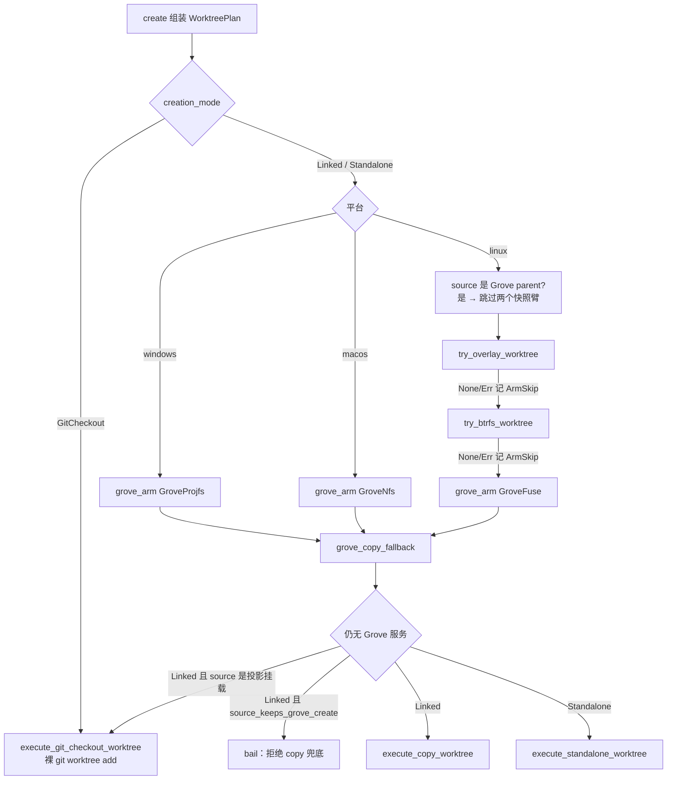

[上一篇：外部 Agent 配置迁移](19-外部Agent配置迁移.md) · [总目录](README.md) · 第 20 / 22 篇 · [下一篇：可靠性与通用技术实现说明书](可靠性与通用技术实现说明书.md)

> **本篇位置**：第 20 / 22 篇

# 20 · Git Worktree 快速铺设设计与 GC

> **场景**：Grok Build 给每个 workspace / agent 会话开独立的 git worktree，worktree 必须「秒开」且带完整工作树。传统做法（`git clone`，或 `git worktree add` 的单线程 checkout）都要把工作树整个写一遍盘。本篇讲承担这件事的专门 crate `xai-fast-worktree`：它怎么用「worktree 元数据瞬时创建 + CoW/reflink 并行克隆 + Linux 上 Btrfs/overlay 快照」把成本降下来；创建的 worktree 怎么在 SQLite 里登记、怎么被 GC 回收；NFS 上怎么特化处理。
>
> **阅读说明**：源码基准 `HEAD = 42f4d7d3`（2026-10-27，`SOURCE_REV = 559751fd`；前次基准 `HEAD = 0e2bfffb` / `SOURCE_REV = 036a5d83`）。工具链 Rust 1.94.0（`rust-toolchain.toml` `[toolchain].channel`）；workspace members 共 **107** 个。本篇主体 crate 是 `crates/codegen/xai-fast-worktree`：src 树 70 个 `.rs` 共 32,830 行，另有顶层集成测试 `crates/codegen/xai-fast-worktree/tests/overlay_integration.rs` 931 行（行数均为实测）。三个消费方是 `crates/codegen/xai-grok-workspace`、`crates/codegen/xai-grok-shell`、`crates/codegen/xai-grok-pager`（各自 `Cargo.toml` 的 `[dependencies]` 实测）。
>
> **索引记法**：`文件路径 · 符号：Name(+偏移)`。**顶层符号**的定义行即 `+0`，不写偏移；**成员**（impl / trait 内的方法、struct 字段）相对其 `impl X` / `struct X` / `enum X` 头行记 `+0`，`+0` = impl/trait/struct 头行本身。偏移全部回当前源码实测（`python3 docs/adrian/sourceReader/.progress/sr_tools.py offset FILE SYM` 可复核）。

---

## 第一层 · 简单框架（系统骨架）

**这个 crate 是什么。** 它的 `crates/codegen/xai-fast-worktree/Cargo.toml` 的 `[package].description` 一句话给出章程：

> "High-performance git worktree creation using CoW cloning"

模块头（`crates/codegen/xai-fast-worktree/src/lib.rs` · `Module：lib`）把做法拆成六条，这六条就是全 crate 的地图：

1. 用 `git worktree add --no-checkout` 做 worktree 元数据创建（瞬时）；
2. 工作树文件做**并行 CoW 克隆**，按哈希分片；
3. 可选的脏文件复制与 ignored 文件复制；
4. Linux 上支持 Btrfs 快照，O(1) 克隆；
5. 面向「预建 worktree 池」的 sync API；
6. SQLite 元数据登记（`metadata` feature 门控）。

**成本模型：为什么要绕开「直接 checkout」。** 三种创建模式（`crates/codegen/xai-fast-worktree/src/api.rs` · 符号：`CreationMode`）的 doc 注释本身就是一份成本对比表：

| `CreationMode` 变体 | 做法（doc 注释要义） | 成本特征 |
|---|---|---|
| `Linked`（默认） | `git worktree add --no-checkout` + 并行 CoW；Linux 上自动升级为 btrfs 快照 | 大仓库（APFS/Btrfs）上最快——本机 APFS 实测确实最快（0.44~0.52s、只吃 0.1~3 MiB），但**前提是 `WorkingTreeMode::PreserveWorkingTree`**；CLI 默认的 `CleanAll` 会退化成「比 `git worktree add` 慢 0.5s 且全额占盘」，见 4.7.3 |
| `Standalone` | 独立 `.git/` 副本，可用 `rename()` 顶替源仓库；Linux 上同样自动走 btrfs | 元数据全量复制，但与源仓库解耦 |
| `GitCheckout` | 裸 `git worktree add`，单线程 checkout | 避免 split-index / index-copy 的边界情形，代价是 checkout 单线程 |

CoW 一侧的开关是 `crates/codegen/xai-fast-worktree/src/api.rs` · 符号：`BtrfsMode`：`Auto`（源在 Btrfs subvolume 上才用快照，否则退回逐文件 CoW）/ `Force`（不在 subvolume 上直接报错）/ `Disabled`。doc 注释点明收益量级：「O(1) standalone repo instead of file-by-file CoW when the source is a btrfs subvolume」。
池化决策的阈值输入是 `crates/codegen/xai-fast-worktree/src/lib.rs` · 符号：`count_tracked_files`——用 `gix` 读 index 头部条目数（不做目录遍历），判断「这个仓库大到值得走 worktree 池吗」。

**与 `gix` / `git2` 的关系。** 依赖面（`crates/codegen/xai-fast-worktree/Cargo.toml` 的 `[dependencies]`）实测：`gix`（features `status`、`parallel`）、`gix-status 0.30.0`、workspace 内的 `xai-gix-status`；**没有 `git2` 条目**——本 crate 走纯 gix 栈，`git2` 是仓库里其它 crate 在用的（第 19 篇提过迁移 crate 的 `scope.rs` 用 git2 discover，与本 crate 无关）。本 crate 对 gix 的逐个接触点在 3.6 给锚点。

**feature 面**（`crates/codegen/xai-fast-worktree/Cargo.toml` 的 `[features]`）：`metadata` = SQLite 登记（引入 `rusqlite 0.37` bundled + `xai-sqlite-journal`）；`default-bazel = ["metadata"]`；`bench` / `lifecycle-bench` 只喂基准二进制。二进制三个（`[[bin]]` × 3）：`fast-worktree`（`crates/codegen/xai-fast-worktree/src/bin/cli.rs`）、`pool-perf-bench`（需 `bench`）、`worktree-lifecycle-bench`（需 `lifecycle-bench`）。

**跨 crate 分工表**（消费方以各自 `Cargo.toml` 的 `[dependencies]` 实测为准）：

| crate | 在 worktree 链路里的角色 | 具体调用点 |
|---|---|---|
| `crates/codegen/xai-grok-workspace` | worktree 生命周期编排方（创建 / 清理 / GC 入口） | 2.2 实测列出 |
| `crates/codegen/xai-grok-shell` | 会话 / agent 侧发起方 | 2.2 实测列出 |
| `crates/codegen/xai-grok-pager` | UI / 命令侧发起方 | 2.2 实测列出 |

**栈位图**（简化名 `lib.rs`、`api.rs` 等均指 `crates/codegen/xai-fast-worktree/src/` 下同名文件）：

```
 workspace / shell / pager（三个消费 crate）
        │  创建 / 补齐 / 清理 / GC / 登记
        ▼
┌────────────────────────────────────────────────────────────┐
│ 公共 API 面（lib.rs 的 pub use 重导出）                      │
│  WorktreeBuilder（创建）  WorktreeSync（预建池补齐）          │
│  gc_worktrees* / maybe_auto_gc（metadata 门控）             │
│  remove_worktree* / cleanup_worktrees_in（清理）            │
├────────────────────────────────────────────────────────────┤
│ 编排层  worktree/plan → worktree/execute   git/safety 护栏   │
├──────────────────┬──────────────────┬──────────────────────┤
│ Linux 专用后端    │ 通用后端          │ 元数据与登记           │
│  btrfs/ 快照      │  copy/ reflink   │  db/ SQLite           │
│  overlay/ 叠加    │  git/ worktree 元│  discovery/ 扫描重建  │
│  mount_info.rs   │  git/ checkout   │  grove_api.rs         │
└──────────────────┴──────────────────┴──────────────────────┘
        │                        │
        ▼                        ▼
 内核（FICLONE / clonefile /   git 仓库本体 +
 snapshot / mount）            ~/.grok 数据目录（DB）
```

模块可见性一览（`crates/codegen/xai-fast-worktree/src/lib.rs` 的 `mod` 声明区，逐条实测）：对外 `pub mod` 只有 `btrfs`（Linux）、`db`（metadata）、`discovery`（metadata）、`sync` 四个；`pub(crate)` 有 `mount_info`（Linux）、`time`、`util`（Linux）；其余 `api`、`auto_gc`（metadata）、`copy`、`data_dirs`、`git`、`grove_api`、`metrics`、`nfs`（`#[path = "nfs_off.rs"]`）、`overlay`（Linux）、`worktree` 全部私有——**外部能拿到的只有重导出符号**。重导出面里有一对存根：`crates/codegen/xai-fast-worktree/src/lib.rs` · 符号：`local_salvage` / `local_clean_artifacts`，函数体只有 `bail!("not available in this build")`——签名是公共契约，实现当前构建里被抽走，真实能力走 NFS daemon（见 3.5）。

---

## 第二层 · 最小例子（全路径走读）

**例子取自真实调用方**：shell 会话恢复时发现 worktree 缺失，就地重建一个（`crates/codegen/xai-grok-shell/src/session/worktree.rs` · 调用点（快照 `worktree.rs:470`））：

```rust
use xai_fast_worktree::{CreationMode, IgnoredFilesMode, WorkingTreeMode, WorktreeBuilder};
let mut builder = WorktreeBuilder::new(&source, &dest)
    .working_tree_mode(WorkingTreeMode::CleanAll)   // 目标树：reset --hard + clean -fd
    .ignored_files_mode(IgnoredFilesMode::Skip)     // 不复制 .gitignore'd 文件
    .creation_mode(CreationMode::Linked)            // linked worktree（默认）
    .worktree_kind(xai_fast_worktree::WorktreeKind::Fork)  // DB 登记 kind
    .session_id(session_id);                        // DB 记 session
if let Some(opts) = grove_worktree_opts_if_enabled(grove_worktree) {
    builder = builder.grove_worktree(opts);         // NFS/Grove 臂的显式开关
}
if let Some(delegate) = btrfs_delegate {            // 沙箱内无 CAP_SYS_ADMIN 时交给外部
    builder = builder.btrfs_delegate(delegate);
}
let report = tokio::task::spawn_blocking(move || builder.create()).await??;
```

`create()` 是**阻塞** API（doc 注释原话「Blocking. Use `spawn_blocking` from async」），async 侧必须 `spawn_blocking` 包一层——消费方全部照此办理。

**这次调用从敲下回车到落盘，中间发生的事**（每一跳都有锚点，第三层逐跳拆）：

```text
WorktreeBuilder::create            api.rs        ① 收敛 id：canonicalize dest → worktree_id_from_path
  │                                               ② is_safe_worktree_id 校验（拒绝 ../ 等）
  │                                               ③ 组装 WorktreePlan（15 个字段的纯数据结构）
  ▼
execute_plan                       worktree/mod.rs · execute_plan —— 一行转发
  ▼
execute_create_worktree            worktree/execute.rs —— 包 metrics 计时 + 主仓 marker
  ▼
execute_create_worktree_dispatch   同上 —— 策略瀑布（核心，见 3.1）
  │   本例 Linked + macOS：grove-nfs 臂拒绝（无 daemon）
  │     → skipped 记一条 ArmSkip
  │     → grove_copy_fallback → execute_copy_worktree（copy 臂，见 3.2）
  ▼
CreateWorktreeResult               resolved_strategy="copy", skipped=[...]
  │
  ▼ （回到 create()）
register_worktree                  api.rs —— metadata feature 打开时，成功后才写 worktrees.db
  ▼
WorktreeReport{worktree_path, commit, unignored_copy, resolved_strategy, skipped, ...}
```

要点先给三条（后面逐条展开）：

1. **`skipped` 是一等公民**：每个拒绝/失败的臂都以 `ArmSkip{arm, detail}` 记进报告，调用方日志用 `render_arm_skips`（`crates/codegen/xai-fast-worktree/src/worktree/mod.rs` · 符号：`render_arm_skips`）拼一行策略说明——「为什么没走快路径」是排查的第一入口。
2. **DB 登记在创建成功之后**：`register_worktree`（`crates/codegen/xai-fast-worktree/src/api.rs` · 符号：`register_worktree`）只在 `execute_plan` 返回 `Ok` 后跑；DB 打不开只 `warn` 不报错——登记是尽力而为，磁盘上的 worktree 才是事实源。
3. **取消是贯穿的**：builder 携带 `CancellationToken`，`copy_ignored_only` 在复制后检查取消并显式 `bail!("cancelled during ignored-only copy")`（`api.rs` · `WorktreeBuilder::copy_ignored_only(+232)` 注释：copy_parallel 取消时返回 Ok+部分统计，必须人工转错误）。

---

## 第三层 · 逐步拆解（机制逐跳）

### 3.1 策略瀑布：一次创建如何选中一条臂

调度入口 `crates/codegen/xai-fast-worktree/src/worktree/execute.rs` · 符号：`execute_create_worktree_dispatch`。臂名与策略名一一对应，常量都在 `crates/codegen/xai-fast-worktree/src/worktree/mod.rs`：`grove-fuse` / `grove-nfs` / `grove-projfs` / `nfs` / `overlay` / `btrfs` / `copy` / `git` / `standalone`。
同文件的 `WorktreeArm` 枚举（符号：`WorktreeArm`）只有 5 个变体（`GroveFuse` / `GroveNfs` / `GroveProjfs` / `Overlay` / `Btrfs`）——**`copy` / `git` / `standalone` 不是「臂」，是兜底终点**；`is_grove(+4)` 注释点出一个易错语义：只有 Grove 的 skip 才解释「Grove 为什么没服务」，快照臂的 skip 意味着「更早的臂先失败、Grove 压根没轮到」。



三条反直觉之处：

- **`Err` 不向上抛**。快照臂返回 `Result<Option<_>>`：`Ok(None)` = 条件不满足，`Err(e)` = 试了但失败，两者都只 `push(arm_failed(...))` 进 `skipped` 然后继续下一臂（`execute_create_worktree_dispatch` 内 `tracing::warn!("overlay snapshot failed, falling back to next strategy")`）。**唯一会把错误抛出去的是 Grove 明确拒绝**——`grove_copy_fallback` 在 `source_keeps_grove_create` 时 `bail!("Grove source: CreateWorktree declined; refusing copy fallback")`，因为对 Grove 源偷偷本地复制会产生一份「看起来成功、实际不是投影」的假 worktree。
- **`PreserveWorkingTree` + 投影源 = 硬错误**：`bail!("preserve on a projected Grove source is not supported")`，不降级。
- **overlay 只在「肯定私有」时跳过**：`should_skip_overlay(status)` 只对 `MountNsStatus::Private` 返回 true，`Unknown` 保持启用（注释：否则非 root 宿主机调用方被逼上慢 copy 路径）。命名空间判定来自 `mount_info.rs` · 符号：`current_mount_ns_status`——比较 self 与 PID 1 的 ns inode。

包装层 `execute_create_worktree`（同文件）只做三件事：`record_grove_wt_create(strategy, elapsed)`、把 `size_class_from_entries(files_copied)` 记进 span、`record_main_repo_marker`。最后一个是**给 standalone 用的补丁**：standalone 副本的 `.git` 是目录、不指向任何地方，所以额外写一个 `git/grok-worktree-source` 文件记主仓根；已存在就不覆盖（注释：它已经命名了 ultimate main repo）。

`PartialWorktreeGuard`（同文件）是失败清理：`new` 装填、成功路径 `disarm()` 消费、`Drop` 时若仍装填就 `remove_worktree(dest)`。注释明确约束——**只在没有后台线程还在往 dest 写之后才装填**，否则清理会和写入竞争。

### 3.2 copy 臂：瞬时元数据 + 并行 CoW

`crates/codegen/xai-fast-worktree/src/worktree/execute.rs` · 符号：`execute_copy_worktree`，五步固定顺序：

| 步 | 动作 | 锚点与要点 |
|---|---|---|
| ① | `find_worktree_root(source)` 定仓库根 | 复制按**根**做，不是按传入的 cwd（可能是子目录） |
| ② | `git worktree add --detach --no-checkout dest git_ref` | `git/worktree.rs` · 符号：`worktree_add_no_checkout`；只建 `.git/worktrees/<id>` 注册信息，不写工作树 |
| ③ | 取 `get_modified_files(&source_root)` | 决定「哪些文件要跳过复制」，见 ④ |
| ④ | `copy_parallel(source_root, dest, cfg, cancel)` | `copy/engine.rs` · 符号：`copy_parallel`；`respect_gitignore: true` |
| ⑤ | `finalize_worktree(...)` | 按 `WorkingTreeMode` 三分支收尾 |

`finalize_worktree` 的分支是整个设计里最省钱的一处：

```rust
match working_tree {
    PreserveWorkingTree => { git::copy_git_index(source, dest)?;         // 直接搬索引
                             git::update_index_stats(dest, &clean)?; }   // 用复制时的 stat 回填
    CleanTracked => git::git_reset_hard_command(dest, None)?,
    CleanAll   => { git::git_reset_hard_command(dest, None)?;
                    git::git_clean_fd(dest, false)?; }
}
```

`PreserveWorkingTree` **不调 `git checkout`**：索引从源复制、每条干净文件的 stat（mtime/size）用并行复制时顺手收集的 `file_metadata` 回填（`collect_clean_metadata` 过滤掉修改过的），于是 `git status` 立刻判定「无改动」，不必逐文件重算哈希——测试 `test_git_status_is_instant_after_worktree_creation` 就是锁这条性质的。`copy_git_index`（`git/index.rs`）内部 `link_shared_indexes` 让 linked worktree 共享索引文件；`update_index_stats(+0)` 逐条 `AssumeUnchanged` 式写回。

**并行复制的形态**（`copy/engine.rs` · `copy_parallel`，worker 侧 `copy/worker.rs`）：

```text
WalkBuilder（ignore crate，threads = num_workers）
  │  filter_entry: 永远跳过名为 .git 的条目
  │  git_global(false) / git_exclude(false)   ← 见下方坑
  │  按 rel_path 分类 Dir / Symlink / File
  ▼  shard = shard_for_path(rel, n)（rapidhash 前缀，同目录必同臂）
bounded channel × N（容量 = config.channel_buffer）
  ▼
run_worker × N  →  process_entry：
    Dir     create_dir_all
    Symlink read_link → cow::replace_symlink（先 remove_file，允许悬空目标）
    File    cow::clone_file → reflink_copy::reflink_or_copy + set_permissions
  ▼
Arc<AtomicU64> × 4（files/dirs/symlinks/skipped）+ Mutex<Vec<String>> issues
DashSet<PathBuf> copied_paths（第二遍 ignored 复制要按它去重）
DashMap<PathBuf, Metadata> file_metadata（喂 ⑤ 的 stat 回填）
```

三个硬约束：

- **worker 数封顶**：`MAX_PARALLEL_WORKERS` macOS = 8、其它 = 32（`engine.rs` · 常量），注释给的理由是 FD 预算——「默认 ulimit 256，8 worker + 8 walker 线程、深树各占约 10 个 FD 仍有富余」。`effective_parallelism`（`worktree/plan.rs` · `WorktreePlan::effective_parallelism(+1)`）填 0 表示「用 `num_cpus`」，随后仍被 `config.num_workers.min(MAX_PARALLEL_WORKERS)` 二次夹住。
- **不读全局 gitignore 与 `.git/info/exclude`**：注释解释得很直白——全局 ignore 是「个人偏好、与建 worktree 无关」，`info/exclude` 常被外部工具塞宽模式（`*.min.js`、`*.zip`），而 `ignore` crate **不看跟踪状态**，会静默丢掉被跟踪的文件。
- **权限要手动补**：`copy/cow.rs` · 符号：`clone_file` 在 reflink 之后 `set_permissions(dest, source 的 perms)`，注释点明原因——FICLONE 只克隆数据块、目标按默认 umask 创建，不补的话**可执行位会丢**。

`copy_ignored_only`（`api.rs` · `WorktreeBuilder::copy_ignored_only(+232)`）是同一条流水线的单用途版：先 `collect_unignored_paths` 收出「已跟踪那一套」，再把它当 `skip_files` 反向传入、`respect_gitignore: false`，于是只剩 ignored 文件被复制。

### 3.3 standalone 臂：并行复制整个 `.git/`

`execute_standalone_worktree`（同文件）不建 linked worktree，而是造一个**可以 `rename()` 顶替源仓库**的独立仓库，因此必须复制 `.git/`。它把耗时件并成两条线程：

| 线程 | 干什么 | 条件 |
|---|---|---|
| `standalone-git-copy` | `copy_git_dir_keeping_origin(source/.git, dest/.git, origin_keep)`（`copy/gitdir.rs`） | 总是 |
| `standalone-modified-scan` | `get_modified_files(&source_root)` | 仅 `PreserveWorkingTree`（Clean 模式必须同步等结果当 skip 集） |

`join_git_copy` 把「线程 panic」和「线程内 `Err`」摊平成一个 anyhow 错误，否则 panic 会变成静默的成功。`.git/` 复制有自己的跳过表 `SKIP_TOP_LEVEL`（`gitdir.rs` · 常量），语义与 `execute.rs` 里的 `SNAPSHOT_GIT_CLEANUP_TOP_LEVEL` 对齐（注释明说「mirrors `copy::gitdir` skip lists」）：`worktrees`、`FETCH_HEAD`、`ORIG_HEAD`、各类 `*_HEAD`、`sequencer`、`rebase-*`、`gc.log`。

复制完还要**消毒**（`copy/standalone.rs` · 符号：`sanitize_standalone_git_dir`），因为副本带着源仓库的 remote 语义会做出危险的事：

- `rewrite_origin_fetch`：把 origin 的 fetch spec 收窄（`narrow_origin_fetch_spec` / `heads_fetch_spec`），避免副本 `git fetch` 拉回全部 refs；`DETACHED_NARROW_FETCH` 是 detached checkout 时的特例（`+HEAD:refs/remotes/origin/HEAD`）。
- `prune_origin_remote_refs` + `filter_packed_refs`：只留 `origin_ref_allowlist` 允许的名字（`KEEP_ORIGIN_REFS` = `HEAD`/`main`/`master`，再按 `git_ref` 追加，见 `origin_keep_names_for_git_ref`）。
- `drop_inconsistent_shallow`：浅克隆的 `shallow` 文件若与 HEAD 不一致就删掉整份 shallow 标记（`head_first_parent_needs_shallow` 用 gix 查首个父提交是否在 grafts 里，`SHALLOW_FIRST_PARENT_CAP = 100_000` 是遍历封顶）。
- 写文件一律 `replace_file` + `tmp_sibling`（同目录临时文件再 rename），不就地截断。

### 3.4 Linux 快路径：overlay 与 btrfs

**overlay 臂**（`overlay/snapshot.rs` · 符号：`create_overlay_worktree`）：lower = 源工作树、upper/work 在受控目录、target 用 `mount overlay` 挂起来（`mount_overlay` / `unmount_overlay`）。快照本身不复制内容，所以「脏不脏」要问 upper：`overlay_upper_has_worktree_changes` 检查 upper 目录；卸载后把 upper 的改动落回真实树。元数据文件记 lower/upper/work/target 四元组（`OverlayMetadata`），删除有两条对账路径——`try_remove_from_mountinfo`（当前挂载表还在）与 `try_remove_from_metadata`（挂载表里找不到、只能按元数据清），孤儿由 `cleanup_orphaned_overlay_snapshots` 扫。`tests/overlay_integration.rs`（931 行）专测这条臂。

**btrfs 臂**（`btrfs/snapshot.rs`）：`create_snapshot_with_symlink` 先 `snapshot_dest_path(btrfs_mount, subvolume_root, dest)` 算出快照落点（同 basename 跨仓库要靠哈希消歧——测试 `test_snapshot_dest_path_disambiguates_same_basename_across_repos` 锁这一点），`btrfs subvolume snapshot` 建 O(1) 快照，写 `BtrfsSnapshotMetadata`（`btrfs_meta_path` / `write_btrfs_metadata`），最后在 dest 处 `create_worktree_symlink` 把「用户期望的路径」做成指向快照的符号链接。**对外看到的一直是个目录路径，实际是 symlink + 快照**。

删除侧的护栏值得单独记：`is_safe_snapshot_delete_target` 只允许删「落在已知 btrfs 挂载点之下、且由本 crate 的命名规则生成」的路径——`delete_snapshot` 拿到一个不像自家快照的路径就拒。这是防「路径解析被 symlink 玩坏后 `subvolume delete` 掉用户的真 subvolume」。

**delegate 旁路**：无 `CAP_SYS_ADMIN` 的进程（典型是 bwrap 沙箱内）自己 mount/snapshot 会失败，于是 `BtrfsDelegate` trait（`api.rs` · 符号：`BtrfsDelegate`）把 `create_snapshot` / `delete_snapshot` / `mount_overlay` / `unmount_overlay` 四个操作交给调用方注入的特权实现；`try_btrfs_delegate` 在 arm 序列里用 delegate 走同样的流程。`delete_fallback_invokes_delegate_when_direct_delete_fails` 一类测试锁的就是「直删失败 → 回落 delegate」的顺序。

### 3.5 Grove / NFS 臂与「本构建不可用」

`grove_api.rs` 是与常驻 Grove daemon 的契约面：`NfsWorktreeOpts`（`enabled` 等）、`NfsStatusView`（`is_linked_local_view` / `is_forkable` / `can_fork` / `keeps_grove_create` / `has_capability` / `mount_transport` / `slug_root`）、能力常量 `CAP_CANCEL_WORKTREE_CREATE`、`CAP_FORK_FROM_BACKING`、失败归类 `GroveHardFail` + `grove_hard_fail(err)`、以及 `is_safe_worktree_id`。id 安全性不是洁癖：worktree_id 会进 daemon 的路径拼接，`create()` 一开始就校验（`bail!("invalid worktree id from dest: ...")`）。

`crates/codegen/xai-fast-worktree/src/nfs_off.rs`（`lib.rs` 以 `#[path = "nfs_off.rs"] mod nfs;` 挂上）是**本仓库这份构建的降级实现**：`dest_is_nfs_mount` 恒 `false`，`NfsWorktreeClient` 的 `detach_worktree` / `salvage_worktree` / `clean_artifacts` / `redirect_events` 一律 `bail!("not available in this build")`。`lib.rs` 顶层的 `local_salvage` / `local_clean_artifacts` 是同样的存根。**签名是公共契约、实现不在这份构建里**——读到这里要知道：Grove 臂在当前代码库里永远拒绝，真实能力在 daemon 侧。因此本文所有「Grove/NFS 会服务」的描述，在本地构建里都表现为「臂被跳过、走 copy」。

### 3.6 SQLite 登记：`worktrees.db`

`metadata` feature 打开后，`db/mod.rs` · 符号：`WorktreeDb` 用 `rusqlite`（bundled）打 `~/.grok/worktrees.db`（`WORKTREES_DB_FILE` 常量，`resolve_db_path`）。schema 见 `db/schema.rs` · 常量：`INIT_SQL`（`SCHEMA_VERSION = 1`）：

```sql
PRAGMA busy_timeout = 5000;
CREATE TABLE IF NOT EXISTS meta (key TEXT PRIMARY KEY, value TEXT NOT NULL);
CREATE TABLE IF NOT EXISTS worktrees (
    id TEXT PRIMARY KEY, path TEXT UNIQUE NOT NULL, source_repo TEXT NOT NULL,
    repo_name TEXT NOT NULL, kind TEXT NOT NULL DEFAULT 'session',
    creation_mode TEXT NOT NULL DEFAULT 'linked',
    git_ref TEXT, head_commit TEXT, session_id TEXT, creator_pid INTEGER,
    created_at INTEGER NOT NULL, last_accessed_at INTEGER,
    status TEXT NOT NULL DEFAULT 'alive', metadata TEXT);
-- 索引：repo_name / (status,kind) / session_id / created_at
```

四个设计决定：

1. **`path UNIQUE` + id 规范化**。`register_worktree` 写库前用 `dunce::canonicalize` 归一 path 与 source_repo，注释点명理由：不这么干的话 macOS 的 `/var` 与 `/private/var` 会各存一行。id 默认 `id_from_path(path)`，与 `worktree/plan.rs` 的 `canonicalize_for_id` + `worktree_id_from_path` 同一套规范（`macos_private_prefix` 处理 `/System/Volumes/Data` 前缀与大小写盘符对；`worktree_id_stable_across_var_and_private_var` 等测试锁稳定性）。
2. **`kind` 六类**：`Session` / `Ab` / `Fork` / `Pool` / `Manual` / `Subagent`（`WorktreeKind`）。三个解析器语义各不同——`from_str_lossy` 未知→`Manual`，`from_str_exact` 未知→`None`，`from_str_opt` 给配置键用（trim + 只在真含大写时才分配小写副本）。GC 的按 kind TTL 就是按这套枚举配的。
3. **`status` 只有 `Alive`/`Dead`**，且 `from_str_lossy` 把**任何未知值判成 Dead**（保守：不认识就当作不可用）。
4. **失败分类进遥测**：`classify_sqlite_error` → `SqliteFailureKind`，`RegistryOpen` 让「文件损坏也照样 `Opened`」这种反直觉行为可读（doc 注释原话「A corrupt file still reaches `Opened`」），`open_read_only` 还带 busy 重试（`open_readonly_with_busy_retry`）。

登记失败**只 warn**（`failed to open worktree DB for registration` / `failed to register worktree in DB`）。反向的对账能力由 `unregister_worktree` 提供，但它只在**磁盘删除成功之后**才调用——`remove_worktree_inner` 的注释是这套纪律的出处：删除失败（如 btrfs EPERM）必须**留着记录**，否则 worktree 变成「磁盘上有、清单里没有」的孤儿，list/gc 再也看不见它。

### 3.7 GC：三趟、四态、一道 600 秒的闸

手动入口 `api/gc.rs` · 符号：`gc_worktrees` / `gc_worktrees_with_delegate`，内部 `run_pass` 固定三趟：

```text
reclaim_dead_records        → status=Dead 的记录，路径存在就删
reclaim_expired_worktrees   → 仅当 age_path_enabled(opts)：按 TTL 走安全闸
reclaim_orphan_pins         → NFS/Grove pin 的并集活性清扫（永不失败整趟 GC）
```

`collect_names_in(sources)` 在删除后对每个 source_repo 跑 `collect_reclaimed_names`（见 3.8），失败只 debug 级注明「下一趟再试」。

**资格判定只有一处**：`Eligibility` 枚举 + `classify`（`api/gc.rs`）。注释强调「所有其它 eligibility 检查（主循环、闸后复查）都走这里，规则与 `force` 覆盖只活在这一个地方」：

| 态 | 条件 |
|---|---|
| `NeverExpires` | `effective_max_age(kind)` 为 `None`（出厂默认只有 `Manual` = None） |
| `NotYetExpired` | `last_active(rec)` 未到 TTL |
| `Guarded` | 过期但被占用：`creator_pid` 还活着，或**有进程 cwd 落在该树内**，或命中 `keep_worktrees_containing` |
| `Reclaimable` | 过期且无占用 → 送安全闸 |

`is_guarded` 的两条占用判据里，cwd 扫描只在 `process_cwd_scan_available()`（= linux/macOS 编译期）为真时做；Windows 上「运行时失败 fail-close 在 `gc_worktrees`」。Grove/NFS 记录有一条特殊分支（`rec_cwd_within`）：**绝不对 NFS dest 做 canonicalize**（注释：卡住的挂载会 hang），改用前缀比较。

**安全闸**在 `git/safety.rs` · 符号：`safe_to_delete_named_worktree` → `decide_within` → `answer_within`。它的形态是这套代码里最强调「宁可不删」的一处：

- 判定跑在**独立线程**（线程名 `worktree-safety-gate`），主流程 `recv_timeout`；
- `GATE_TIMEOUT = 600s`（GC 一趟内则夹到 `GATE_TIMEOUT_IN_PASS = 120s`，并有 `const _: () = assert!` 保证它小于 `AGE_PASS_BUDGET = 60s` 的相关约束）；
- **超时 → `Keep(CheckFailed)` 语义的「保留」**（日志：`safety gate timed out; keeping worktree`），线程起不来同样保留；
- 判定内容：`decide_safety` 先分 `Ownership`（Linked / Standalone），再看工作树内容（`find_working_tree_content`、`find_gitlink_content`）、可达性（`find_unpushed_commits`、`find_missing_objects`、`find_reflog_only_commits`）、快照覆盖（`Captured::WorkingTreeSnapshot`）。

`KeepReason` 11 个变体就是「为什么不删」的完整词表：`Dirty`、`HiddenFromStatus`、`IgnoredContent`、`EmbeddedRepo`、`Unpushed`、`OnlyCopy`、`NotInSnapshot`、`WorktreeLocalState`、`NoRepo`、`CheckFailed`、`GateTimedOut`；`name()` 给遥测用的稳定小写标签（`gate-timed-out` 等），带内容的走 `Display` 的 `name: detail` 形式。

**自动 GC**（`auto_gc.rs`）把这套策略包成配置解析 + 节流：

| 项 | 值 / 锚点 |
|---|---|
| 环境变量 | `GROK_WORKTREE_AUTO_GC`、`_DRY_RUN`、`_MAX_AGE`、`_REBUILD`（常量 `ENV_AUTO_GC*`） |
| 优先级 | env > local > remote > defaults（`resolve_worktree_auto_gc_from_layers` 注释原样） |
| kill-switch | `env_auto_gc_disabled()` 直接置 `enabled=false`，配置层无法翻回来 |
| 默认 | `DEFAULT_MAX_AGE_SECS = 7*86400`、`DEFAULT_MIN_INTERVAL_SECS = 6*3600`、`DEFAULT_REBUILD_MIN_INTERVAL_SECS = 24*3600` |
| 夹逼 | max_age ∈ `[3600, 90*86400]`，min_interval ∈ `[60, 7*86400]`（`clamp_*`） |
| 按 kind 覆盖 | `max_age_by_kind`：默认表只有 `Manual → None`（永不按龄回收），合并顺序「产品默认 → remote → local」 |
| 节流 | `is_throttled(now, last, min_interval)`，上次时间戳写进 DB `meta` 表（`META_LAST_AUTO_GC_AT`、`META_LAST_AUTO_REBUILD_AT`） |
| dry-run | `age_expiry_allowed(scan_platform, dry_run)` = 「平台能扫」或「dry-run」——dry-run 允许跑指标但不删 |
| 入口 | `maybe_auto_gc(db, policy)`；`run_auto_gc_pass(policy, context)` 是给宿主的一次性调用壳 |

`maybe_auto_gc` 内部会**重新施加** env kill-switch / dry-run / rebuild 三个开关（`ResolvedWorktreeAutoGc` 的 doc 注释明说这三项在 `maybe_auto_gc` 里再套一层），所以「解析出的策略」和「实际执行的策略」可能不同——排查时两个都要看。可选的 `include_rebuild` 默认关，打开才会「从磁盘重建 DB + 清 grok 域内过期 `.git/worktrees/` 注册」，注释给的理由是「等 rebuild 成本测出来再默认开」。

### 3.8 快照到 ref：删之前先把内容留在 git 里

创建路径之外，本 crate 还导出「把一棵工作树冻成一个 commit ref」的能力，用于「删除前捕获」：

```rust
// git/checkout.rs · snapshot_worktree_to_ref
let tree = write_worktree_tree(worktree_path, IndexSeed::Head)?;   // 全程用 GIT_INDEX_FILE 临时索引
let snap = snapshot_git(worktree_path, &["commit-tree", &tree, "-p", "HEAD", "-m", message], &ident)?;
snapshot_git(worktree_path, &["update-ref", ref_name, &snap], &[])?;
```

三个细节：

- **绝不动真实索引**：`ScratchIndexGuard` + `scratch_index_path()` 造一次性索引，`Drop` 里删掉；工作树的 index 保持原样。
- **`IndexSeed` 两态是性能与正确性的折中**：`Head`（用 HEAD 的树播种）保证「已跟踪但同时被 .gitignore 命中」的文件不被 `add -A` 丢掉（`add -A` 从不重新忽略已跟踪项），代价是没有 stat 缓存、每个被跟踪文件都要哈希；`WorktreeIndex`（复制工作树自己的索引）带 stat 缓存，monorepo 上「十秒而不是两分钟」。
- **身份不外泄**：`GIT_AUTHOR_NAME/GIT_COMMITTER_NAME` 等四个 env 只在这次调用里给（`Grok Snapshot <grok-snapshot@example.com>`），**绝不写进 git config**。
- 时间戳由 `SNAPSHOT_TIMEOUT` 兜着；`NO_HOOKS` 指向 `/dev/null`（Windows 是 `NUL`），防止快照过程中触发用户钩子。

`reclaimed.rs` 是配套的「回收名册」：被删工作树若命名了别的 ref 都到不了的提交，就在 `refs/grok/reclaimed` 下起个名字（`ref_name_for`）存住，`RECLAIMED_LIFETIME = 30*24*3600` 后由 `collect_reclaimed_names` 清理；`reclaimable_after_snapshot` / `reclaimable_within` 是对外查询入口（`Reclaim` 枚举）。`commits_nothing_else_reaches` 是「只有这个 worktree 到得了」的判据实现。

### 3.9 预建池补齐：`WorktreeSync`

池化的前提是「先有干净树，再把它推到源的状态」。`sync.rs` · 符号：`WorktreeSync` 做四阶段，`SyncReport` 逐阶段记毫秒：

```text
① head_resolve_ms   gix 取 source/worktree 两个 HEAD
② reset_hard_ms     HEAD 变了才 git reset --hard
③ clean_ms          git clean -fd（skip_clean=true 时跳过，记 clean_skipped）
④ dirty_sync_ms     git status --porcelain=v2 -z --untracked-files=all
                    → apply_porcelain_v2_entries（copy/delete）
                    → replay_staged_changes（git add / git rm --cached）
```

`SourceDirtyState` 是把 `git status` 的**原始 NUL 分隔输出**当载荷缓存（`raw: Bytes`，`is_empty()` 即「源干净」），配套 `collect_source_dirty_state` + `sync_from_precomputed(+68)` 让**一次 status 服务多个池 worktree**——这是池场景的主要省钱点（`dirty_skipped` 字段就记「因为预计算为空而跳过」）。

解析侧有三个易错分支，代码里各配了函数：`is_submodule_entry`（子模块条目必须跳过，否则会把 gitlink 当普通文件复制）、`extract_index_mode_hash`（类型 1/2/u 冲突条目取不同字段）、`extract_ordinary_path`。`replay_staged_changes` 只做索引层重放（不复制内容），因为「暂存了但没提交」的状态本来就是索引事实。测试 `test_sync_staged_deletion_file_still_on_disk` 锁的就是这条语义：staged delete 不能真的删盘上的文件。

### 3.10 发现与重建：DB 可以从磁盘长回来

`discovery.rs` 假设两个受管目录、固定深度：`WORKTREES_DIR = "worktrees"`、`WORKTREE_POOL_DIR = "worktree_pool"`、`WORKTREE_DEPTH = 2`（并有编译期断言 `const _: () = assert!(WORKTREE_DEPTH == 2, "this scan is written for depth 2")`）。`discover_worktrees(grok_home)` 走 `scan_two_level_dir`，对每个候选用 `detect_creation_mode`（看 `.git` 是文件还是目录）和 `detect_source_repo`（读回链）判型，跳过项由 `should_skip_entry` 决定，时间戳用 `fs_creation_time`；`DiscoveredWorktree::into_record` 才产 `WorktreeRecord`。

`rebuild_worktree_db` / `rebuild_worktree_db_with_grove_data` 是 DB 丢失后的重建入口：把磁盘发现结果与 Grove/NFS 身份做并集（`register_nfs_from_union`），并处理 dest 认领（`claim_nfs_dest` / `skip_if_grove_mount` / `physical_nfs_dest`）。`managed_worktree_roots` 返回 `[grok_home/worktrees, grok_home/worktree_pool]`，`path_under_managed_worktree_roots` 给上层判「这个路径是不是我们管的」。

`git/worktree.rs` 的 stale 注册清理刻意**不用 `git worktree prune`**——doc 注释是本篇最该记住的一句话之一：

> Not `git worktree prune`: prune also drops registrations merely invisible in this mount namespace, wiping live linked worktrees in a container.

取而代之 `remove_stale_worktree_registrations` 按 `StaleWorktreeMatch::{Path, UnderPrefix}` 精确匹配，并且**只有「肯定不存在」才算 stale**：`try_exists()` 返回 `Err` 时保留注册（注释：它的 reflog 可能是一个提交的最后一份副本）。路径比较前先 `normalized_for_match`，测试 `under_prefix_matches_symlinked_base_spelling` / `matches_across_symlinked_base_spelling` 锁住 symlink 拼写差异不能导致漏删或误删。

`data_dirs.rs` · 符号：`candidate_data_dirs` 是「Grove 数据目录可能有几个」的答案：按 `GROVE_DATA_DIR` → configured → `XDG_DATA_HOME` → `LOCALAPPDATA`（Windows）→ home → `resolve_grok_home` 收集并去重（测试 `candidate_dirs_include_each_source_once`、`windows_candidates_use_localappdata_not_unix_share` 各锁一条）。

### 3.11 消费方：谁在哪一层调它

| crate | 调用点（快照行号） | 用途 |
|---|---|---|
| `crates/codegen/xai-grok-workspace` | `src/worktree/mod.rs` · `WorktreeBuilder::new`（快照 `mod.rs:522`、`mod.rs:1280`、`mod.rs:2037`、`mod.rs:2348`） | 会话/fork/池的主创建路径 |
| 同上 | `src/worktree/mod.rs` · `gc_worktrees_mgmt`（快照 `mod.rs:2900`） | 包 `gc_worktrees` 成管理入口，由 `workspace_ops.rs`（快照 `workspace_ops.rs:1434`）在 span 内调 |
| 同上 | `src/worktree/mod.rs`（快照 `mod.rs:1607`、`mod.rs:1635`、`mod.rs:1636`） | `rehydrate_worktree_from_ref` / `snapshot_worktree_to_ref` + `transfer_snapshot_to_repo`（删除前捕获、跨仓搬运） |
| 同上 | `src/worktree/create_root.rs`（快照 `create_root.rs:140`、`create_root.rs:283`） | `dest_is_projected_mount` / `dest_is_grove_projection` 判投影挂载 |
| 同上 | `src/worktree/strategy.rs`（快照 `strategy.rs:230`、`strategy.rs:257`） | 消费 `SKIP_SOURCE_IS_GROVE_MOUNT` 与 `grove_hard_fail` 决定改写/失败归类 |
| `crates/codegen/xai-grok-shell` | `src/session/worktree.rs`（快照 `worktree.rs:476`）、`src/agent/subagent/handle_request.rs`（快照 `handle_request.rs:677`） | 会话重建、subagent 起树 |
| 同上 | `src/agent/mvp_agent/mod.rs`（快照 `mod.rs:1856`） | 启动时 `maybe_auto_gc` |
| 同上 | `src/util/config/worktree.rs` · `src/agent/config.rs` | 组 `WorktreeAutoGcLayer`；注释明确「平台 age-expiry 在 `maybe_auto_gc` 里判，不在配置层」 |
| 同上 | `src/session/worktree_pool.rs` | `WorktreeSync` 池补齐 |
| `crates/codegen/xai-grok-pager` | `src/worktree_cmd/mod.rs` | 重导出 `DbStats` / `GcReport` / `KeptWorktree` / `RebuildReport`，`grok worktree` 子命令的展示层 |
| 同上 | `src/git_info.rs`（快照 `git_info.rs:239`）、`src/fs_size.rs`（快照 `fs_size.rs:7`） | 只读打开 `WorktreeDb` 做归属判定；按 `WORKTREE_DEPTH` 估盘 |
| 同上 | `src/app/effects/helpers.rs`（快照 `helpers.rs:437`） | 用 `OUT_OF_DISK_CONTEXT` / `ENOSPC_OS_MESSAGE` 把 ENOSPC 归类成用户可读错误 |

第 8 篇（TUI 事件循环）与第 11 篇（workspace/权限/沙箱）分别在 UI 侧与工作区侧引用这些能力；本篇是它们共同的底层。

---

## 第四层 · 源码补齐（配置面、测试矩阵、坑清单、不变量、本机实测）

### 4.1 三重门控：feature / 平台 / 运行时

同一个 crate 在不同构建里能力差别很大，三层门控要分开看——**混起来读会得出「这段代码没生效」的错误结论**。

| 门 | 打开时多出来的能力 | 锚点 |
|---|---|---|
| `metadata` feature | `mod auto_gc`、`pub mod db`、`pub mod discovery`、`api::gc`、`remove_worktree_in`、`candidate_data_dirs`、`WorktreeBuilder` 的 `worktree_kind` / `session_id` / `worktree_id` / `metadata` / `registry_home` 五个字段与登记调用；引入 `rusqlite 0.37` bundled + `xai-sqlite-journal` | `Cargo.toml` 的 `[features].metadata`、`src/lib.rs` 的 `#[cfg(feature = "metadata")]` 声明区 |
| `target_os = "linux"` | `pub mod btrfs`、`mod overlay`、`pub(crate) mod mount_info`、`pub(crate) mod util`、`cleanup_snapshot_git_state`、`cleanup_orphaned_btrfs_snapshots`、`cleanup_orphaned_overlay_snapshots` | `src/lib.rs` 的 `#[cfg(target_os = "linux")]` |
| `target_os = "macos"` / `windows` | 只影响分派里选哪个 Grove 臂（Nfs / Projfs）与 `MAX_PARALLEL_WORKERS`（8 vs 32）、`NO_HOOKS`（`/dev/null` vs `NUL`） | `src/worktree/execute.rs` · `execute_create_worktree_dispatch`、`src/copy/engine.rs` · 常量、`src/git/checkout.rs` · `NO_HOOKS` |
| 运行时 | Grove/NFS 臂要求 daemon 可达；overlay 臂要求非「肯定私有」挂载命名空间；btrfs 臂要求源在 subvolume 上（`BtrfsMode::Force` 才报错）；age-expiry 要求 `process_cwd_scan_available()`（编译期 linux/macos） | `src/mount_info.rs` · `current_mount_ns_status`、`src/btrfs/detect.rs`、`src/auto_gc.rs` · `age_expiry_allowed` |
| 构建期删减 | 本仓库这份构建里 Grove 实现被抽走，`nfs_off.rs` 的四个 client 方法与 `lib.rs` 的两个 `local_*` 全部 `bail!("not available in this build")` | `src/lib.rs` · 符号：`local_salvage`、`src/nfs_off.rs` · 符号：`NfsWorktreeClient` |

### 4.2 配置面清单（键 / env / 默认值）

**builder 旋钮**（`src/api.rs` · 符号：`WorktreeBuilder`，全部消费点在 `impl` 内，`create(+145)`）：

| 方法 | 默认值 | 备注 |
|---|---|---|
| `new(source, dest)` | git_ref=`HEAD`、parallelism=`0`（→ `num_cpus`，再夹到 8/32）、channel_buffer、`WorkingTreeMode::PreserveWorkingTree`、`IgnoredFilesMode::Skip`、`CreationMode::Linked`、`BtrfsMode::Auto` | 默认组合就是「原样复制 + linked + 自动快照」 |
| `git_ref` / `parallelism` / `ignored_parallelism` / `channel_buffer` | — | `ignored_parallelism=0` 时回退到 `parallelism`，再回退 `num_cpus`（`copy_ignored_only` 里的三级兜底） |
| `cancellation_token` | 新 token | 贯穿 walker/worker，取消后 `create` 显式报错而非静默半成功 |
| `btrfs_mode` / `btrfs_delegate` | `Auto` / `None` | delegate 是给无 `CAP_SYS_ADMIN` 场景的出口 |
| `grove_worktree(opts)` / `nfs_worktree(opts)` | `None` | 显式启用 NFS 臂；`None` 或 `enabled:false` 直接跳过该臂 |
| `standalone(bool)` | `false` | 便捷写法，等价 `creation_mode(Standalone)` |
| `worktree_kind` / `session_id` / `worktree_id` / `metadata` / `registry_home` | `None` | **仅 `metadata` feature 存在**；`kind` 为 `None` 时完全不登记 |

**CLI 不吃这套默认**：`src/bin/cli.rs` · 顶层函数：`main`（体内 `+141~+145`）把 `-d/--dirty` 映射成 `PreserveWorkingTree`、**不带 `-d` 映射成 `CleanAll`**，与上表的库默认（`PreserveWorkingTree`）正好相反；本机实测两种模式差 3 倍耗时与两个数量级的磁盘占用，见 4.7.3。

**自动 GC 旋钮**（`src/auto_gc.rs`）：四个 env（`ENV_AUTO_GC`、`ENV_AUTO_GC_DRY_RUN`、`ENV_AUTO_GC_MAX_AGE`、`ENV_AUTO_GC_REBUILD`）+ 两层配置（`WorktreeAutoGcLayer` 的 8 个 `Option` 字段：`enabled`、`max_age_secs`、`min_interval_secs`、`dry_run`、`include_orphan_snapshots`、`max_age_by_kind`、`include_rebuild`、`rebuild_min_interval_secs`）；默认值见 3.7 表；`include_orphan_snapshots` 的默认是 `cfg!(target_os = "linux")`，`enabled` 默认 `true`。

**手动 GC 旋钮**（`src/api/gc.rs` · 符号：`GcOptions`）：`dry_run`、`max_age_secs`、`force`、`include_orphan_snapshots`、`keep_worktrees_containing`。`force` 是**运维覆盖**，注释直说它「ignores liveness and in-use guards」。

### 4.3 数据落盘布局

```text
~/.grok/                              resolve_grok_home()
├── worktrees.db                      WORKTREES_DB_FILE（meta + worktrees 两张表）
├── worktrees/                        WORKTREES_DIR（受管工作树，深度 2）
│   └── <repo>/<id>/                  linked：.git 是文件；standalone：.git 是目录
└── worktree_pool/                    WORKTREE_POOL_DIR（预建池，深度 2）

Linux btrfs：  快照落在 btrfs 挂载点内（snapshot_dest_path），dest 处只留 symlink + .grok-btrfs-snapshot.json
Linux overlay：lower=源树，upper/work 在受控目录，target 为挂载点
Grove/NFS：    数据目录由 candidate_data_dirs() 给出多个候选（GROVE_DATA_DIR / XDG_DATA_HOME / LOCALAPPDATA / …）
worktree 内：  standalone 副本的 .git/grok-worktree-source ← record_main_repo_marker 写的主仓根
被删工作树：    .git/refs/grok/reclaimed/<name>（RECLAIMED_LIFETIME = 30 天）
```

### 4.4 测试矩阵（谁锁哪条性质）

| 测试位置 | 规模 | 锁住的性质 |
|---|---|---|
| `src/worktree/mod.rs` · `mod tests` | 38 个 `#[test]` | 创建主链路：父目录自建、ignored 两种模式、symlink 保留、dirty 文件的 `git status` 语义、`test_git_status_is_instant_after_worktree_creation`（stat 回填）、后台 finalize、权限保留、`BtrfsMode::{Disabled,Auto}` 在非 btrfs 上的行为、standalone 六件套（独立性、`worktrees/` 不生成、`promotable_via_rename`、origin fetch 收窄、不一致 shallow 被丢、detached checkout 后仍留 origin ref） |
| `src/git/safety_tests/`（`gate.rs` / `reachability.rs` / `working_tree.rs` / `git_dir.rs` / `conversions.rs`） | 50 个 `#[test]` | 安全闸判定矩阵：什么内容必须 `Keep`、`HiddenFromStatus` 与 `IgnoredContent` 的差别、unpushed/only-copy 判据、闸门超时 fail-close |
| `src/git/safety/`（6 个实现文件） | — | 判定逻辑本体，`reason.rs` 的 `KeepReason` 是它的输出词表 |
| `src/db/tests.rs` | 36 个 `#[test]` | 登记/注销/`mark_dead`/`touch`/`sweep_dead`/`ListFilter`/label 语义/损坏文件仍 `Opened` |
| `src/copy/standalone_tests.rs` | 19 个 `#[test]` | `.git/` 消毒：origin ref 白名单、fetch spec 重写、packed-refs 过滤、shallow 一致性 |
| `src/api.rs` · `mod tests` | — | ENOSPC 判定五例（storage-full kind / `ENOSPC` io / Windows disk-full 码 / 消息文本 / 无关错误不误判）、`annotate_disk_full` 把原因提到顶层、`dispose_method` 全映射、删除回落 delegate 三例、metadata 写读往返（public writer 写 → metadata removal 找得到 → orphan scan 能回收）、`remove_stale_worktree_registration` 不误伤 sibling |
| `src/git/worktree.rs` · `mod tests` | — | stale 注册：只删匹配项、锁住的注册保留、相对 backlink 解析、symlink 拼写跨形式匹配 |
| `tests/overlay_integration.rs`（931 行，12 个 `#[test]`） | 全 crate 唯一顶层集成测试 | Linux overlayfs 端到端（需真实挂载能力，本地一般跳过） |
| `src/git/reclaimed_tests.rs` | 6 个 `#[test]` | 「只有这个 worktree 到得了」的提交被命名存住 |
| `src/offline_clean_tests.rs` | 9 个 `#[test]` | 无 Grove 时（`nfs_off`）清理路径仍自洽 |
| `src/worktree/plan.rs` · `mod tests` | — | id 稳定性：`/var` vs `/private/var`、`/tmp` vs `/private/tmp`、相对 dest、不跟随 symlink |
| `src/data_dirs.rs` · `mod tests` | — | 候选目录去重与各平台优先级 |
| `src/bin/pool_perf_bench.rs`（816 行，需 `bench`）/ `src/bin/worktree_lifecycle_bench.rs`（1878 行，需 `lifecycle-bench`） | — | 池补齐与全生命周期（创建→使用→GC）的性能基线 |

### 4.5 坑清单（与失败路径）

1. **`create()` 阻塞**：doc 注释与 `lib.rs` 都写明「Blocking. Use `spawn_blocking` from async」。直接 `.await` 不了；三个消费方一律 `spawn_blocking` 包裹。
2. **Grove/NFS 拒绝是错误，不是回落**。`grove_copy_fallback` 在 `source_keeps_grove_create` 时 `bail`；误以为「Grove 失败就自动本地复制」会写出错误预期。
3. **投影源 + `PreserveWorkingTree` 直接失败**：`bail!("preserve on a projected Grove source is not supported")`；`Linked` + 投影源在非 preserve 模式下**改走 `execute_git_checkout_worktree`**，而不是 copy。
4. **登记只 warn**。DB 打开失败/写入失败都不会让创建失败。`grok worktree list` 少一行 ≠ worktree 没建成——用 `discover_worktrees` 与磁盘对账才是真相（这也是 `include_rebuild` 存在的原因）。
5. **删除失败必须留记录**。`remove_worktree_inner` 只在磁盘删除 `Ok` 后 `unregister_worktree`（注释：否则 EPERM 场景会把 worktree 变成磁盘上有、清单里没有的孤儿）。
6. **NFS dest 绝不 canonicalize**。`rec_cwd_within` 对 grove 策略或 `dest_must_not_stat` 的dest 走前缀比较——对卡死挂载做 `stat`/`canonicalize` 会把 GC 线程挂住。
7. **`.git` 指针不可信**。`remove_worktree_from_disk` 回落路径清注册前做**双重验证**：目录形状必须是 `.git/worktrees/<name>`，且注册项自己的 `gitdir` backlink 必须解析回本 worktree；注释写明「任一条件都不够：形状挡不住任意目录，backlink 挡不住 sibling」。
8. **symlink 型 worktree 要用 `symlink_metadata`**。`exists()` 会跟随链接，悬空 symlink 因此被跳过、永远删不掉（Linux 上正常由 `try_btrfs_remove` 提前处理，回落路径必须自己兜）。
9. **reflink 不保留权限**。`clone_file` 必须显式 `set_permissions`，否则可执行位丢；这是「APFS/Btrfs 上跑得好、换文件系统就诡异」的一类根因。
10. **不读全局 gitignore / `info/exclude`**。这两个被显式关掉，理由写在 `copy_parallel` 注释里（个人偏好无关 + 外部工具宽模式会静默丢被跟踪文件）。若你在新消费者里改用 `ignore` 默认配置，会重现这个 bug。
11. **worker 数封顶不是可调项**。macOS 上「调到 16 更快」会撞 FD 上限（`ulimit 256`）；`MAX_PARALLEL_WORKERS` 是硬夹取，配置里的 `parallelism` 再大也无效。
12. **`git worktree prune` 不能用**。容器/私有挂载命名空间里它会删掉「本 ns 看不见但其实活着」的注册；只能用 `remove_stale_worktree_registrations*`，且 `stat` 报错时保留。
13. **取消不等于失败**。`copy_parallel` 取消时返回 `Ok` + 部分统计，调用方必须自己查 token（`cancelled after git worktree add` / `cancelled after parallel copy` / `cancelled during ignored-only copy`），漏查会把半棵树当成功交付。
14. **`WorkingTreeMode::Clean*` 需要一次全量 status**。`PreserveWorkingTree` 把 modified 扫描放到后台线程（standalone 臂的 `standalone-modified-scan`），Clean 模式则必须同步等——池化补齐时选错模式会明显变慢。
15. **快照臂只在 Linux**。macOS 的 APFS 加速完全来自 `reflink_copy`（clonefile），没有 O(1) 目录快照；`CreationMode::Linked` 的 doc 说「大仓库（APFS/Btrfs）上最快」指的就是文件级 CoW，别误读成有快照。（本机 APFS 量化：单文件 512 MiB 的 clonefile 比复制快 24~37x，两万个小文件只剩 **2.06x**——字节免费、inode 不免费，见 4.7.1。）
16. **`bail` 前已装填的 guard 会清理**，但**只在没有后台线程还在写 dest 后才装填**（`PartialWorktreeGuard` 注释）；新增臂时若先起线程再装填 guard，会出现「清理和写入打架」。
17. **CLI 默认模式（`CleanAll`）会把 CoW 收益清零**——`fast-worktree create` 不带 `-d` 走 `CleanAll`，finalize 里多一次 `git reset --hard` + `git clean -fd`，本机实测 1.32~1.49s / 吃掉整棵树大小的磁盘，**比 `git worktree add` 更慢且不省盘**；带 `-d` 才是 0.52s / 1~3 MiB。而库侧 `WorktreeBuilder::new` 的默认是 `PreserveWorkingTree`，**两边默认相反**。详见 4.7.3。
18. **`PreserveWorkingTree` 不保证内容完整**。walker 按仓库自身 `.gitignore` 决定复制范围，于是「被 ignore 但仍被跟踪」的文件在 Preserve 模式下**根本不铺**，`git status` 报 ` D`（本机实测 57 个，含 `Cargo.lock`、`crates/**/src/bin/*.rs`）；CleanAll 靠 `reset --hard` 兜住，`-d -i` 靠 ignored 复制兜住（实测 0 缺失、仍只吃 4% 磁盘）。详见 4.7.5。

### 4.6 不变量（重写时必须保持）

1. **id 是幂等键**：`canonicalize_for_id(dest)` → `worktree_id_from_path` 三处共用（plan id、IPC 幂等键、DB 主键），且**不跟随 symlink**、跨 `/var`↔`/private/var` 稳定；`is_safe_worktree_id` 校验在任何路径拼接之前。
2. **快路径失败只降级、不报错**；唯一例外是 Grove 明确拒绝（fail closed）。
3. **登记与删除的顺序纪律**：创建成功后才登记；磁盘删除成功后才注销。
4. **删除前必答「有没有内容只活在这棵树里」**：安全闸 11 个 `KeepReason` + `refs/grok/reclaimed` 命名存证 + 30 天生命周期。判定 fail-close（超时/起线程失败 → 保留）。
5. **工作树状态与索引一致**：`PreserveWorkingTree` 必须让 `git status` 立刻干净（复制时顺手收 stat、回填 index），否则每次 git 操作都要全树重哈希。
6. **池补齐以源的 `git status` 为唯一事实**：porcelain v2 `-z --untracked-files=all`，子模块条目跳过、staged 变更只做索引重放。
7. **DB 可从磁盘重建**：`discover_worktrees` + `rebuild_worktree_db` 覆盖 `worktrees/` 与 `worktree_pool/` 两个根、固定深度 2（编译期断言）。
8. **权限与符号链接是数据的一部分**：`set_permissions` 补齐、symlink 原样重建（允许悬空）。
9. **公共 API 只有 `lib.rs` 的重导出面**：`btrfs`/`db`/`discovery`/`sync` 之外全是私有模块；跨 crate 依赖只能拿到稳定符号，这层「模块私有 + 集中重导出」是它能被三个消费方共用而不漂移的原因。

### 4.7 本机 APFS 实测对照（本篇唯一的非源码证据节）

> **本节每一条都是本机读数，不是源码结论。** 立此节的动因：前四层的 reflink / Btrfs 收益全部来自源码与 doc 注释，没有「在这台机器上到底快多少、省多少」的对照。基准 `HEAD = 42f4d7d3`，实测日期 2026-10-28。

**环境与口径**（每一项都是当场取的）：macOS 27.0.1（`26A434`）/ arm64 / `hw.ncpu=10` / 64 GiB；`/tmp` 落在 `/dev/disk3s5` → `/System/Volumes/Data`，`diskutil info` 的 File System Personality = **APFS**；`git version 2.56.0`；BSD `cp`（不认 `--version`，即 `-c` 是 clonefile 开关那一个）；被测二进制由本次 `cargo build --release -p xai-fast-worktree --bin fast-worktree --features metadata` 现编，CoW 原语是 `src/copy/cow.rs` · 顶层函数：`clone_file`（`+11~+19`）→ `reflink-copy 0.1.28` 的 `reflink_or_copy`。**所有 git 操作一律在 `/tmp` 的一次性克隆上做**——`git worktree add` 会往源仓库 `.git/worktrees/` 写注册项，真仓上测等于污染用户仓库。

#### 4.7.1 原语层：clonefile 与逐字节复制

| 被测形状 | clonefile | 普通复制 | 时间比 | df 读数（1024-block） |
|---|---|---|---|---|
| 单文件 512 MiB（3 轮交替） | 9.2 / 6.8 / 6.3 ms | 227.4 / 254.5 / 228.3 ms | 24.6x / 37.3x / 36.3x | 克隆 `−12 KiB`，复制 `−524,304 KiB` |
| 20,000 个小文件 / 80,000 KiB（`cp -c -R` vs `cp -R`） | 2.650 / 2.397 s | 4.942 s | **2.06x** | — |

两张表并起来就是 APFS 收益的真实形状：**字节免费，inode 不免费**。单文件 36x，两万文件只剩 2x——因为 clonefile 是**逐文件**系统调用，APFS 没有目录级快照（4.5 第 15 条那句话的量化版）。

噪声底必须先量再读：idle 1.5 s 的 df 漂移实测 `−32 ~ +104 KiB`，连续 6 次空闲采样极差 `240 KiB` ⇒ **小于 ~0.3 MiB 的 df 差值在这台机上无意义**；91 MiB / 800 MiB 两档与 git 的差是数量级的，可信。

#### 4.7.2 「它究竟是克隆、硬链接还是复制」——三种判据只有一种能用

| 判据 | 本机读数 | 判定 |
|---|---|---|
| `du -A`（号称 APFS 真实占用） | 源 / 克隆 / 复制 三棵树**都是 10,642 KiB** | **不能用**：对克隆与复制给同一个数 |
| `stat -f %i` inode 号 | 源 `184304404` → 克隆 `184304827`（不同） | 必要但不充分：能排除硬链接，不能排除独立复制 |
| **改写后回读源** | 在 `create -d` 的 worktree 里把 `blob0.bin` 前 2 字节写成 `5a5a`，源仍是 `5388`，df 只再吃 `4 KiB` | **决定性**：内容独立 ⇒ 是 CoW 克隆 |
| 硬链接对照（验证上一条不是空测） | 经 `ln` 出的链接在 offset 4 写 `5151`，源 offset 4 **同步变 `5151`** | 判据真的能看见共享 |

顺带修掉一处**我自己的假阳性**：第一轮 harness 报「`cp -c -R` 返回 0 但目标树里 0 文件」，随后把 6 种目标写法逐一复测（目标名不存在 / 目标是已存在空目录 / 源带尾斜杠 / 目标带尾斜杠 / 普通 `cp -R` 对照 / 再加 `-a`），**全部 rc=0 且文件都落地**——错的是计数脚本统计了错的目录，不是 BSD `cp` 的行为。工具报 0 时先怀疑量具，再怀疑被测物。

#### 4.7.3 CLI 的默认模式会把收益整个吞掉（本轮最重要的读数）

模式分岔在源码里是硬事实：`src/bin/cli.rs` · 顶层函数：`main`（体内 `+141~+145`）——**不带 `-d` ⇒ `WorkingTreeMode::CleanAll`，带 `-d` ⇒ `PreserveWorkingTree`**；而 `src/api.rs` · 符号：`WorktreeBuilder::new` 的默认是 `PreserveWorkingTree`（4.2 表第 1 行）。即 **CLI 默认与库默认相反**。代价差发生在 `src/worktree/execute.rs` · 顶层函数：`finalize_worktree`（`+902~+924`）：Preserve 只做 `copy_git_index` + `update_index_stats`（`src/git/index.rs` · 顶层函数：`copy_git_index`（`+13`）、`update_index_stats`（`+145`）），CleanAll 额外 `git reset --hard` + `git clean -fd`。

`-v` 日志给出的内部分段（debug 构建，只为拿分解）：`strategy="copy"`、`parallel copy complete elapsed=386.8ms files=4464 dirs=604`、`git reset --hard`、`finalize complete elapsed=812.4ms`、总 `1.429s`、`size_class="small"`（阈值 `1..=9_999`，见 `src/metrics.rs` · 顶层函数：`size_class_from_entries`（`+100~+107`））。**finalize 一段占总时长 57%，而它做的事是把刚克隆完的整棵树重写一遍。**

**表 A · 真实形状仓库**（`/tmp` 克隆 = 本仓 `42f4d7d3`；4,521 个跟踪文件；工作树 `du -sk` 91,420 KiB；release 构建，各 3 次）

| 铺法 | 三次耗时 (s) | 三次 df (KiB) | 落地文件 | `git status` 里 `D` 行 |
|---|---|---|---|---|
| `create -d`（Preserve） | 0.559 / 0.521 / 0.478 | **+8,456** / −1,080 / −3,436 | 4,465 | 57 |
| `create`（CleanAll，CLI 默认） | 1.492 / 1.318 / 1.425 | −95,864 / −94,624 / −94,304 | 4,522 | 0 |
| `git worktree add` | 0.829 / 0.835 / 0.798 | −93,904 / −94,200 / −94,192 | 4,522 | 0 |
| `create -d -j 1` | 0.715 / 0.709 / 0.682 | −3,052 / −4,828 / −756 | 4,465 | 57 |
| `create -d -j 8` | 0.480 / 0.461 / 0.438 | −3,296 / −2,192 / −3,744 | 4,465 | 57 |
| `create -d -j 32` | 0.428 / 0.470 / 0.456 | −968 / −4,100 / −2,660 | 4,465 | 57 |
| `create -d -i` | 0.50 | −3,764 | 4,522 | 0 |

**表 B · 大内容仓库**（现造：4 个跟踪文件 = 4 × 200 MiB 加密随机字节，压缩不掉；工作树 819,204 KiB）

| 铺法 | 三次耗时 (s) | 三次 df (KiB) | `D` 行 |
|---|---|---|---|
| `git worktree add` | **2.417** / 0.864 / 0.873 | −818,416 / −819,256 / −819,604 | 0 |
| `create`（CleanAll） | 1.256 / 1.305 / 1.208 | −819,112 / −819,248 / −819,240 | 0 |
| `create -d`（Preserve） | 0.443 / 0.445 / 0.464 | −132 / **+12** / −128 | 0 |

三句话读数：

1. **时间与空间都站在 crate 这边，但只在 `-d` 下**：真实仓库 0.52s vs git 0.83s、盘上 −1~−3 MiB vs −94 MiB；大内容仓库 0.44s vs 0.87s、−132 KiB vs −819 MiB（约 6,000x）。第一层那句「大仓库（APFS/Btrfs）上最快」在本机成立。
2. **CLI 默认（CleanAll）把两项收益同时清零**：1.32~1.49s 比 git 原生还慢 0.5~0.6s，盘上照吃 94 MiB / 819 MiB，一点没省。任何「用了 fast-worktree 就省盘」的论断都必须先确认调用方传的是 `PreserveWorkingTree`。
3. `-d` 的耗时几乎不随体积变化（800 MiB 的仓库 0.44s **快于** 91 MiB 的仓库 0.52s）——固定成本（`worktree add --no-checkout` + 索引复制）占大头，成本按 **inode 数**结算而不是按字节。这与 4.7.1 的两张表是同一件事的两个尺度。

#### 4.7.4 并行度的实测形状，以及一个必须区分口径的反面对照

- `-d` 下 j1 → j8：0.70 → 0.46s（**1.5x**）；j8 → j32：0.46 → 0.46s（**无收益**）。这与 `src/copy/engine.rs` · 符号：`MAX_PARALLEL_WORKERS`（`+20~+26`，macOS 夹到 8、其他平台 32）一致，4.5 第 11 条「配到 16/32 也无效」被实测坐实。
- 反面对照（**不能拿来当 crate 的并行度证据**）：用 shell 的 `find | xargs -P8 cp -c` 逐文件扇出，两万文件耗时 **52.9s**，比一次 `cp -c -R`（2.40s）慢 22x。那测的是 fork/exec 次数，而 crate 的 worker 是进程内线程；正确的对照只有上面的 j1 vs j8。
- 另一处口径澄清：`cp -c -R` 递归克隆本身**没有并行**，它 2.4s 铺完两万文件已经接近这台机的元数据上限，crate 的 `-j 8` 在同等文件数下（4,464 文件）用 0.44s，说明它的成本模型与 shell 版不可互推。

#### 4.7.5 `Preserve` 少铺 57 个「被 `.gitignore` 命中但仍被跟踪」的文件

- 本机读数：`create -d` 落地 4,465 个文件、`git status --porcelain` 有 **57 行 ` D`**；`create`（CleanAll）与 `git worktree add` 都是 4,522 / 0。差值 57 **恰好等于**源里「跟踪且被排除」的文件数（`git -C <origin> ls-files -i -c --exclude-standard` 在测量用的沙箱 HOME 下 = 57）。
- 命中原因逐条可见：源 `.gitignore` 第 50 / 70 / 83 / 185 / 278 行的 `*.lock`、`logs`、`bin`、`storage*/` 是宽模式，`Cargo.lock`、`bin/protoc`、`crates/build/xai-proto-build/**`、`crates/**/src/bin/*.rs` 全被吃掉；`-v` 日志里就是 `ignoring <path>: Ignore(IgnoreMatch(Gitignore(...)))`。crate 的 walker 用 `.gitignore` 决定复制范围（`IgnoredFilesMode::Skip`），于是这些**跟踪文件**从未被复制，而 Preserve 模式按设计不跑 `reset --hard`，它们就在 `git status` 里以删除态露出来。
- 真实账号 HOME 下同一个命令给出 **58**，第 58 个是 `.workbuddy-ai/memory/2026-08-25.md`，它**只**被用户全局忽略文件命中（`git check-ignore --no-index -v` → `/Users/vincent/.gitignore_global:8: .workbuddy-ai`）。而按 3.2 的纪律 crate **不读**全局 excludes 与 `info/exclude`，所以这一个反而被正常复制了、没进缺失清单——**4.5 第 10 条关掉的那项豁免，在本机以「缺失数少 1」的形式显现**；把 HOME 换成沙箱目录后 `ls-files -i -c` 立刻从 58 掉到 57，可复现。
- 实测存在的修法：`create -d -i`（切到 `IgnoredFilesMode::Copy`）→ 4,522 个文件、0 个 `D`、0.50s、df −3,764 KiB，**仍然只吃 git 原生铺法的 4% 磁盘**。即 `-i` 一个开关同时拿到 CoW 收益与内容完整，代价是多扫一遍 ignored。
- 边界（诚实）：这条落在 crate 的设计取舍上，**当前源码无法确定它是有意取舍还是疏漏**——`copy_parallel` 的注释讲的是「别读全局 exclude / `info/exclude`，宽模式会静默丢被跟踪文件」，方向相反；没有任何一句提到「跟踪文件恰好被仓库自己的 `.gitignore` 命中」这一类。CleanAll 用一次全量 `reset --hard` 兜住了它，代价见 4.7.3。

#### 4.7.6 本节读数不能外推的地方

- **一台机、一个 APFS 卷** ⇒ 跨卷 clonefile 完全没测。APFS clonefile 不跨卷，换卷后 `reflink_or_copy` 会**静默**降级为逐字节复制，本机无法验证那笔降级的真实代价。
- 只跑了 `fast-worktree` 这一个入口；`pool-perf-bench`（需 `bench`）与 `worktree-lifecycle-bench`（需 `lifecycle-bench`）**没跑**，池补齐与全生命周期没有任何实测数。
- 库 API 的三个真实消费方（3.11 表）各传哪种 `WorkingTreeMode` **没逐点核对**，所以「CLI 默认吞掉收益」**不等于**「产品默认吞掉收益」，两者不能互换引用。
- 时间读数含 git 自身冷缓存：大内容仓库 `git worktree add` 首样 2.417s、后两样 0.86/0.87s，比较取的是热态量级；若真实场景每次都是冷缓存，crate 的优势会更大而不是更小。
- `-d` 档的 df 在 91 MiB 尺度已贴近噪声底（三次里出现一次 `+8,456`，即空闲期回收压过写入），该档只宜说「比 git 少一到两个数量级」，**不宜给精确倍数**；800 MiB 档不受此影响。
- Grove / NFS / overlay / btrfs 四条臂在 macOS 上根本不会被选中（4.1 三重门控），本节对它们**零覆盖**；`BtrfsMode` 的 `Auto` 在本机永远走不到快照分支，这一点与 4.5 第 15 条互证。

> 这一节的存在方式本身就是提示：**别把「CoW 很快」当成无条件收益**。它条件是三件事同时成立——文件系统支持 clonefile、调用方走 `PreserveWorkingTree`、仓库成本大头在字节而不是 inode。三件事在 macOS + CLI 默认下只成立第一件。

> **一句话总结**：这个 crate 的核心不是「CoW 很快」，而是**一条按平台与运行时能力排序的降级瀑布 + 「绝不丢内容」的删除纪律 + 一份「磁盘才是事实、DB 只是索引」的登记观**。重写时若只搬 `reflink_or_copy`，你会得到一个快但会误删用户未推送提交、并且在容器里把活 worktree 的注册 prune 掉的版本。

---

## 本篇在文档库中的位置

- 上层调用者：[第 11 篇 · Workspace 权限沙箱与 Git](11-Workspace权限沙箱与Git.md)（worktree 作为 workspace 的一种宿主形态）、[第 15 篇 · 跨模块完整运行链与场景](15-跨模块完整运行链与场景.md)。
- UI 侧消费者：[第 8 篇 · TUI 交互循环与渲染](08-TUI交互循环与渲染.md)（`grok worktree` 展示与 ENOSPC 错误归类）。
- 可靠性模式横切：[可靠性与通用技术实现说明书](可靠性与通用技术实现说明书.md)（fail-close 闸、幂等键、节流、尽力而为登记）。

---

## 变更记录

**2026-10-28 · 收口轮：新增 §4.7「本机 APFS 实测对照」（基准 `HEAD = 42f4d7d3`，实测日期同日）**

- ① 本篇原先只有源码级证据，缺「这台机器上到底快多少、省多少」，本轮补上唯一的非源码证据节 4.7。环境逐台实测（macOS 27.0.1 / `26A434` / arm64 / 10 CPU / 64 GiB；`/tmp` → `/dev/disk3s5` → `/System/Volumes/Data`，File System Personality = APFS；`git 2.56.0`；`reflink-copy 0.1.28`）；被测二进制是本轮 `cargo build --release -p xai-fast-worktree --bin fast-worktree --features metadata` 现编的，**不是**跑别人的数。
- ② **原语层**（4.7.1）：512 MiB 单文件 clonefile 9.2/6.8/6.3 ms vs 复制 227.4/254.5/228.3 ms（24.6x~37.3x），df 侧 `−12 KiB` vs `−524,304 KiB`；20,000 个小文件 `cp -c -R` 2.650/2.397s vs `cp -R` 4.942s（**只剩 2.06x**）。据此把第一层「字节免费、inode 不免费」的成本形状写实，并先量噪声底（idle 1.5s 漂移 `−32~+104 KiB`、6 次空闲采样极差 240 KiB）再读数。
- ③ **判据层**（4.7.2）：`du -A` 对源/克隆/复制给出**同一个** 10,642 KiB，不能用；`stat -f %i` 只排硬链接不排独立复制；决定性判据是「改写后回读源」（克隆侧写 `5a5a`、源仍 `5388`、df 再吃 4 KiB）+ **硬链接对照**（同法写 `5151` 会同步串到源）证明判据真的能看见共享。另记一处自己的假阳性：首轮 harness 报「`cp -c -R` rc=0 但目标 0 文件」，逐一复测 6 种目标写法全部 rc=0 且落地，错在计数脚本统计了错目录——**工具报 0 先怀疑量具**。
- ④ **crate 层**（4.7.3，本轮核心）：先坐实模式分岔是源码硬事实（`src/bin/cli.rs` · `main` 体内 `+141~+145`：不带 `-d` ⇒ `CleanAll`，带 `-d` ⇒ `PreserveWorkingTree`；`src/worktree/execute.rs` · `finalize_worktree` `+902~+924`：CleanAll 多一次 `reset --hard` + `clean -fd`），再用 `-v` 拿到内部分解（`strategy="copy"`、parallel copy 386.8ms/4,464 文件、finalize 812.4ms = 总时长 57%、`size_class="small"`，阈值补记自 `src/metrics.rs` · `size_class_from_entries` `+100~+107`）。release 构建各 3 次的两张对照表：真实形状仓库（4,521 跟踪文件 / 91,420 KiB）`-d` 0.559/0.521/0.478s、df +8,456/−1,080/−3,436 KiB vs `git worktree add` 0.829/0.835/0.798s、−94 MiB 档；大内容仓库（4 × 200 MiB 随机字节 / 819,204 KiB）`-d` 0.443/0.445/0.464s、df −132/+12/−128 KiB vs git 2.417/0.864/0.873s、−819 MiB。**结论：收益为真，但只在 Preserve 下；CLI 默认把时间与空间两项同时清零，且比 git 原生更慢。** 并显式限定「三个库侧消费方各传哪种模式没逐点核对 ⇒ CLI 默认 ≠ 产品默认」。
- ⑤ **并行度**（4.7.4）：`-d` 下 j1→j8 = 1.5x、j8→j32 = 无收益，实测坐实 `src/copy/engine.rs` · `MAX_PARALLEL_WORKERS`（`+20~+26`）macOS 夹到 8；同时给出反面对照并**否定**其证据力——`find | xargs -P8 cp -c` 逐文件扇出两万文件要 52.9s（比一次 `cp -c -R` 慢 22x），那测的是 fork/exec 次数而不是 crate 的进程内线程池。
- ⑥ **内容完整性**（4.7.5）：`-d` 少铺 **57** 个「被仓库自身 `.gitignore` 命中但仍被跟踪」的文件（`Cargo.lock`、`bin/protoc`、`crates/**/src/bin/*.rs`…），与沙箱 HOME 下 `git ls-files -i -c --exclude-standard` 的 57 精确相等；真实 HOME 下是 58，第 58 个 `.workbuddy-ai/memory/2026-08-25.md` 只被 `/Users/vincent/.gitignore_global:8` 命中，而 crate 按纪律不读全局 excludes ⇒ **它反而没缺**，第 10 条坑以「缺失数少 1」的形式被实测到。`-d -i` 实测修好（4,522 文件、0 缺失、0.50s、仍只吃 4% 磁盘）。标注边界：这是设计取舍还是疏漏，**当前源码无法确定**。
- ⑦ 连带回写四处：第一层 `CreationMode` 表 `Linked` 行补「必须 Preserve 模式」前提；§4.2 补「CLI 不吃这套默认」一段；第四层标题与 §4.5 补第 17/18 两条坑（16 → 18 条），第 15 条挂上 4.7.1 的量化；⑤ 里那句「16 条坑清单」是新建当轮的历史记录，不改写。
- ⑧ 4.7.6 逐条列出**不能外推**的地方：单卷 ⇒ 跨卷 clonefile 静默降级未测；`pool-perf-bench` / `worktree-lifecycle-bench` 未跑；git 首样冷缓存（2.417s vs 热 0.86s）；91 MiB 档 `-d` 的 df 已贴噪声底（三次里出现一次正值）故只给数量级不给精确倍数；Grove/NFS/overlay/btrfs 四臂在 macOS 上永不被选中，本节零覆盖。

**2026-10-28 · 第 20 篇新建（基准 `HEAD = 42f4d7d3`）**

- ① 新建本篇，主体 crate `crates/codegen/xai-fast-worktree`（src 树 70 个 `.rs` / 32,830 行 + 顶层集成测试 931 行，均实测）。此前文档库只在第 11 篇以「workspace 的一种宿主」侧面提到 worktree，本 crate 的 CoW/快照/GC 机制无专篇覆盖。
- ② 第一层给出 crate 章程（`lib.rs` 六条模块注释）、`CreationMode`/`BtrfsMode` 成本模型、feature 与 bin 面、模块可见性与「公共 API 只有重导出面」的结论。
- ③ 第二层用 shell 会话恢复的真实调用（`xai-grok-shell/src/session/worktree.rs`）走一遍 `create()` → `execute_plan` → 分派 → 登记全路径。
- ④ 第三层拆 11 节：策略瀑布与 `ArmSkip`（含三条反直觉：Err 不外抛、Grove 拒绝 fail-closed、overlay 只在肯定私有时跳过）、copy 臂五步与 `finalize_worktree` 的 stat 回填、standalone 的并行 `.git/` 复制 + 四项消毒、Linux overlay/btrfs 快照与 symlink 暴露 + delegate 旁路、`nfs_off.rs` 构建期降级存根、`worktrees.db` schema 与四个设计决定、GC 三趟/`Eligibility` 四态/600s 安全闸/自动 GC 分层解析、`snapshot_worktree_to_ref` 与 `refs/grok/reclaimed` 30 天、`WorktreeSync` 四阶段与预计算复用、discovery 深度 2 重建与「不能用 `git worktree prune`」、三张消费方调用点表。
- ⑤ 第四层给三重门控矩阵（feature/平台/运行时 + 构建期删减）、builder 与 GC 配置面、落盘布局、测试矩阵（含 50 个安全闸测试与 12 个 overlay 集成测试的归属）、16 条坑清单、9 条不变量。
- ⑥ 与第 11 篇的分工已在末节声明：该篇讲 workspace 宿主与权限，本篇讲 worktree 铺设与回收本体。
